<div align="center">

# GridGuide

### A little clarity. A better plan.

Understand an outage scenario. Prepare for what comes next. See the decisions behind repair order.

[](https://github.com/its-spark-dev/GridGuide/actions/workflows/ci.yml)
[](LICENSE)
[](https://github.com/its-spark-dev/GridGuide/releases/tag/v1.1.0)
[](https://github.com/its-spark-dev/GridGuide/releases/tag/v1.2.0)
[](frontend/package.json)
[](docs/ARCHITECTURE.md)

**[Watch the 4:44 demo](docs/media/v1.1.0-integrated/README.md) · [Explore the product](#product-walkthrough) · [Quick start](#getting-started) · [Architecture](#architecture)**

</div>

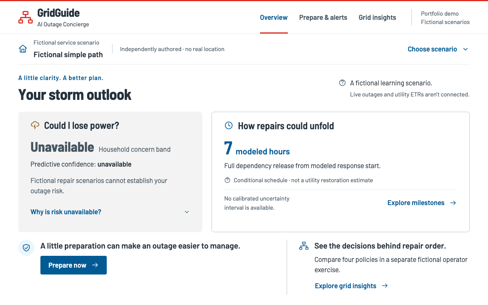

**An outage concierge connecting customer preparedness with explainable restoration planning.**
Built at HackOHI/O 2026 and developed into a reproducible portfolio project. Explore the
preserved source-backed application or run the standalone fictional demonstration.
Both make assumptions visible; neither is a live utility service.

## Product walkthrough

**Overview → Prepare & alerts → Grid insights.** Follow an outlook through its repair
dependencies, keep practical guidance close, and inspect the tradeoffs behind a plan.
Select any screenshot for its full-resolution view.

### Overview — understand the scenario

The original **challenge-local** outlook brings together an ordinal concern indicator,
conditional restoration range and crew/access controls. The **fictional public demo**
adds prepared milestones and inspectable power paths, with deterministic Ask GridGuide
answers. Blocked or unresolved dependencies never turn into a finite estimate.

<table>
<tr>
<td width="50%"><a href="docs/media/v1.0.0/overview.png"></a><br><strong>Original outlook · challenge-local</strong></td>
<td width="50%"><a href="docs/media/v1.1.0-integrated/03-completed.png">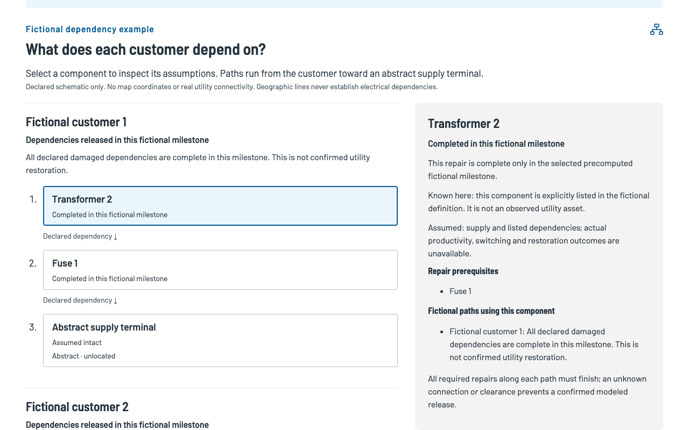</a><br><strong>Inspect a dependency · fictional demo</strong></td>
</tr>
</table>

*The concern band is not an outage probability; timing is conditional, not a utility ETR
or calibrated confidence interval. Household risk remains unavailable in the fictional demo.*

### Prepare & alerts — keep useful guidance close

Read, print or download the public preparedness kit. Explicitly save a timestamped
fictional snapshot and enable offline access to revisit it after a browser restart.
The original challenge-local journey also offers tailored preparation and four
communication stages: pre-storm, outage confirmed, estimate updated and restored.

<table>
<tr>
<td width="50%"><a href="docs/media/readme/preparedness-desktop.png">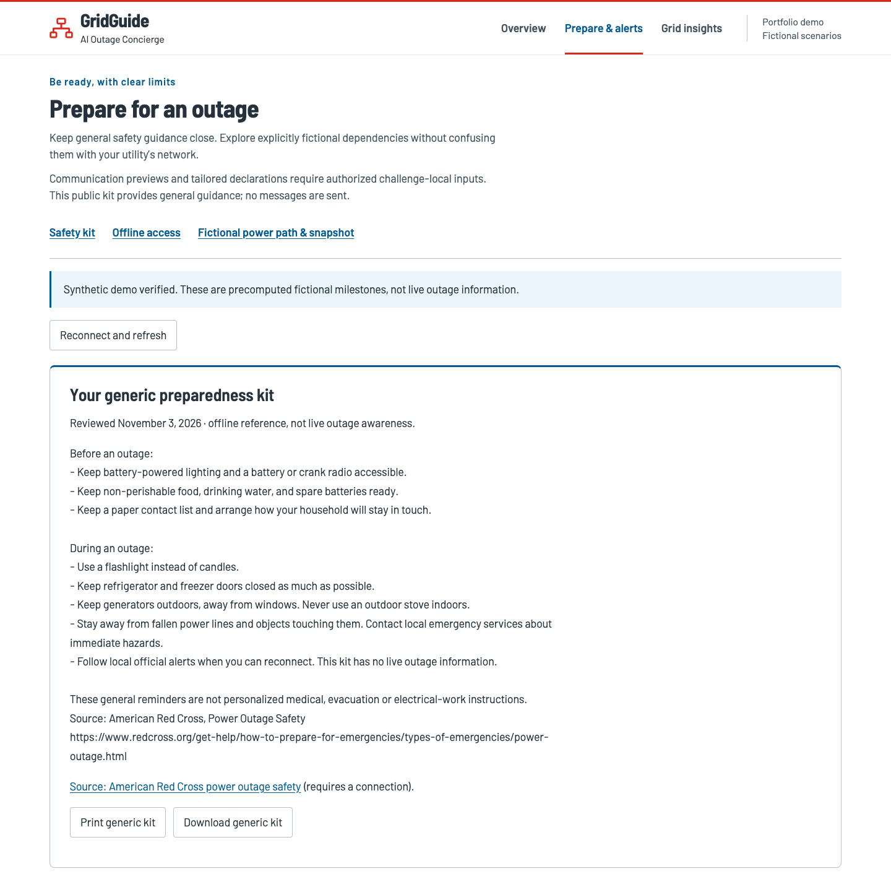</a><br><strong>Preparedness kit · fictional demo</strong></td>
<td width="50%"><a href="docs/media/v1.0.0/communication-preview.png">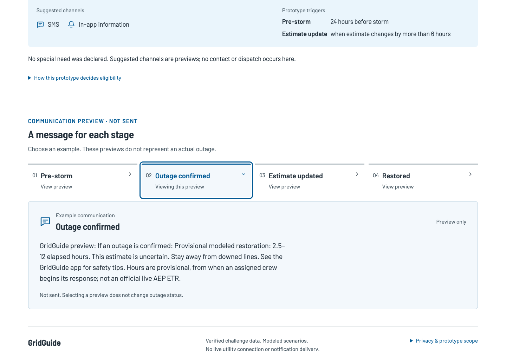</a><br><strong>Hypothetical communication · NOT SENT</strong></td>
</tr>
</table>

*Communication previews neither confirm an outage nor send a message. Tailored guidance
requires authorized challenge-local inputs. Offline snapshots are historical immediately;
storage can be evicted, and offline access does not recalculate results.*

### Grid insights — compare, question and review

**Four repairs. Four geographic perspectives.** Select a candidate in the original
challenge-local workspace to connect its map, dependent-customer areas, source evidence
and crew assignment. Inspection is independent of which repair the policy recommends.
Optional OpenStreetMap streets provide geographic context.

<table>
<tr>
<td width="50%"><a href="docs/media/readme/grid-insights/01-asset-1e0e3d979b0f64d6c949.png">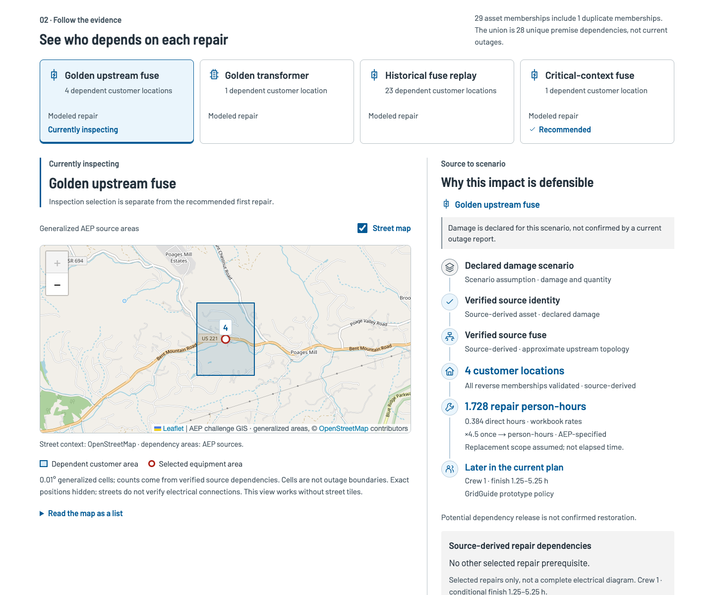</a><br><strong>Golden upstream fuse</strong></td>
<td width="50%"><a href="docs/media/readme/grid-insights/02-asset-973c492bfd0e358f7d68.png">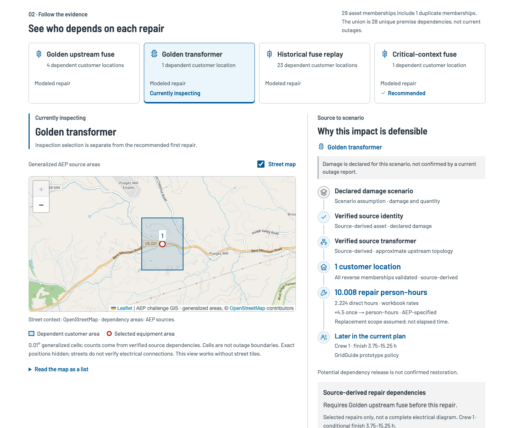</a><br><strong>Golden transformer</strong></td>
</tr>
<tr>
<td width="50%"><a href="docs/media/readme/grid-insights/03-asset-4271bb66fe1b6174f491.png">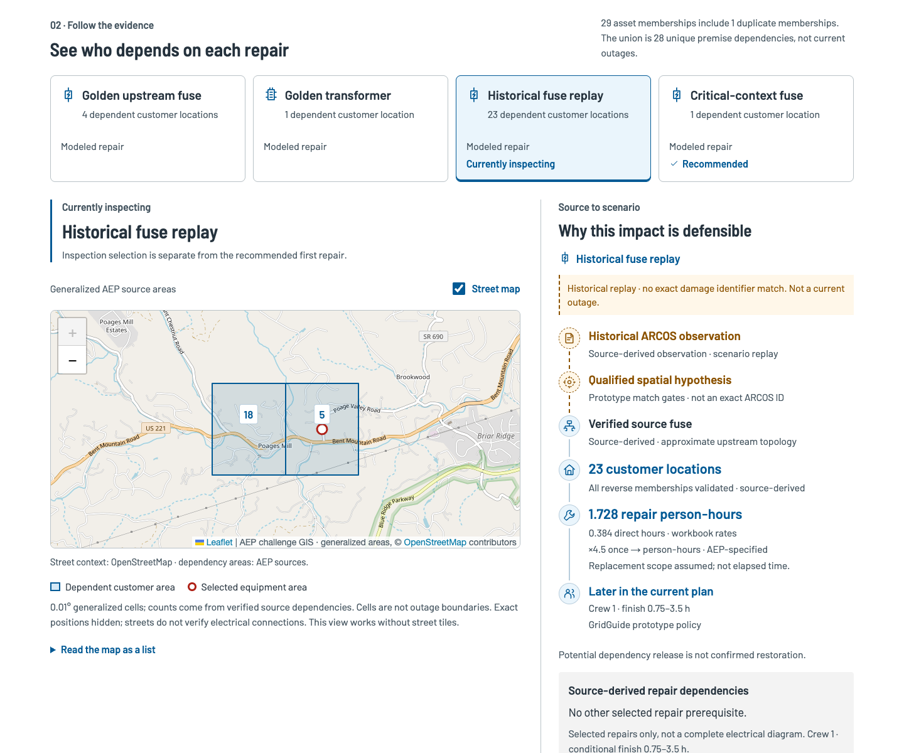</a><br><strong>Historical fuse replay</strong></td>
<td width="50%"><a href="docs/media/readme/grid-insights/04-asset-dd55cf26c71b6d415bc7.png">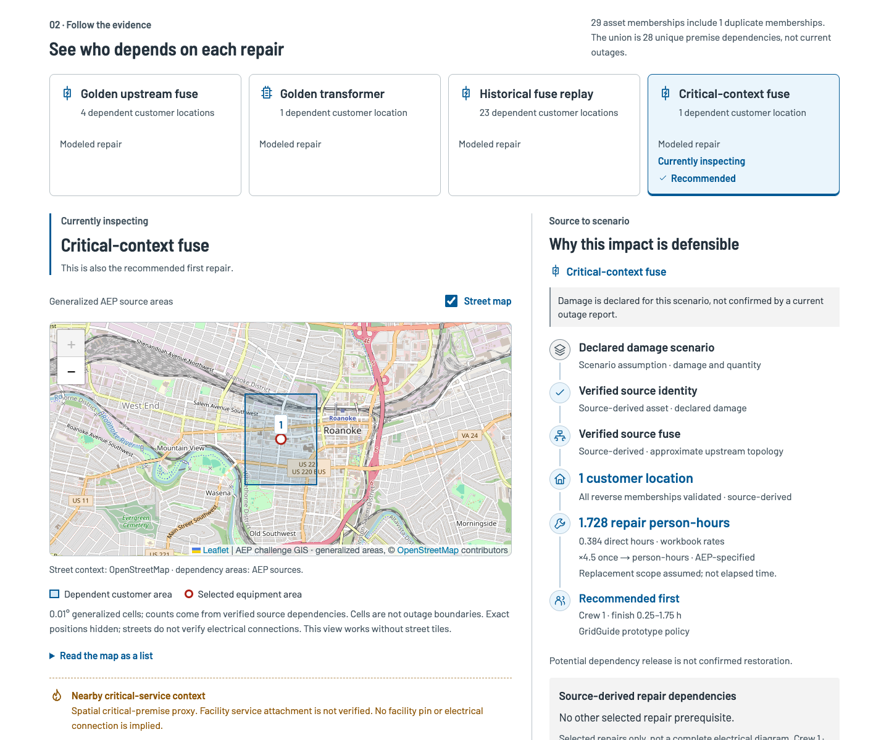</a><br><strong>Critical-context fuse</strong></td>
</tr>
</table>

*Four authentic v1.0.0 captures, unchanged from the reviewed originals. Select an image
for full resolution. Source overlays: generalized AEP challenge GIS. Basemap ©
[OpenStreetMap contributors](https://www.openstreetmap.org/copyright).*

The upstream fuse and transformer share a generalized cell but have different dependency
counts and repair prerequisites. Cells are not outage boundaries; streets do not verify
electrical connections. Critical-service proximity does not establish facility attachment.
[Capture provenance and publication record](docs/media/readme/MAP_GALLERY_REVIEW.md).

### Plan the work — follow priorities and dependencies

The original comparison puts critical-service context and customer impact side by side.
Explore one or two crews, separate people-per-crew settings and access constraints.
Independent repairs can overlap; a downstream transformer still waits for its upstream
fuse. Blocked work withholds completion rather than inventing clearance.

<table>
<tr>
<td width="50%"><a href="docs/media/v1.0.0/grid-insights.png">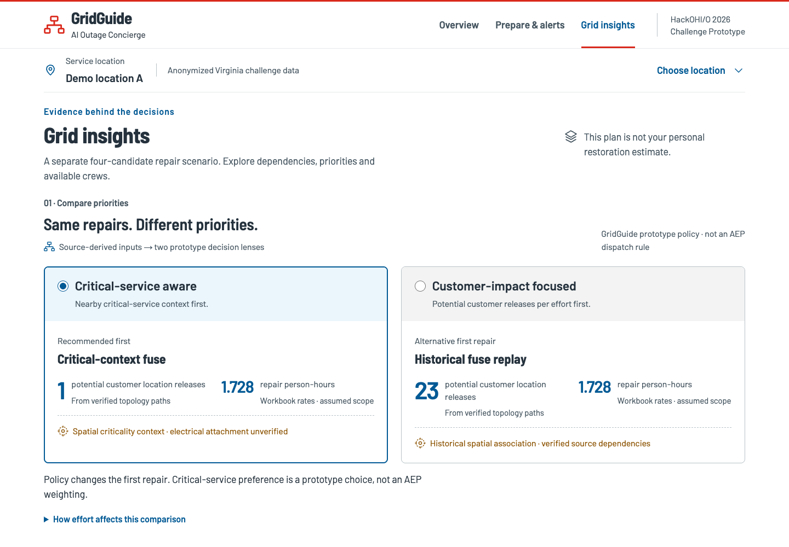</a><br><strong>Compare repair priorities · challenge-local</strong></td>
<td width="50%"><a href="docs/media/readme/crew-planning.png">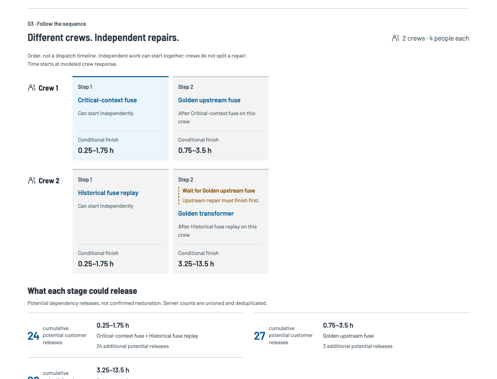</a><br><strong>Two crews, explicit dependencies · challenge-local</strong></td>
</tr>
</table>

*Prototype priority policies, not AEP dispatch rules. Repair person-hours differ from
elapsed time; additional crews do not divide one repair's duration.*

### Review the decision — reproduce the result

The separate **non-geographic fictional operator workspace** compares four policies on
identical inputs. Inspect customer-hours, critical-service latency and fairness; add a
supported precedence constraint; then acknowledge the evidence gaps and export the plan.
Changes invalidate review. Replay the JSON independently in Python.

<table>
<tr>
<td width="50%"><a href="docs/media/v1.1.0-integrated/10-policies.png">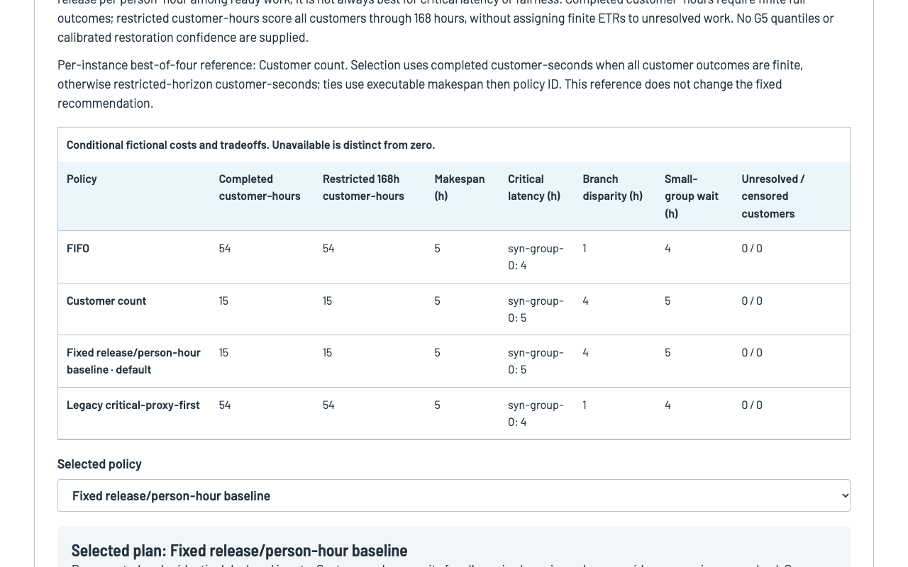</a><br><strong>Four-policy comparison · fictional demo</strong></td>
<td width="50%"><a href="docs/media/v1.1.0-integrated/12-reviewed.png">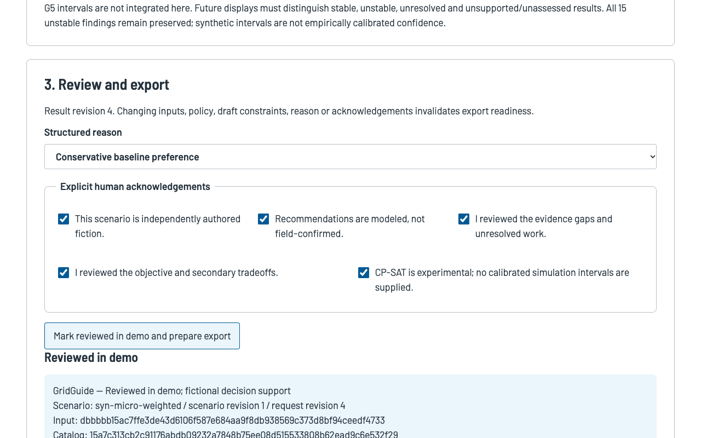</a><br><strong>Explicit review and export · fictional demo</strong></td>
</tr>
</table>

*Completed and restricted-horizon customer-hours remain distinct. Unresolved and censored
outcomes stay visible. Checksums verify consistency, not reviewer identity or a tamper-proof
audit history. Nothing dispatches crews.*

<details>
<summary><strong>On a smaller screen</strong> — responsive customer and operator views</summary>

<p align="center">
<a href="docs/media/v1.1.0-integrated/mobile-preparedness.png">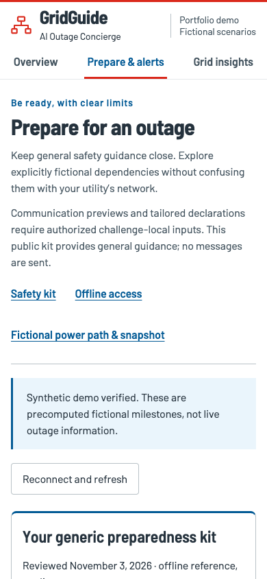</a>
<a href="docs/media/v1.1.0-integrated/mobile-operator.png">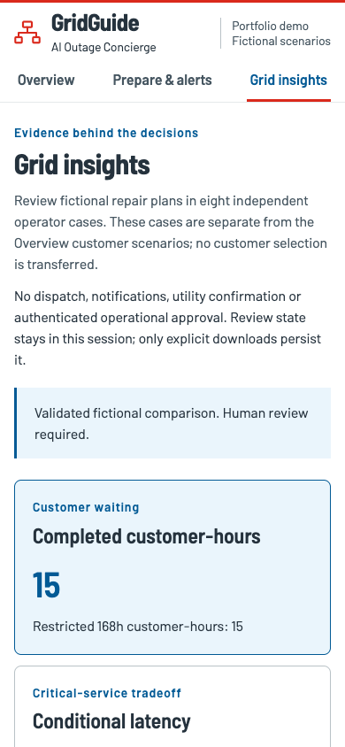</a>
</p>

Actual Chromium captures; no cross-browser or manual screen-reader certification is implied.

</details>

[Demo and captions](docs/media/v1.1.0-integrated/README.md) ·
[Visual inventory and provenance](docs/media/readme/VISUAL_MANIFEST.md) ·
[Original preparation checklist](docs/media/v1.0.0/preparation.png)

## From HackOHI/O to v1.1.0

The three-person HackOHI/O project established the connected customer and operator
journey: geographic context, an explainable ordinal concern band, conditional restoration
ranges, crew/access scenarios, preparation and communication previews. Those features
remain in the original application; v1.1.0 preserves its visual identity and navigation
while adding independently authored fictional examples, offline preparedness, validated
policy comparisons and reproducible review exports.

**The two modes have different evidence and capabilities:**

| Product area | Public fictional demonstration | Authorized challenge-local application |
| --- | --- | --- |
| Overview | Prepared milestones, declared power paths and deterministic explanations | Generalized geographic context, source-validated dependencies, ordinal concern band and conditional labor-based range |
| Scenario controls | Approved examples, including blocked and missing-evidence cases | Crew-size and access changes; separate crew-count controls in repair planning |
| Prepare & alerts | Generic kit, offline access and explicitly saved fictional snapshots | Scenario-tailored preparation, optional session-only declarations and four communication previews; nothing is sent |
| Grid insights | Eight fictional cases, four baselines, bounded precedence overrides and review/export | Four curated repair candidates, two prototype priority policies, source evidence and conditional crew scheduling |

Challenge-local mode requires permission to use the pinned source files. Its concern
band is not an outage probability, and its restoration envelope is not a guaranteed
completion time. The fictional demo does not reproduce source-backed maps, risk scores,
arbitrary crew/access recalculation or tailored communications with invented inputs.

[Original v1.0.0 release](https://github.com/its-spark-dev/GridGuide/releases/tag/v1.0.0) ·
[Original product screenshots](docs/media/v1.0.0/README.md) ·
[Detailed feature comparison](docs/planning/V1_1_0_CONTINUITY.md#feature-level-comparison)

## Architecture

**React/TypeScript presents the experience; one FastAPI/Python service owns numerical
rules and validation.** Prepared immutable inputs and versioned contracts connect the
two. There is no database or browser copy of the numerical engine.

- **Explain validated results.** Public Standard explanations use approved frame values
  and reviewed text. The preserved challenge-local AI adapter can select approved
  references; it cannot calculate risk or restoration times. Standard answers work
  without an external model.
- **Validate schedules independently.** Check prerequisites, crew conflicts and customer
  release before presenting a comparison. Keep assumptions, nulls and tradeoffs visible.
- **Bind review to the result.** Scenario revisions and fingerprints reject stale or
  mismatched responses and make exported fictional cases reproducible.
- **Distribute only approved inputs.** An explicit allowlist packages fictional data,
  compiled UI and the Python runtime code without challenge records, credentials or
  Git history. Scoped offline caching excludes API responses and sensitive declarations.
- **Verify the real application.** Public CI exercises the extracted package and container,
  browser journeys, export replay and preserved evidence hashes. Source-dependent tests
  are reported unavailable when their data is absent, never counted as passed.

[Architecture and API boundaries](docs/ARCHITECTURE.md) ·
[Model specification](docs/MODEL_SPEC.md) · [Explanation design](docs/AI_EXPLANATIONS.md)

## ML Lab — learning which policy to choose

<sub>Research figure gallery: every study below links its full-resolution plots. Primary charts appear at full README width; supporting charts open at original size.</sub>

A separate, source-free supervised ML study compares logistic regression, random forests
and gradient boosting on **720 newly generated fictional scheduling problems**. Inspect
41 pre-decision features, grouped data splits, exact policy labels, frozen models and a
one-time holdout evaluation.

<p align="center">
  <a href="docs/ml-lab/presentation/figures/performance.svg">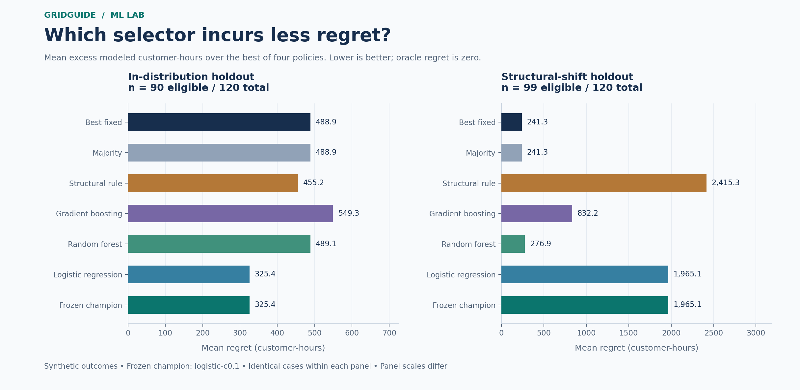</a>
</p>
<p align="center"><sub>Sealed ML Lab I evaluation · Open the full-resolution SVG chart to inspect labels and individual results.</sub></p>

**An instructive negative result:** the selected logistic model lowered in-distribution
mean regret by 33.44% on 90 eligible cases, but failed the uncertainty and critical-service
promotion gates. On 99 shifted cases, regret was 714.45% higher than the training-selected
fixed policy. All failures and per-case evidence remain inspectable; no model was retuned
after reveal. These are simulator outcomes, not measured utility performance.

**[Explore ML Lab](docs/ml-lab/README.md) · [Full research report](docs/ml-lab/presentation/REPORT.md) · [Reproduce the experiment](docs/ml-lab/REPRODUCE.md)**

<details>
<summary><strong>ML Lab I: additional research plots</strong> (3 additional figures; click any image for full size)</summary>

<table>
<tr>
<td width="50%" align="center" valign="top">
  <a href="docs/ml-lab/presentation/figures/regret-distribution.png">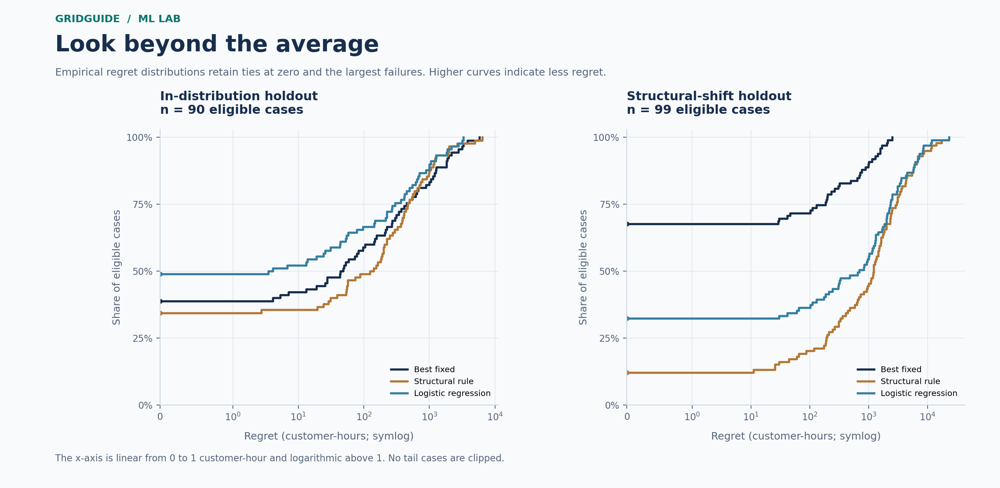</a>
  <br><sub><strong>Regret distributions</strong> · Click to enlarge</sub>
</td>
<td width="50%" align="center" valign="top">
  <a href="docs/ml-lab/presentation/figures/confusion.png">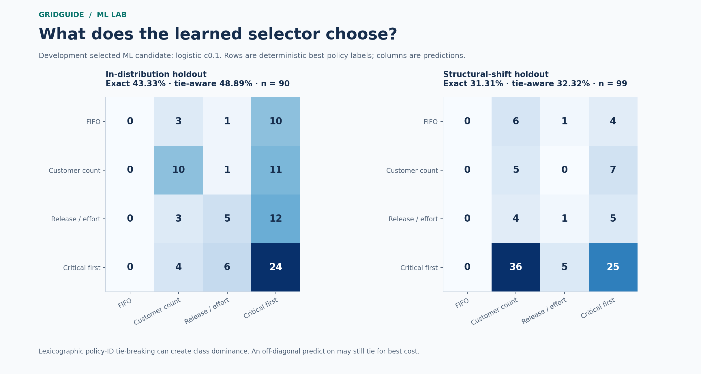</a>
  <br><sub><strong>Policy selection confusion</strong> · Click to enlarge</sub>
</td>
</tr>
<tr>
<td width="50%" align="center" valign="top">
  <a href="docs/ml-lab/presentation/figures/feature-importance.png">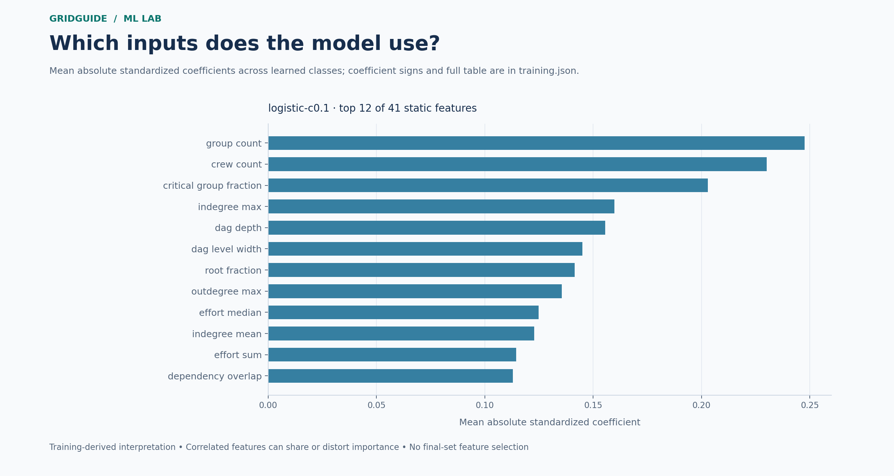</a>
  <br><sub><strong>Feature importance</strong> · Click to enlarge</sub>
</td>
<td width="50%"></td>
</tr>
</table>

</details>

The existing dashboard, historical research, four-map gallery and v1.1.0 defaults remain
unchanged. ML Lab recommends retaining its fixed comparator rather than promoting the
learned selector.

## ML Research II — verify the observed data first

A separate [observed-outage source audit](docs/outage-ml/README.md) examines PNNL's
**1,385,389 recorded county episodes**, Purdue's major-outage workbook and the Zenodo
EAGLE-I/VTEC release. Reproducible checks expose duplicate incident links, chronology
ambiguities, unknown censoring and limits on onset-time features.

**NO-GO before training:** the reviewed sources do not establish the label, grouping and
rights requirements for this study. No predictor or holdout score is claimed.

<p align="center">
  <a href="docs/outage-ml/presentation/figures/source-landscape.png">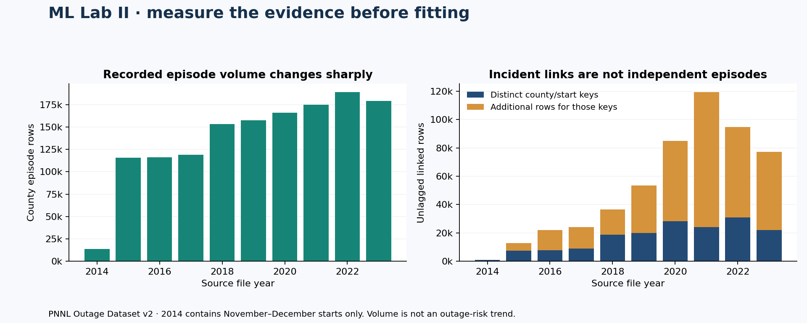</a>
</p>
<p align="center"><sub>Observed-source feasibility figure · Open the full-resolution image to inspect labels and individual results.</sub></p>

<details>
<summary><strong>Outage-ML: supporting source audit figure</strong> (1 additional figure; click the image for full size)</summary>

<table>
<tr>
<td width="50%" align="center" valign="top">
  <a href="docs/outage-ml/presentation/figures/recorded-duration.png">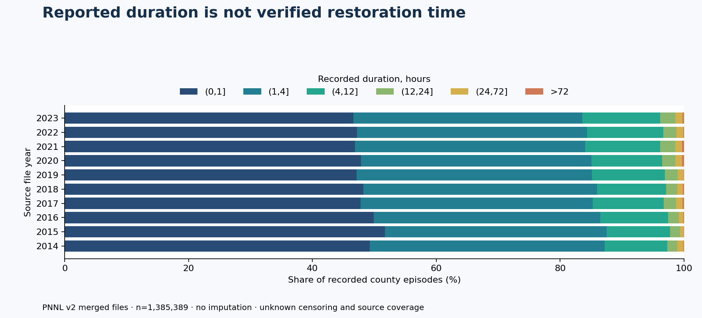</a>
  <br><sub><strong>Recorded durations</strong> · Click to enlarge</sub>
</td>
<td width="50%"></td>
</tr>
</table>

</details>

Inspect the
[measured findings and figures](docs/outage-ml/README.md),
[feasibility decision](docs/outage-ml/FEASIBILITY.md) and
[source replay commands](docs/outage-ml/REPRODUCE.md).

## Adaptive Dispatch — decisions as repairs finish

A new [event-driven scheduling study](docs/adaptive-dispatch/README.md) compares **15
non-clairvoyant methods across 29,880 validated fictional method-episodes**. Policies
assign ready tasks or wait using observed completions; future durations stay hidden.

On 24 independent confirmation configurations, the selected reactive method reduces
mean waiting by **7.88%** against the selected fixed-order control. The stochastic
teacher adds only **0.113%** over cheaper online search, with an interval crossing zero
and about **8×** the decision cost. The preregistered learning gate fails, so no learned
dispatch model or RL benefit is claimed. Prior ML studies and the dashboard remain separate.

<p align="center">
  <a href="docs/adaptive-dispatch/presentation/figures/comparators.svg">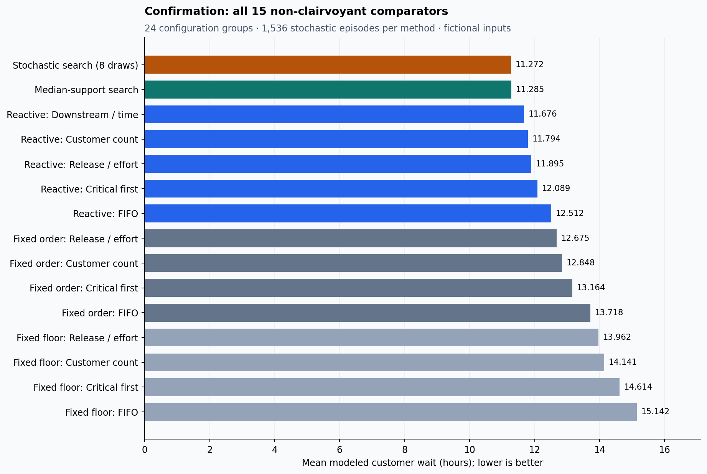</a>
</p>
<p align="center"><sub>Reactive and search policy quality · Open the full-resolution SVG chart to inspect labels and individual results.</sub></p>

<details>
<summary><strong>Adaptive Dispatch: supporting comparisons</strong> (2 additional figures; click any image for full size)</summary>

<table>
<tr>
<td width="50%" align="center" valign="top">
  <a href="docs/adaptive-dispatch/presentation/figures/paired-configurations.png">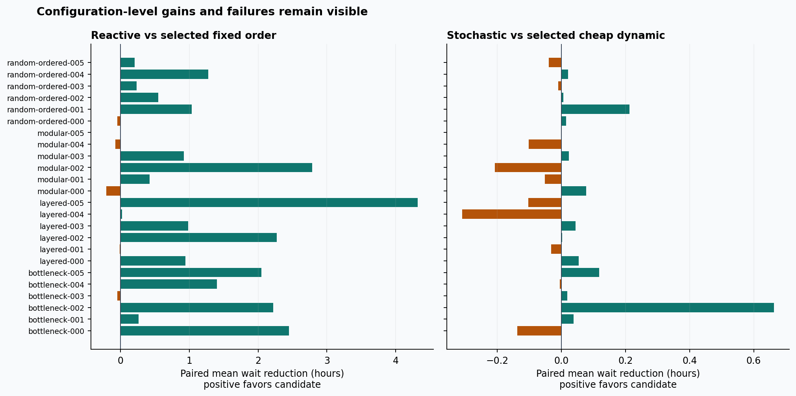</a>
  <br><sub><strong>Configuration effects</strong> · Click to enlarge</sub>
</td>
<td width="50%" align="center" valign="top">
  <a href="docs/adaptive-dispatch/presentation/figures/quality-runtime.png">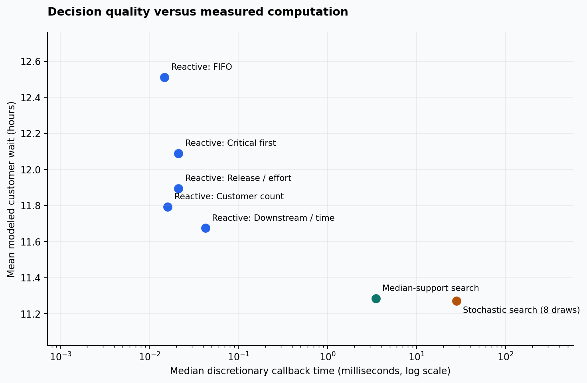</a>
  <br><sub><strong>Quality versus runtime</strong> · Click to enlarge</sub>
</td>
</tr>
</table>

</details>

[Comparisons and figures](docs/adaptive-dispatch/presentation/REPORT.md) ·
[Protocol and limitations](docs/adaptive-dispatch/PROTOCOL.md) ·
[Reproduction](docs/adaptive-dispatch/REPRODUCE.md)

<!-- learned-dispatch:start -->
## Learned Adaptive Dispatch — a trained policy you can run

A separate [policy-distillation experiment](docs/learned-dispatch/README.md) now trains
GridGuide-specific state/action rankers from **24,240 teacher-labeled action rows across
48 independent training configurations**. Inspect 46 public-state features, fitted Ridge
and random-forest parameters, SHA-verified JSON models and complete learned-policy rollouts.

<p align="center">
  <a href="docs/learned-dispatch/presentation/figures/quality-latency.svg">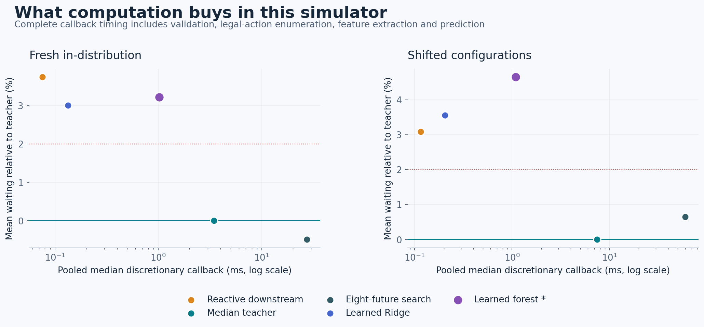</a>
</p>
<p align="center"><sub>Trained model versus search and reactive policies · Open the full-resolution SVG chart to inspect labels and individual results.</sub></p>

The development-selected forest is **3.85× faster in-distribution and 7.82× faster under
shift** than its median-search teacher, but modeled waiting is **3.22% and 4.66% higher**.
It fails the preregistered quality gate and is **not promoted**. The real trained model and
negative findings remain available; these are fictional simulator results, not utility outcomes.

[Run trained inference](docs/learned-dispatch/REPRODUCE.md) ·
[Model card](docs/learned-dispatch/MODEL_CARD.md) ·
[Full results and uncertainty](docs/learned-dispatch/presentation/REPORT.md)

<details>
<summary><strong>Learned Dispatch: all additional research plots</strong> (3 additional figures; click any image for full size)</summary>

<table>
<tr>
<td width="50%" align="center" valign="top">
  <a href="docs/learned-dispatch/presentation/figures/quality.png">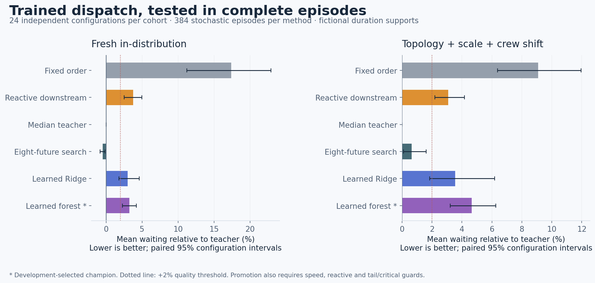</a>
  <br><sub><strong>Held-out quality</strong> · Click to enlarge</sub>
</td>
<td width="50%" align="center" valign="top">
  <a href="docs/learned-dispatch/presentation/figures/configuration-errors.png">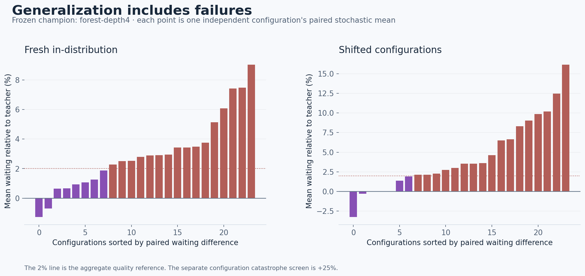</a>
  <br><sub><strong>Configuration errors</strong> · Click to enlarge</sub>
</td>
</tr>
<tr>
<td width="50%" align="center" valign="top">
  <a href="docs/learned-dispatch/presentation/figures/learned-parameters.png">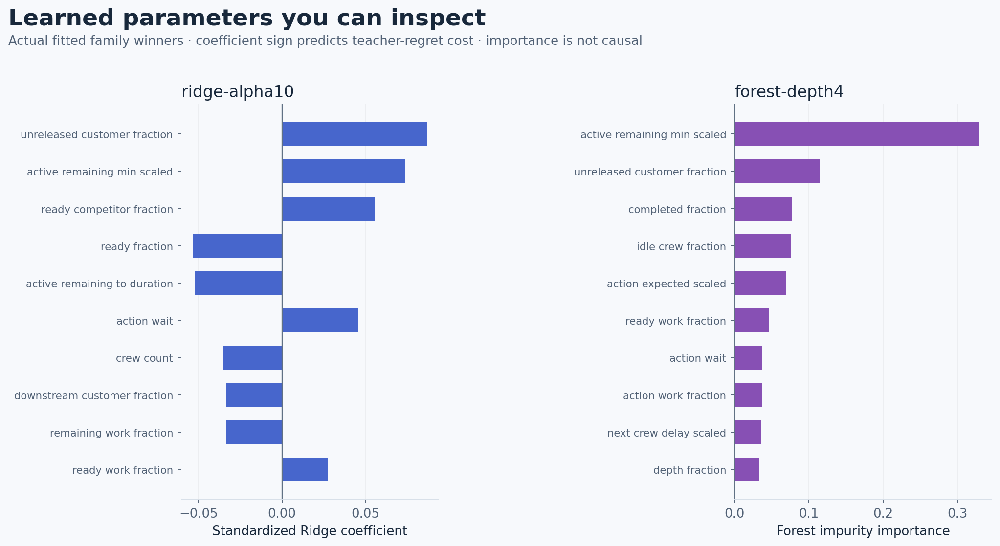</a>
  <br><sub><strong>Fitted parameters</strong> · Click to enlarge</sub>
</td>
<td width="50%"></td>
</tr>
</table>

</details>

<!-- learned-dispatch:end -->

## ML opportunity assessment — what to investigate next

A separate [evidence-first opportunity audit](docs/research/ml-opportunity/REPORT.md) revisits the published ML Lab, adaptive scheduling and learned-dispatch results. It independently replays archived measurements and examines new four-task exact scheduling examples. **Verdict: NO-GO for another immediate training pilot**, not a proof that better learning is impossible. No new scientific model was trained, historical final holdouts remain spent, and neither application defaults nor v1.1.0's stable demonstration changed.

**Future research is recorded as conditional work, not promised v1.2.0 functionality:**

- **Direction B — Decision-focused ranking ([Issue #24](https://github.com/its-spark-dev/GridGuide/issues/24)).** Before training, register a controlled, group-isolated study comparing regret-aware action ranking with cost regression and strong non-ML dispatch baselines. Only proceed if its pre-training evidence, runtime budget and validation plan justify the experiment. Teacher-WAIT rarity and action ties are open questions, not established root causes.
- **Direction C — Find a better-posed ML problem ([Issue #25](https://github.com/its-spark-dev/GridGuide/issues/25)).** First audit candidate prediction targets, pre-decision inputs, usable ground truth, data rights and meaningful non-ML baselines. A new synthetic task is simulation research only; no utility-calibrated forecast or actual dispatch benefit is claimed.

<p align="center">
  <a href="docs/research/ml-opportunity/quality-cost.svg"></a>
</p>
<p align="center"><sub>Independent opportunity audit · Open the full-resolution SVG chart to inspect labels and individual results.</sub></p>

[Audit summary](docs/research/ml-opportunity/README.md) ·
[Full report and limits](docs/research/ml-opportunity/REPORT.md) ·
[Original opportunity study](https://github.com/its-spark-dev/GridGuide/issues/22) ·
[Research roadmap for v1.2.0](docs/releases/v1.2.0-research-roadmap.md)

The prospective **v1.2.0 ML Research Edition** is intended as a documentation/reproducibility milestone for completed research, separate from the **v1.1.0 stable product** and its unchanged downloads. It does **not** announce a released v1.2.0 package or promise any future model improvement.

## Research findings and reproducibility

Frozen scenarios, independent validation and reproducible reports make unsuccessful
experiments as inspectable as successful ones:

- **Optimization:** the preregistered 5% median promotion target failed. The strongest
  fixed release/person-hour baseline remains the default; CP-SAT is optional and
  experimental, with only frozen validated results exposed in the public comparison.
- **Outage prediction:** the acquired evidence led to a No-Go for supervised modeling.
  No trained predictor or validated outage probability is claimed. This is an evidence
  limit, not a conclusion that all public-data research is infeasible.
- **Restoration uncertainty:** assumption-based fixed-timetable simulation retains all
  15 unstable convergence findings. It is not empirically calibrated restoration
  confidence, and detailed uncertainty visualization is not integrated into the product.

The [complete evidence report](docs/benchmarks/v1.1.0.md) retains numerical results,
denominators, regressions, timeouts and limitations. The
[reproduction guide](docs/REPRODUCING_V1_1.md) connects each result to its inputs and commands.

<a id="quick-start"></a>

## Getting started

**Try the fictional package first.** Download the [v1.1.0 standalone ZIP](https://github.com/its-spark-dev/GridGuide/releases/download/v1.1.0/gridguide-v1.1.0-public.zip)
and [SHA256SUMS](https://github.com/its-spark-dev/GridGuide/releases/download/v1.1.0/SHA256SUMS).
Follow the [acquisition and inspection guide](docs/REPRODUCING_V1_1.md#acquire-and-inspect-the-standalone-package)
and [stable package manifest](docs/releases/v1.1.0/package.json) before running it.
GitHub's automatic source archives include original challenge material; they are **not**
the source-free demonstration. GridGuide is a local portfolio release with no hosted service.

From the **clean extracted package**, with Python 3.12:

```sh
python3.12 -m venv /tmp/gridguide-runtime
/tmp/gridguide-runtime/bin/pip install --require-hashes -r deploy/requirements.lock
PYTHONDONTWRITEBYTECODE=1 /tmp/gridguide-runtime/bin/python deploy/serve.py
```

Open **http://127.0.0.1:8000/**. Keep the environment and downloaded exports outside the
immutable package. Installation needs network access; installed local operation needs
no external service. [Docker instructions](docs/REPRODUCING_V1_1.md#container-path) use the
same inspected extraction, never a broad repository copy.

For the preserved original application, use the
[v1.0.0 setup instructions](https://github.com/its-spark-dev/GridGuide/blob/v1.0.0/README.md#getting-started)
with authorized pinned challenge sources. That mode is separate from the fictional package.

<a id="verify"></a>

**Explore further:** [verification and replay commands](docs/REPRODUCING_V1_1.md) ·
[documentation guide](docs/README.md) · [release notes](docs/releases/v1.1.0.md) ·
[contributing](CONTRIBUTING.md).

## Contributors, attribution and scope

GridGuide was built collaboratively by **three teammates** at **HackOHI/O 2026,
October 24–25**. Original team achievements, pipeline guidance and pole-replacement work
remain preserved. [Contributor history](https://github.com/its-spark-dev/GridGuide/graphs/contributors)
records the work; individual roles are not inferred from commit counts. The last known
hackathon checkpoint is [`bb7c53c`](https://github.com/its-spark-dev/GridGuide/commit/bb7c53ce2e0733c6770c9de631a75df094407727);
the exact submission SHA is unconfirmed. Later independent v1.1.0 improvements are
traceable through [reviewed pull requests](https://github.com/its-spark-dev/GridGuide/pulls?q=is%3Apr+is%3Amerged)
and do not reassign original teammate contributions.

This is an independent portfolio project with no AEP endorsement or utility deployment
claim. It provides no real alerts, arbitrary-address lookup, field dispatch, switching
advice or operational safety certification. Testing covers Chromium; detailed manual
VoiceOver observations and cross-browser behavior remain unverified. Offline storage
and same-origin trust limitations, retained dependency advisories and unexecuted OS CVE
scanning are documented in the [release limitations](docs/releases/v1.1.0.md#security-privacy-and-scope).
Future public hosting requires a current vulnerability assessment and host-security review.

The contributors have approved the [MIT License](LICENSE) for GridGuide's original
software code and documentation. **This does not license the AEP challenge datasets,
derived source records, third-party fonts, map tiles, or other externally owned material.**
Their separate terms and unresolved redistribution/privacy questions remain documented.
The source-free package does not remove historical repository exposure or grant rights
in excluded materials. See the [publication audit](docs/releases/PUBLIC_RELEASE_AUDIT.md#findings)
and [third-party notices](THIRD_PARTY_NOTICES.md).

v1.1.0 is intended as the final major feature release, with reproducible artifacts
preserved for later review. No service/support SLA or ongoing maintenance is promised.
[Requirements coverage](docs/REQUIREMENTS_TRACEABILITY.md) · [Risk register](docs/RISK_REGISTER.md).
