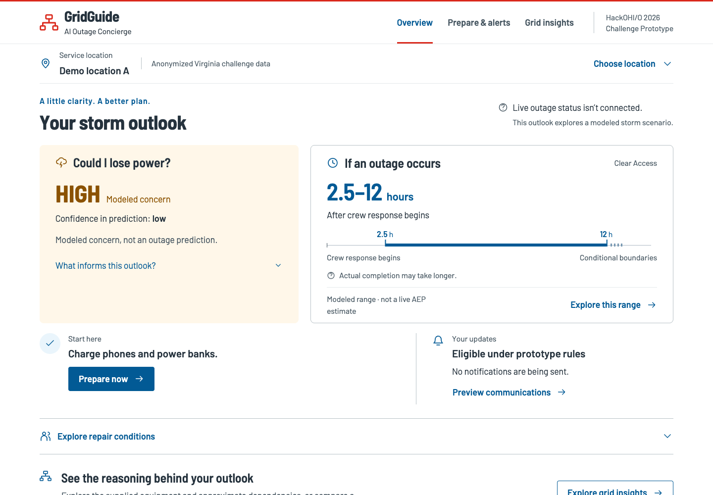
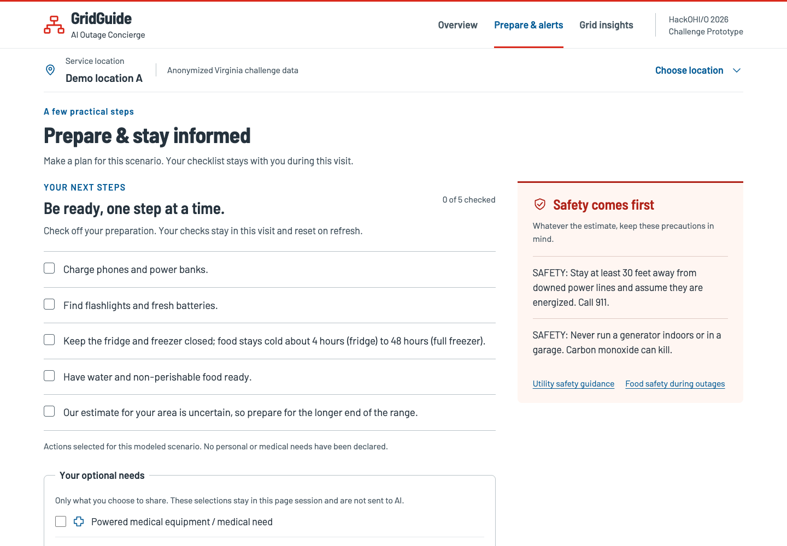
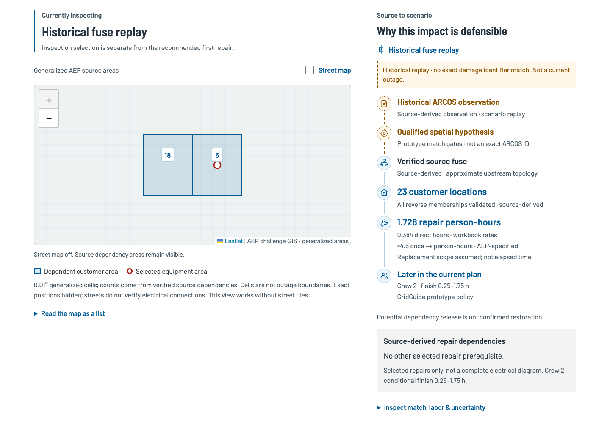
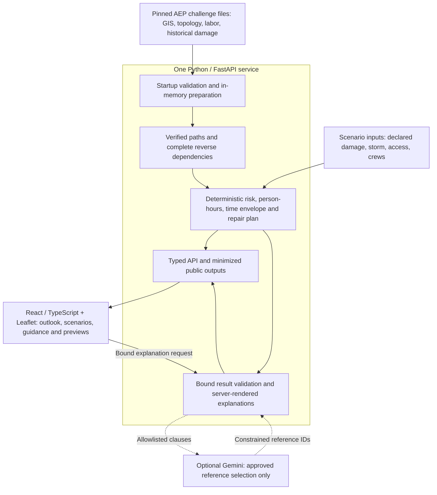

# GridGuide

**Explainable Storm Outage Intelligence**

**HackOHI/O 2026 · AEP AI Outage Concierge Challenge · Independent hackathon prototype**

When a storm threatens power, customers need to understand what could happen, what changes the outlook, and how to prepare. GridGuide connects source-verified utility dependencies with transparent restoration scenarios and practical customer guidance. Python owns the calculations; optional AI explains only validated evidence.



*The working application, captured after the hackathon from the preserved implementation. The outlook is a scenario, not live outage status or a utility-confirmed restoration estimate.*

[Walkthrough](#product-walkthrough) · [Architecture](#architecture) · [Run locally](#getting-started) · [Technical docs](docs/README.md) · [Release draft](docs/releases/v1.0.0.md)

## What we built

| Capability | What the prototype does |
| --- | --- |
| **Verified network evidence** | Checks pinned source files, typed asset identities, circuit consistency, upstream paths, and complete asset-to-premise reverse memberships. |
| **An explainable customer outlook** | Shows an ordinal storm concern band, uncertainty, and a conditional restoration range for one vetted anonymous demo location. |
| **Restoration scenarios with explicit units** | Uses AEP workbook labor, applies the 4.5 multiplier once, and separates repair person-hours from conditional elapsed time. Crew size and access can change the scenario. |
| **Repair-priority decisions** | Compares four curated candidates under two transparent prototype policies, with dependency-aware schedules for one or two crews. |
| **Preparation and communication previews** | Adapts preparation to optional customer declarations and demonstrates four notification stages. Nothing is sent or subscribed. |
| **Grounded explanations** | An optional Gemini adapter selects approved references; the server renders the claims. Standard explanations work without a model or external network. |

## Product walkthrough

**1. Understand the outlook.** Customer Overview leads with the scenario, confidence, conditional range, and next action. Explore the range to change crew size or access; blocked access withholds a completion time.

**2. Prepare and preview updates.** Review preparation actions and optional support needs, then inspect a communication preview. Declarations remain session-only and do not change risk, repair calculations, or infrastructure priority.



<details>
<summary><strong>View a communication preview</strong></summary>


Selecting a stage changes only the example message; it does not confirm an outage or send a notification.

</details>

**3. Inspect the policy tradeoff.** Grid Insights puts the recommendation, alternative policy, generalized map, and source evidence in one workspace.


The strongest example compares two repairs with the **same 1.728 modeled repair person-hours**:

| Prototype policy | First repair | Potential premise releases |
| --- | --- | ---: |
| Critical-service aware | Declared critical-context fuse, associated with a fire-station/premise **spatial proxy** | **1** |
| Customer-impact focused | Historical fuse replay, qualified through a pole/device **spatial hypothesis** | **23** |

These are GridGuide policies, not AEP dispatch rules. The fire station's electrical attachment is unverified. Potential releases are conditional dependency counts, not confirmed restored customers.

<details>
<summary><strong>View the source evidence and crew assignment</strong></summary>



The four candidates have **28 unique premise dependencies** after deduplication. One/two crews control independent task concurrency; people per crew is a separate input. The serial upstream fuse → transformer branch retains its dependency order.

</details>

[Screenshot provenance and capture settings](docs/media/v1.0.0/README.md) · [Detailed decision model](docs/Q2_Q4_DECISION_SUPPORT.md)

## Architecture



Preparation runs once at startup; the service does not reload raw GIS per request. There is no database or training pipeline. The frontend renders API results, with TypeScript types generated from OpenAPI. AI has no authority over risk, topology, restoration time, or dispatch priority.

Historical source evidence, scenario assumptions, and prototype policies are labeled separately. Live outage status, measured crew productivity, switching feasibility, and clearance delays remain unavailable. Optional tiles and AI can fail without blocking numerical results; offline operation still requires the local services and source files.

[Module responsibilities and privacy boundaries](docs/ARCHITECTURE.md) · [AI validation and fallback](docs/AI_EXPLANATIONS.md)

## Technical highlights

| Evidence | Verified scope and limit |
| --- | --- |
| **117,599 indexed premise paths** | **40,779** pass complete source validation; **76,820** remain unresolved. Indexing does not establish verified connectivity. |
| **8,093 physical assets with complete reverse evidence** | 6,103 transformers + 1,990 fuses, within **32,600 syntactically indexed asset/terminal keys**. Two additional abstract terminals have complete evidence but are not physical assets. |
| **4 candidates / 28 unique dependencies** | Curated repair comparison; 29 memberships include one overlap. This is not system-wide optimization. |
| **11.736 repair person-hours in the customer scenario** | Transformer + fuse replacement: 2.608 direct labor hours × 4.5 once, including travel/setup. At four people and clear access, the displayed conditional envelope is **2.5–12 elapsed hours**. |
| **Unavailable means unavailable** | Blocked access withholds full completion; incomplete reverse memberships withhold impact. Unknown operational delays are not filled with convenient constants. |
| **194 Python tests / 49 browser tests** | Passed during portfolio verification on November 3, 2026, alongside the production build and generated-type check. [Verification scope](docs/releases/VERIFICATION.md). |

The time envelope compares ideal all-person contribution with a single effective worker. It is **not a calibrated confidence interval or guaranteed restoration bound**; unknown delays can exceed it. Planning and customer views use separate, documented rounding policies. [Formulas and golden derivation](docs/MODEL_SPEC.md).

## Engineering principles

- **Calculate before explaining.** Deterministic rules produce versioned results; AI selects references to those results.
- **Keep provenance visible.** Distinguish source-derived facts, AEP-specified rules, scenario assumptions, prototype policies, customer declarations, and unavailable evidence.
- **Abstain when evidence is incomplete.** Nulls, stale-result rejection, and Standard explanations are part of the product behavior.
- **Keep units and scope explicit.** Person-hours differ from elapsed hours; crew count differs from crew size; dependency release differs from actual restoration.
- **Minimize public outputs.** APIs omit raw identifiers and precise customer/facility coordinates. Declarations are excluded from AI context. Repository data distribution requires a separate review.

## Getting started

### Data prerequisite

The full application and source-dependent tests require four exact AEP challenge files under `data/raw/`:

```text
data/raw/
├── Data1.zip
├── Data2.zip
├── matched_upstream.zip
└── Install_Labor_HackOHIO.xlsx
```

Their hashes are checked at startup against [source pins](backend/config.py); [the data audit](docs/DATA_AUDIT.md) records the pinned upstream revision. The current repository already tracks these files and derived customer data, including in history. The owner has accepted the existing challenge data as an input to this faithful v1.0.0 release. This decision does not add a data license; concrete exposure findings and the decision are recorded in the [release audit](docs/releases/PUBLIC_RELEASE_AUDIT.md).

Run the data-dependent demo only with files you are authorized to use. If they are absent from an approved source-only distribution, obtain permission and the exact snapshot from the challenge owner before placing them locally. There is no bundled synthetic substitute or automatic download path. The frontend build alone does not provide a working data-backed demo. The browser backend prepares directly from the archives; running `pipeline/build.py` or extracting raw GIS is not required.

### Install and launch

Use **Python 3.12** and **Node.js 22.12+**, with npm. This review used Python 3.12.14, Node 26.5.0, and npm 11.17.0. Run from the repository root:

```sh
python3.12 -m venv .venv
.venv/bin/python -m pip install -r requirements-web.txt
npm --prefix frontend ci
```

`requirements-web.txt` includes the pinned engine dependencies in `requirements-checkpoint.txt`. The separate historical `requirements.txt` belongs to the teammate pipeline and is not the dashboard setup path.

Terminal 1 — deterministic backend:

```sh
GRIDGUIDE_AI_PROVIDER=none .venv/bin/python -m uvicorn backend.api:app --host 127.0.0.1 --port 8000
```

Wait for startup preparation to finish. Terminal 2 — frontend:

```sh
npm --prefix frontend run dev
```

Open [GridGuide locally](http://127.0.0.1:5173/). Ports 8000 and 5173 must be free. [API health](http://127.0.0.1:8000/api/health) and [interactive API documentation](http://127.0.0.1:8000/docs) are available after startup. The demo selects one vetted location; it does not support arbitrary customer addresses.

**Optional Gemini:** follow the [server-side credential and launch setup](docs/GEMINI_PROVIDER.md#local-credential-and-launch-setup). The app reads process environment variables; `.env` is not loaded automatically. Keep credentials out of frontend variables and version control. Missing credentials, provider failures, or invalid responses use Standard explanations. Historical live-provider checks are recorded separately from this release's offline verification.

### Verify

```sh
.venv/bin/python -m unittest discover -s tests -v
.venv/bin/python -m backend.demo
npm --prefix frontend run types:generate
git diff --exit-code -- frontend/src/api.generated.ts
npm --prefix frontend run build
npm --prefix frontend test
```

Browser tests require an installed **Google Chrome** and free fixture ports **15173, 18080, and 18081**. They start isolated local services and block external browser requests. See the [browser test guide](frontend/tests/README.md) and [current verification record](docs/releases/VERIFICATION.md). No GitHub Actions workflow is configured in this checkpoint.

## Limits of the prototype

- No live outage feed or utility-confirmed restoration estimate. Concern bands are not calibrated outage probabilities.
- No established switching/sectionalization feasibility or verified critical-facility electrical attachment.
- No observed crew productivity, dispatch delay, material availability, or clearance time. Unknown delays may exceed the displayed envelope.
- Four curated repair candidates, one vetted customer location, and bounded source validation; no system-wide optimization or arbitrary-address coverage.
- Communications are previews. There is no real subscription, notification delivery, or dispatch integration.

[Evidence coverage](docs/REQUIREMENTS_TRACEABILITY.md) · [Model limitations](docs/MODEL_SPEC.md) · [Risk register](docs/RISK_REGISTER.md)

## Project background and team

GridGuide was built collaboratively by **three teammates** for the AEP AI Outage Concierge Challenge at **HackOHI/O 2026, October 24–25**. The capabilities described here are project-wide achievements. Existing [Git contributor attribution](https://github.com/its-spark-dev/GridGuide/graphs/contributors) is preserved; a complete owner-approved team credit is pending. No individual roles are inferred from commit counts.

[`bb7c53c`](https://github.com/its-spark-dev/GridGuide/commit/bb7c53ce2e0733c6770c9de631a75df094407727) is the **last known hackathon-period checkpoint**, not an independently confirmed submission SHA. The draft **v1.0.0: HackOHI/O 2026 Portfolio Release** adds documentation and presentation polish after the event while preserving the implementation. Future **v1.1.0: Post-Hackathon Improvements** may address predictive validation, scheduling benchmarks, and product differentiation; those improvements are not part of this release.

GridGuide is an independent prototype, with no claim of AEP endorsement or official utility deployment. No project-wide software license has been selected. Existing Git attribution and third-party notices are preserved. The owner’s data-retention decision is documented in the release checklist.

## Documentation

| Start here | Go deeper |
| --- | --- |
| [Documentation guide](docs/README.md) | [Architecture](docs/ARCHITECTURE.md) · [Model specification](docs/MODEL_SPEC.md) |
| [Data and evidence](docs/DATA_AUDIT.md) | [Decision support](docs/Q2_Q4_DECISION_SUPPORT.md) · [Requirement traceability](docs/REQUIREMENTS_TRACEABILITY.md) |
| [AI boundaries](docs/AI_EXPLANATIONS.md) | [Customer guidance](docs/CUSTOMER_INTEGRATION.md) · [Map contract](docs/GEOGRAPHIC_MAP.md) |
| [Contributing](CONTRIBUTING.md) | [Third-party materials](THIRD_PARTY_NOTICES.md) |
| [v1.0.0 release draft](docs/releases/v1.0.0.md) | [Readiness checklist](docs/releases/CHECKLIST.md) · [Public-release audit](docs/releases/PUBLIC_RELEASE_AUDIT.md) |
