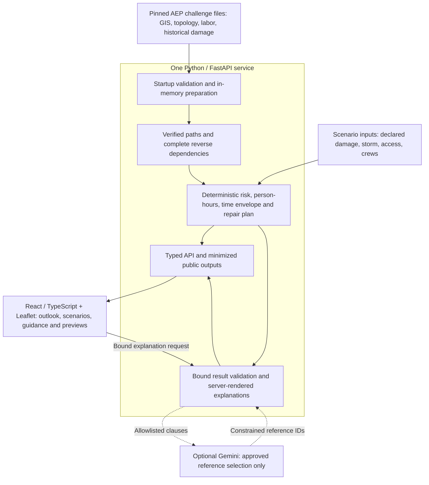

# GridGuide

**Explainable storm outage scenarios, from network evidence to customer preparation.**

GridGuide helps customers explore storm outage scenarios and prepare for disruption. Built by three teammates for the **AEP AI Outage Concierge Challenge at HackOHI/O 2026**, it connects validated network dependencies, transparent repair calculations, and interactive maps.

Python owns numerical results. Optional AI selects supporting evidence; the server renders every explanation.


*Authentic application capture from November 3, 2026. This is a modeled scenario, not live outage status or a utility-confirmed restoration estimate.*

[Walkthrough](#product-walkthrough) · [Architecture](#architecture) · [Run locally](#getting-started) · [Technical docs](docs/README.md) · [v1.0.0 release](https://github.com/its-spark-dev/GridGuide/releases/tag/v1.0.0)

## What you can explore

- **Understand the outlook.** Inspect a storm concern band, its evidence, and how crew size or access changes a conditional restoration range.
- **Compare repair priorities.** Explore two transparent policies over four repair candidates, with dependency-aware schedules for one or two crews.
- **Prepare for disruption.** Review guidance, optional session-only support declarations, and four communication previews.
- **Trace the reasoning.** Follow generalized maps and source dependencies into explanations that remain available without external AI.

## Product walkthrough

**1. Start with the customer outlook.** Overview shows one vetted anonymous location, uncertainty, and a next action. Changing crew size or access updates the scenario; blocked access withholds a completion time.

**2. Prepare and preview updates.** The preparation view adapts guidance to optional declarations. These do not change risk or repair priority. Communication examples are hypothetical; nothing is sent.

<details>
<summary>View preparation and communication screens</summary>


</details>

**3. Inspect the repair tradeoff.** Grid Insights compares critical-service-aware and customer-impact-focused policies, then connects the recommendation to source evidence and crew assignments.


For equal modeled repair effort, one policy starts with a repair serving **one premise** near a critical facility; the other starts with a historical replay serving **23 premises**. The facility relationship is a spatial proxy, and the historical damage match is a hypothesis. These are potential dependency releases under GridGuide policies, not confirmed restorations or AEP dispatch rules.

<details>
<summary>View map evidence and crew assignment</summary>


Separate crews can work on independent branches; an upstream fuse still gates its transformer. The map preserves generalized source areas and OpenStreetMap attribution.

</details>

[Screenshot provenance](docs/media/v1.0.0/README.md) · [Detailed decision model](docs/Q2_Q4_DECISION_SUPPORT.md)

## Architecture



One **FastAPI** service validates pinned sources once at startup and computes versioned results. **React, TypeScript, and Leaflet** render typed API outputs; OpenAPI generates the frontend contracts. There is no database or training pipeline.

The optional Gemini adapter selects approved references; server templates render every claim. Missing evidence withholds results, and stale responses are rejected. External AI and map tiles can fail while local calculations and Standard explanations remain available. APIs omit raw identifiers and precise customer/facility locations; this boundary does not anonymize the repository's source files.

[Service and privacy boundaries](docs/ARCHITECTURE.md) · [AI validation and fallback](docs/AI_EXPLANATIONS.md)

## Verified engineering achievements

- **40,779 complete source-validated premise paths** from 117,599 indexed paths. Unresolved paths remain explicit, and incomplete asset memberships withhold impact counts.
- **Four repair candidates with 28 unique premise dependencies.** Set unions remove overlap, while schedules preserve upstream dependencies and distinguish crew count from people per crew.
- **194 Python tests and 49 Chrome browser tests passed** on November 3, 2026, alongside the production build, generated-type consistency, and golden CLI scenarios.

These checks verify prototype behavior, not prediction accuracy or operational performance. [Verification and claim sources](docs/releases/VERIFICATION.md) · [Formulas, units, and coverage definitions](docs/MODEL_SPEC.md)

## Getting started

Use **Python 3.12**, **Node.js 22.12+**, and npm. Run from the repository root.

### Data prerequisite

The application requires four pinned challenge files, already tracked under `data/raw/`: `Data1.zip`, `Data2.zip`, `matched_upstream.zip`, and `Install_Labor_HackOHIO.xlsx`. Startup checks their [source hashes](backend/config.py) and prepares directly from the archives; no extraction or batch pipeline run is needed.

Use only data you are authorized to use. There is no automatic download or synthetic substitute. Repository data contains identifying fields beyond the minimized API outputs; the [recorded data findings](docs/releases/PUBLIC_RELEASE_AUDIT.md#findings) and [third-party notices](THIRD_PARTY_NOTICES.md) describe the remaining privacy and permission boundaries.

### Install and launch

```sh
python3.12 -m venv .venv
.venv/bin/python -m pip install -r requirements-web.txt
npm --prefix frontend ci
```

`requirements-web.txt` includes the pinned engine dependencies. The historical `requirements.txt` belongs to the separate batch pipeline.

Terminal 1 — backend:

```sh
GRIDGUIDE_MODE=challenge-local GRIDGUIDE_AI_PROVIDER=none .venv/bin/python -m uvicorn backend.runtime:app --host 127.0.0.1 --port 8000
```

Wait for startup preparation. Terminal 2 — frontend:

```sh
npm --prefix frontend run dev
```

Open [GridGuide locally](http://127.0.0.1:5173/). Ports 8000 and 5173 must be free. [API health](http://127.0.0.1:8000/api/health) and [interactive API docs](http://127.0.0.1:8000/docs) are available after startup. The demo supports one vetted location, not arbitrary customer addresses.

For optional Gemini, see [server-side configuration](docs/GEMINI_PROVIDER.md#local-credential-and-launch-setup). The app reads process environment variables; `.env` is not loaded automatically. Missing credentials or invalid provider output use Standard explanations.

### Verify

```sh
.venv/bin/python -m unittest discover -s tests -v
.venv/bin/python -m backend.demo
npm --prefix frontend run types:generate
git diff --exit-code -- frontend/src/api.generated.ts
npm --prefix frontend run build
npm --prefix frontend test
```

Browser tests need installed **Google Chrome** and free ports **15173, 18080, and 18081**. See the [browser harness](frontend/tests/README.md) and [recorded verification environment](docs/releases/VERIFICATION.md). No GitHub Actions workflow is configured.

## Limits of the prototype

- Concern bands are ordinal, not calibrated outage probabilities. There is no live outage feed or utility-confirmed estimate.
- Repair person-hours and elapsed time are distinct. The time envelope is not a confidence interval or guaranteed bound; unknown productivity and operational delays can exceed it.
- Historical spatial matches and facility proximity do not establish current damage, facility electrical attachment, or switching feasibility.
- One customer location and four curated repair candidates demonstrate bounded scenarios, not system-wide optimization. Communications are previews, with no notification delivery or dispatch integration.

[Model assumptions](docs/MODEL_SPEC.md) · [Coverage and missing evidence](docs/REQUIREMENTS_TRACEABILITY.md) · [Remaining risks](docs/RISK_REGISTER.md)

## Project background and team

GridGuide was built collaboratively by **three teammates** at **HackOHI/O 2026, October 24–25**. The achievements here belong to the project as a whole. [Git contributor attribution](https://github.com/its-spark-dev/GridGuide/graphs/contributors) preserves the recorded contributions; individual roles are not inferred from commit counts.

The [v1.0.0 release](https://github.com/its-spark-dev/GridGuide/releases/tag/v1.0.0) presents the hackathon implementation with post-event documentation and authentic screenshots. [`bb7c53c`](https://github.com/its-spark-dev/GridGuide/commit/bb7c53ce2e0733c6770c9de631a75df094407727) is the last known hackathon-period checkpoint; the exact submitted SHA is unconfirmed.

GridGuide is an independent prototype, without AEP endorsement or official utility deployment. No project-wide software license has been selected; see [third-party materials and license status](THIRD_PARTY_NOTICES.md).

[Documentation guide](docs/README.md) · [Architecture](docs/ARCHITECTURE.md) · [Model specification](docs/MODEL_SPEC.md) · [Contributing](CONTRIBUTING.md)
