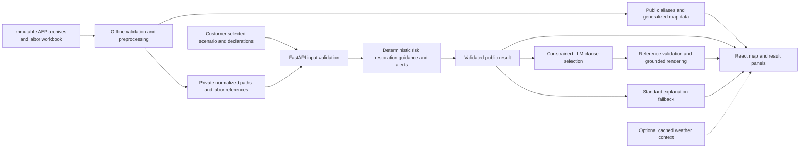

# Architecture

Recommendation: a React/TypeScript map interface, one Python/FastAPI process, immutable preprocessed local files, deterministic risk/restoration/guidance rules, and one optional-at-runtime constrained LLM adapter. Offline numerical results and standard explanations are always available. An actual grounded AI path remains required for submission. No database, message broker, geocoder, authentication service, or training pipeline in MVP.

This recommendation follows the measured coverage and failures in [DATA_AUDIT.md](DATA_AUDIT.md). [MODEL_SPEC.md](MODEL_SPEC.md) owns numerical rules, assumptions, golden values and JSON contracts. Do not duplicate calculation logic in frontend code or prompts.

**Implemented engine:** `backend/data.py` prepares the verified real customer in memory; `backend/engine.py` computes risk, restoration and access comparisons; `backend/contracts.py` owns the public Pydantic boundary; `backend/config.py` centralizes source pins and unit/scope assumptions; `backend/demo.py` is the executable CLI. This is the numerical core of the design below. Run `.venv/bin/python -m backend.demo` from the repository root.

**Browser slice update:** `backend/api.py` loads one verified context during FastAPI lifespan startup and calls the unchanged engine. `frontend/` is React/TypeScript + Vite, using a same-origin `/api` proxy. The grid view pairs Leaflet geography with the authoritative dependency schematic; `backend/geography.py` prepares a small privacy-safe map DTO once. Preparation and preview-only alerts adapt teammate guidance through `backend/customer.py`. Optional OSM tiles have a local-vector fallback. Constrained explanations now select approved references through a provider interface with strict server validation and deterministic fallback; see [AI implementation](AI_EXPLANATIONS.md). No persistence or new analytics were introduced. See [map audit and failure behavior](GEOGRAPHIC_MAP.md); README contains local launch commands.

## Components and data flow

| Component | Responsibility | Explicit boundary |
|---|---|---|
| Offline preprocessing | Hash sources; parse ZIP/shapefile/workbook; validate IDs/CRS; produce curated fixtures and indexes | Checkpoint uses `backend/data.py` in memory; `scripts/audit_data.py` remains the separate full audit |
| Private data store | Read-only normalized source records, path indexes, workbook cell mappings, audit flags | Never mounted as frontend static content or sent wholesale to LLM |
| Public data store | Opaque location/node aliases, coarse display positions, safe labels, schematic paths | No raw premise IDs, roads/annotation text, facility identifiers, operational fields |
| Risk engine | Versioned ordinal rules and missing-data behavior | No percentages or training on invented labels |
| Restoration engine | Explicit recipes and serial dependency effort envelope | No official ETR, road routing, queue prediction, or per-person conversion |
| Scenario engine | Validate bounded typed controls, version snapshots, calculate deltas | Does not mutate inventory/history or infer damage from risk |
| Guidance/alerts | Curated decision tables and lifecycle message previews | No real sending, subscription lookup, or utility eligibility claim |
| Explanation adapter | Select grounded clauses for customer question | No numerical authority, arbitrary tool execution, or scenario mutation |
| Frontend | Map selection, result panels, scenario controls, comparison, preparation, message previews | Never independently recalculate risk/restoration |

## Geospatial and topology representation

Use Leaflet with a locally served, generalized structured map DTO because this demo has a small number of selected locations and simple overlays. The implemented DTO uses explicit nullable assets and coordinate paths instead of wholesale GeoJSON records, keeping the public allowlist small. MapLibre/vector tiles add unnecessary preparation and rendering scope. A neutral map background and coarse local geography work without internet; the optional public basemap retains provider attribution and normal browser caching. Third-party tiles are not a startup dependency.

Processing may use GeoPandas/Shapely/pyproj because GIS is the main input. Use pandas/openpyxl for workbook inspection/normalization. Plain Python dictionaries and ordered path arrays are sufficient for P0; introduce NetworkX only if a later branch simulation materially benefits. No Polars/scikit-learn requirement.

Read each layer's declared CRS and transform horizontal coordinates explicitly. Use WGS84 for display and UTM 17N for metric validation. Drop Z from public artifacts. Parse identifiers as strings, preserving leading zeros. Maintain private `(entity_table, entity_id)` keys with a source hash and record locator. Keep observed inventory facts separate from graph interpretations.

Retain each customer's ordered path; do not flatten conflicting paths into a single-parent graph. Validate unique customer, exact first-transformer ID, transformer location/circuit consistency, terminal circuit, every required non-circuit node, and unambiguous bidirectional circuit alias mapping. Reject a P0 fixture if a path node has conflicting parents or a relevant GIS upstream disagreement. The audit's 52,321 fully ID-resolved rows have not all passed this stricter fixture gate.

Circuit supply nodes remain abstract. The pole/line/switch layers provide contextual geometry and future investigation material, not proven directed electrical edges. Do not snap lines into a graph or reconcile recloser installation/bank IDs silently. Circuit alias conflicts must block overlays that would imply the wrong circuit.

The public map shows generalized location markers (e.g. 0.01° grid cell centers, labeled approximate) and a schematic dependency view with equipment types. Any circuit overview must be sufficiently generalized, small, privacy-reviewed and tied to a validated alias; it is optional for P0. Precise equipment positions and original infrastructure IDs stay private. The customer journey must work with keyboard-selectable location cards as well as map clicks. No address entry or real customer lookup is required because R01 permits anonymized locations.

## Preprocessing and caches

Proposed outputs under ignored `data/derived/`:

- `manifest.json`: schema/version, source hashes, generation configuration, validation counts.
- Private path/recipe indexes: only curated demo premises and required assets initially.
- `public/locations.geojson` and sanitized result fixtures: aliases/coarse geography, no private fields.
- Versioned default scenarios and approved guidance/communication clauses.

No persisted derived files are needed: `prepare_context()` verifies the hashes, derives the selected path and labor references directly from archives, and returns a private context reusable across scenario changes. No full GIS extraction is performed. The API loads this context once at startup. Add `data/derived/` to `.gitignore` before introducing the proposed disk artifacts. Existing raw inputs and root ignore rules remain unchanged.

Prepare data once at development startup, never unzip/reproject/scan 452k+ GIS features per request. Fail on hash/schema changes rather than silently serving incompatible fixtures. Runtime data lives in memory; scenario results cache by `(data_hash, model_versions, location_alias, canonical_inputs)`. Explanation cache additionally keys by result ID and supported question intent, never storing sensitive profile text. Public payload target: under 1 MB for curated initial map; scenario roundtrip target: under 300 ms locally after preload. These are acceptance targets, not measured product performance.

Checkpoint measurement on this workstation: first `prepare_context()` call took 1.674 seconds (excluding Python/import startup; filesystem cache uncontrolled). Across 100 evaluations reusing that context, median was 0.089 ms and maximum 0.514 ms; one compact public result was 8,698 bytes. These are local engine timings, not an HTTP/browser benchmark. The small payload and reusable context make a persisted cache unnecessary for this checkpoint.

For a future single-process demo, FastAPI can serve the built frontend. The current browser slice uses two local processes: Vite on 5173 proxies `/api` to FastAPI on 8000. README documents the working CLI, API, UI and test commands. `requirements-web.txt` includes the four pinned engine dependencies and adds the HTTP/test dependencies without changing the teammate's broader `requirements.txt`. No scenario cache is needed at this scale; evaluation reuses the prepared context and generates deterministic content-based result IDs.

## HTTP and state contracts

Implemented: `GET /api/locations` returns the public location list, `GET /api/health` reports ready data/model versions, and `POST /api/evaluate` accepts `AnalysisRequest` and returns `AnalysisResponse {result: Evaluation, comparison: Comparison | null, customer_journey: CustomerJourney}`. The request exposes only the golden location, access and positive integer revision, plus an optional previous access/revision strictly earlier than the requested revision. The backend recomputes both selections and calls `compare_access`; it accepts no client-supplied model outputs. Invalid requests get sanitized 422 responses, unsupported locations get 404, and numerical preparation failure prevents startup. `GET /api/map?location_alias=demo-a` returns the in-memory `GeographicMap`; map-only failure returns a safe 503 without preventing analysis. HTTP responses are not cached. Raw source files are never mounted.

`scripts/export_api_schema.py` exports OpenAPI without starting the application or loading data. `npm --prefix frontend run types:generate` produces the checked-in TypeScript contract; the intermediate schema and build output are ignored. UI code formats returned numbers but contains no risk/restoration formulas or golden range constants. It cancels older requests, validates returned revision/access/location and comparison identity, and hides the old range during loading/failure. The remaining HTTP design below includes future full-product scope.

| Proposed route | Input | Output / rule |
|---|---|---|
| `GET /api/locations` | None | Public audited aliases and approximate map features |
| `POST /api/evaluate` | Location alias, scenario revision, bounded controls, optional declarations | One validated result matching MODEL_SPEC; 422 for invalid inputs; typed unavailable result for valid but incomplete data |
| `POST /api/explain` | Server-generated result ID, question, optional previous result ID | Validated clause selection rendered into grounded text; template fallback |
| `GET /api/health` | None | Schema/model/data versions and readiness, without private paths or secrets |

`POST /api/explain` is now implemented as a fifth route: it recomputes the current/previous scenario from validated selections, checks result-ID bindings, builds an allowlisted context, and optionally requests supporting-clause references. It returns only server-rendered facts and caveats. Unknown questions bypass the provider; missing keys, timeout and invalid output use standard explanations. See [the exact contracts and provider setup](AI_EXPLANATIONS.md). Declared profiles remain design only. Bind locally for the hackathon; keep API keys on the server, outside source control. No accounts or persistence are needed.

Frontend state: selected alias → immutable scenario inputs/revision → pending evaluation → validated result → explanation for that exact result. Abort superseded calls and discard stale revisions. Numeric cards, preparation and communication preview all read the same result. Show pending/failed state without silently retaining an obsolete range. Risk band, confidence, provenance and assumptions must remain visible when the chat panel is closed.

## Weather decision

**P0: frozen, explicitly simulated storm presets. P2: NWS contextual panel if the whole core journey already works.** Live weather adds recognizable current context but cannot supply missing outage labels or validate AEP restoration estimates. Current weather must never be presented as the weather that caused the historical damage extract. The default judging scenario must not change because the actual day is calm.

NWS is the recommended optional provider for US forecast/alert context. Its API is free; currently it requires an identifying User-Agent rather than an API key. Resolve `/points/{latitude},{longitude}` to `properties.forecastHourly`; retain period `startTime`, `endTime`, `windSpeed`, `windDirection`, `probabilityOfPrecipitation.value`, `shortForecast`. From `/alerts/active?point=lat,lon`, allowlist alert `id`, `event`, `severity`, `certainty`, `urgency`, `onset`, `expires`, `headline`. Store retrieval time and forecast validity; parse wind units/ranges explicitly. See [NWS documentation](https://www.weather.gov/documentation/services-web-api) and its [OpenAPI schema](https://api.weather.gov/openapi.json), checked 2026-10-24.

Open-Meteo is the alternative if numerical gust context becomes essential: hourly `time`, `wind_speed_10m`, `wind_gusts_10m`, `precipitation`, `precipitation_probability`, `weather_code`, with returned `hourly_units`, `timezone`, `utc_offset_seconds`. Gusts represent preceding-hour maxima. Set `wind_speed_unit=ms`, `precipitation_unit=mm`, `timezone=UTC`. The noncommercial endpoint does not require an API key; reserved commercial resources do. It offers straightforward numerical forecasts but is unnecessary for P0. See [official API documentation](https://open-meteo.com/en/docs), checked 2026-10-24.

Adapter policy (team choices): server-side fetch for a coarse representative region, 3-second timeout, honor cache headers with a 15-minute refresh target, retain last valid context with visible age, and fall back to “Live weather unavailable.” Do not send customer IDs or declared needs. Do not turn failure/no alerts into low risk. Do not automatically substitute cached/live conditions into the frozen scenario. Future weather-to-risk mapping needs its own documented scale; v1 uses manually selected storm levels. No weather API was integrated in this task.

## Preparation and communication rules

The frozen browser adapts `pipeline/guidance.py` through `backend/customer.py`, using band, displayed duration and confidence. It collects no personal declarations, contacts or opt-in; `priority_needs=False` means no declaration was collected. Baseline covers lighting/charging and preparation; extended-duration scenarios add backup-plan review. Safety copy is fixed teammate guidance, never LLM-authored repair/switching instructions. Optional declared-needs adaptation remains an unimplemented challenge requirement, not a feature of this demo. A future implementation must use explicit declarations, never infer medical needs from raw customer fields. Background guidance: [Ready.gov outage sheet](https://www.ready.gov/sites/default/files/2024-08/ready.gov_power-outage_info-sheet.pdf) and [FDA device preparedness guidance](https://www.fda.gov/medical-devices/emergency-situations-medical-devices/fda-offers-tips-about-medical-devices-and-natural-disasters).

Implemented **GridGuide prototype policies**, not official AEP enrollment or timing rules:

| State/trigger | Eligibility and timing | Channel / escalation |
|---|---|---|
| HIGH/SEVERE; or MODERATE with displayed upper bound ≥12 hours | Eligible for demo alerts; unknown duration cannot establish duration-dependent eligibility | Suggested SMS/in-app, never sent; LOW receives in-app information |
| Pre-storm preview | Team timing assumption: 24 hours before a storm; no live storm schedule exists | Display sample text only |
| Eligible customer and either raw restoration endpoint changes by **more than 6 hours**, or availability changes between finite/unavailable | Qualifies for an update preview; exactly 6 hours does not qualify | CLEAR → RESTRICTED qualifies through the 6.75-hour upper change; finite/unavailable is an explicit adapter extension |
| Displayed bounds change without crossing the qualifying threshold | An estimate-update sample can be viewed, but is not an eligible notification | Preview availability and alert qualification are separate; identical scenarios do not create an update |
| Outage-confirmed / restoration-complete preview selected | Hypothetical message only; no utility state changes | Never triggered by a timer or interpreted as a confirmed event |
| Safety guidance | Always shown, independent of alert eligibility | No emergency dispatch integration |

Eligibility is distinct from consent: no enrollment, channel selection or actual scheduling occurs. All four lifecycle states are previews. The earlier planning rule of a one-hour displayed change is superseded by the integrated **strict >6-hour raw endpoint** policy above; it is tested at 6 and 6.001 hours. See [customer integration](CUSTOMER_INTEGRATION.md) and [demo freeze](DEMO_FREEZE.md).

## Failure behavior

| Failure | Result |
|---|---|
| Unmatched/ambiguous premise or relevant circuit mapping | No borrowed nearest-customer identity; choose a vetted demo alias or show insufficient data |
| Missing later upstream geometry | Schematic unresolved node; no claim of complete mapped path; only independently justified risk inputs may remain |
| Conflict/cycle, unknown required recipe, blocked access, no crew | Null restoration range with concrete reason |
| Historical date/repair inconsistency | Exclude from duration training; preserve historical context only |
| Missing LLM key, timeout, invalid result IDs or references | Standard grounded explanation; numerical results remain usable |
| Weather/tiles unavailable | Local map and scenario continue; context unavailable explicitly |
| Privacy allowlist/schema check fails | Fail preprocessing/public serialization; do not return raw record fallback |
| No saved data version compatible with model | Startup readiness failure with developer diagnostic; no plausible fabricated demo values |

The three-person ownership and implementation gates are in [EXECUTION_PLAN.md](EXECUTION_PLAN.md). All tests must prove observable contracts rather than simply reproduce implementation details.
