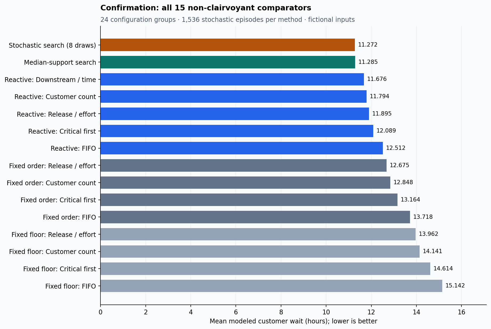
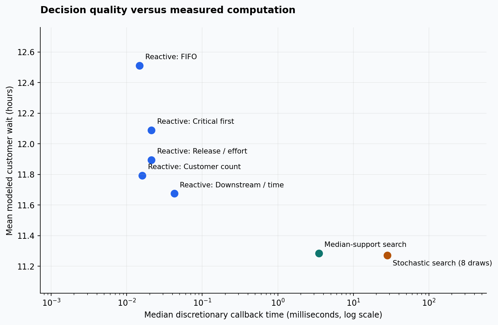

# GridGuide Adaptive Dispatch

### Useful adaptive decisions; no demonstrated advantage for the proposed learned surrogate yet

**36 fictional configurations · 15 comparators · 29,880 validated method-episodes**

[Complete report](presentation/REPORT.md) · [Scientific protocol](PROTOCOL.md) ·
[Architecture](ARCHITECTURE.md) · [Reproduce](REPRODUCE.md) · [Foundation audit](FOUNDATIONS.md)

This study introduces an independent event-driven restoration scheduler. It chooses
which ready repair to assign to an available crew, or whether to wait, using only
known task characteristics and observed completions. Actual future durations remain
private. This is a new sequential decision problem, separate from ML Lab I's trained
four-policy selector and ML Lab II's observed-source audit.

**Adaptive scheduling is useful in this fictional cohort. The preregistered learning
opportunity gate nevertheless fails.** A downstream-customer reactive rule reduces
mean waiting by 7.88% against the discovery-selected fixed-order comparator. But the
eight-future stochastic teacher improves only 0.113% over the cheaper support-median
search, with an interval crossing zero and about eight times the decision cost.
The study therefore stops before fitting a learned model, as the protocol requires.

## What confirmation measured

Twelve discovery configurations selected the comparators. Twenty-four independent
confirmation configurations tested them. Each configuration has related 2/3-crew
variants; all variants and repeated duration draws stay together for uncertainty.
There are 1,536 stochastic episodes per method, **24 independent configuration groups**,
and another 48 deterministic episodes per method reported separately.

| Discovery-frozen comparator | Mean customer wait, hours | Median discretionary decision, ms |
|---|---:|---:|
| Fixed crew/order: release per person-hour | 12.674750 | One-time planning; not a callback |
| Reactive downstream customers / expected duration | 11.675868 | 0.042541 |
| Conditional-support-median search | 11.284803 | 3.490396 |
| Eight-future stochastic search | 11.272070 | 28.119980 |

These are modeled customer-hours divided by customer count, averaged within configuration
before averaging across configurations. Lower is better. Callback times exclude independent
post-episode verification; forced one-action decisions are reported separately in the full report.

- **Reactive vs fixed:** 0.998882-hour mean reduction; grouped 95% interval
  **[0.564832, 1.456983]**. The ≥2% adaptive-value gate passes.
- **Teacher vs cheap search:** 0.012734-hour reduction; interval
  **[−0.049116, 0.090523]**. The ≥1% positive-interval headroom gate fails.
- **Critical-service guard:** teacher maximum critical-group wait worsens by 0.266429
  hours on average across 1,024 supported episodes / 16 groups. It remains within
  the preregistered max(0.25 hour, 5%) tolerance; it is still a reported regression.
- **Customer-tail guard:** mean per-episode p95 wait improves by 0.151839 hours across
  all 1,536 episodes / 24 groups. This guard passes.

The reactive comparison combines a new priority rule with completion-responsive
decisions; it does not isolate the causal contribution of uncertainty. Fixed controls
include both historical planned-start floors and earliest-feasible fixed-order replay,
so the comparison does not rely only on reclaiming deliberate idle time. The teacher's
learning gate additionally compares against the stronger online search.

## Engineering substance

The simulator advances directly between crew arrivals and task completions. Assignments
are nonpreemptive, prerequisites require actual completion, and simultaneous completions
are processed together. A public observation exposes active starts and elapsed time;
conditional hypothetical durations use only that observation and a separate random namespace.
No actual episode future, private seed or result metric enters an online policy callback.

Every actual online trajectory is independently checked, and every online/fixed schedule
and full metric object passes the existing independent G2 checker through an explicit
integer-duration adapter. Blocked or unknown work remains unresolved. Tiny exact rational
dynamic programming verifies expected costs and a deliberate-wait fixture: reserving a crew
for soon-ready high-impact repairs gives 413 customer-hours versus 511 for starting a long
low-impact repair immediately. These are verification fixtures, not population claims.

Inputs were committed before discovery; comparator selections were committed before
confirmation. The new generator reuses audited graph mechanisms with fresh configurations,
not the old evaluated cohorts. Numerical results, every schedule, random-draw identities,
timings, paired failures and complete manifests remain inspectable in [evidence](evidence/).
Hashes establish consistency, not independent third-party scientific validation.

## Recommendation and limits

**Do not start full RL development or promote a learned dispatcher from this evidence.**
The bounded teacher has not established meaningful extra quality over the cheaper search.
No imitation model, RL agent, trained weights, model accuracy or learned speedup is claimed.
The conditional train/development/held-out/shift pilot was intentionally not opened after
the failed gate; this is not a failed trained model or proof that learning can never help.

A future separately preregistered study could investigate distilling the cheaper search
or improving teacher quality under larger budgets. It would need fresh configurations,
strong matched controls, measured student rollouts and customer/critical guardrails;
the published confirmation cases must not become a new blind test. Those follow-ups
were not run and are not treated as benefits achieved by this study.

The finite duration distributions are authored assumptions, not utility calibration.
Independent tasks, complete known repair scope, identical crews and small 10–14-task
graphs omit correlated storms, unknown damage, travel, switching, skill constraints and
larger-scale generalization. No dashboard behavior, historical benchmark conclusion,
source permission, prior ML study, release or tag is changed by this research.
