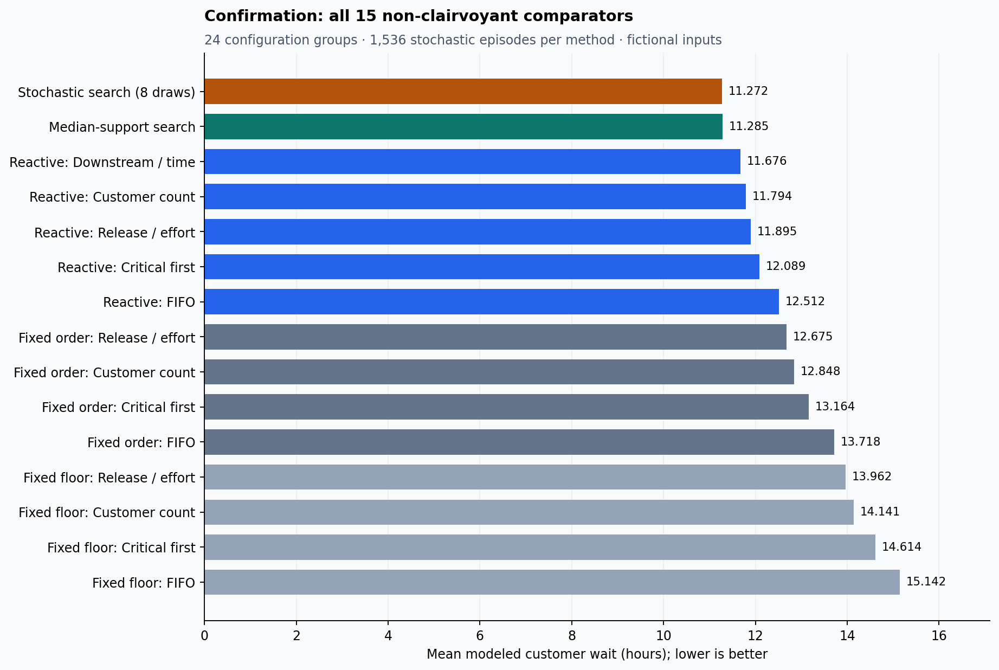
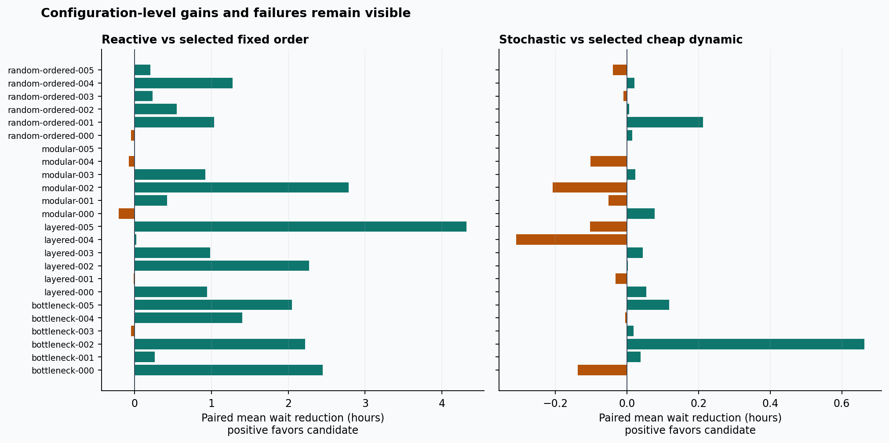
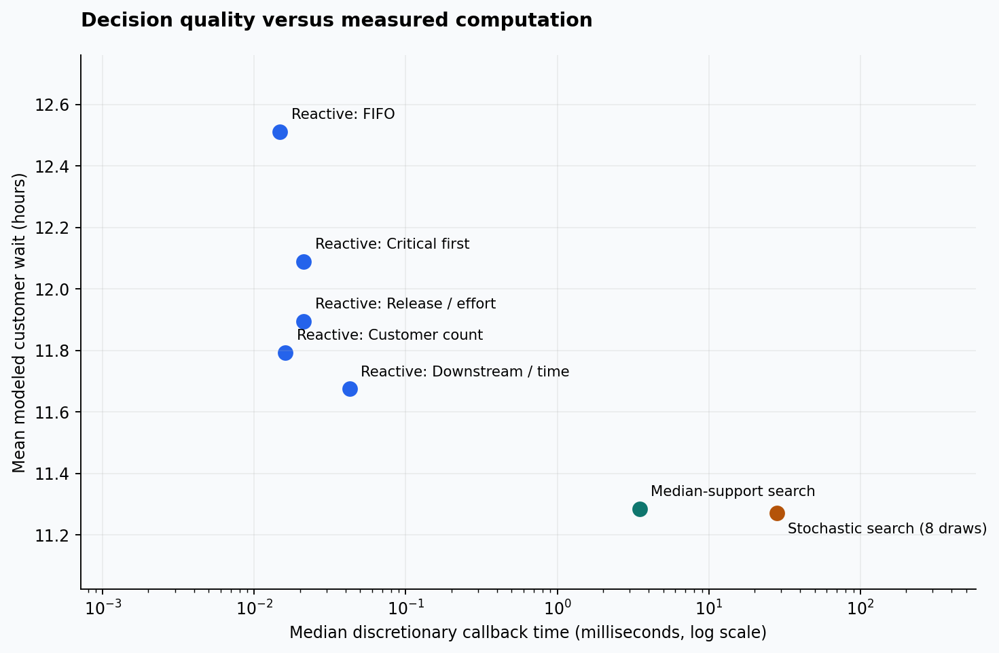

# Adaptive dispatch opportunity report

**NO-GO for this preregistered learning pilot.**

All results are from fictional, complete-scope scheduling problems. No measured utility
outcomes, calibrated repair-time distribution or operational dispatch claim is involved.

## Cohorts and decision boundary

Discovery: 12 configurations × two crew variants × (one deterministic + 16 stochastic episodes)
= 408 episodes per method / 6,120 method-episodes. Confirmation: 24 new configurations ×
two crew variants × (one deterministic + 32 stochastic episodes) = 1,584 episodes per
method / 23,760 method-episodes. Stochastic confirmation uses **1,536 paired episodes per
method across 24 configuration groups**; deterministic results are separate.

The selected fixed comparator and dynamic rules were frozen on discovery before confirmation:

- Fixed: `fixed-order:legacy-release-per-person-hour-adapter-v1`.
- Reactive: `reactive:downstream`.
- Cheap dynamic: `search:support-median`.

Waiting cost is completed modeled customer-hours divided by customer count in each case.
Both crew variants, stochastic profiles and draws are averaged within each configuration;
configuration means receive equal weight. Intervals use 2,000 configuration bootstrap
resamples. Repeated episodes are not treated as independent structural samples.

## Preregistered confirmation gate

| Comparison / guardrail | Reference mean | Candidate mean | Paired reduction, hours | 95% interval | Supported episodes / groups | Pass |
|---|---:|---:|---:|---|---:|---|
| adaptive_value | 12.674750 | 11.675868 | 0.998882 | [0.564832, 1.456983] | 1536 / 24 | True |
| teacher_critical | 13.883665 | 14.150094 | -0.266429 | [-0.620383, 0.025376] | 1024 / 16 | True |
| teacher_headroom | 11.284803 | 11.272070 | 0.012734 | [-0.049116, 0.090523] | 1536 / 24 | False |
| teacher_p95 | 20.628745 | 20.476906 | 0.151839 | [0.059797, 0.277202] | 1536 / 24 | True |

Adaptive value requires ≥2% cost reduction with an interval strictly above zero.
Teacher headroom requires ≥1% reduction against the strongest discovery-selected cheap
dynamic method with an interval strictly above zero. Critical and p95 guards limit mean
regression to max(0.25 hour, 5% of the reference mean) on paired supported episodes.

Adaptive relative reduction: **7.8809%**. Teacher relative reduction: **0.1128%**.

## Every comparator, with profiles separated

| Method | Pooled stochastic mean wait, h | Low variability, h | High variability, h | Deterministic, h |
|---|---:|---:|---:|---:|
| Fixed floor: FIFO | 15.141776 | 14.405306 | 15.878247 | 12.833852 |
| Fixed floor: Customer count | 14.140552 | 13.422512 | 14.858593 | 11.932313 |
| Fixed floor: Release / effort | 13.962427 | 13.262016 | 14.662839 | 11.875999 |
| Fixed floor: Critical first | 14.613638 | 13.850222 | 15.377054 | 12.317168 |
| Fixed order: FIFO | 13.718326 | 13.313861 | 14.122792 | 12.833852 |
| Fixed order: Customer count | 12.847677 | 12.392444 | 13.302910 | 11.932313 |
| Fixed order: Release / effort | 12.674750 | 12.231691 | 13.117809 | 11.875999 |
| Fixed order: Critical first | 13.163837 | 12.706280 | 13.621394 | 12.317168 |
| Reactive: FIFO | 12.511899 | 12.372807 | 12.650991 | 12.324772 |
| Reactive: Customer count | 11.793814 | 11.651696 | 11.935932 | 11.605621 |
| Reactive: Release / effort | 11.895398 | 11.728139 | 12.062657 | 11.679983 |
| Reactive: Critical first | 12.089149 | 11.944879 | 12.233418 | 11.913842 |
| Reactive: Downstream / time | 11.675868 | 11.489345 | 11.862391 | 11.457523 |
| Median-support search | 11.284803 | 11.038405 | 11.531202 | 10.785091 |
| Stochastic search (8 draws) | 11.272070 | 11.002194 | 11.541945 | 10.785091 |

Fixed-order controls reclaim planned slack while retaining original crew assignments and
task order. The planned-floor variants are reported but are not the sole adaptive comparator.
Search is bounded root-action rollout, not an optimal dispatcher. No hindsight future is
available to any policy; hypothetical draws use public state and a separate namespace.

The downstream reactive rule is new, so its comparison with fixed G2 combines a different
priority rule with completion-responsive decisions. This is not a causal decomposition
of the value of uncertainty or adaptivity alone. Deterministic outcomes help expose this
limitation; teacher headroom is assessed against the stronger online search comparator.

## Runtime and resource measurements

| Online method | All callbacks, median ms | Discretionary callbacks, median ms | Discretionary p95 ms | Discretionary count |
|---|---:|---:|---:|---:|
| Reactive: FIFO | 0.003208 | 0.014750 | 0.019417 | 18302 |
| Reactive: Customer count | 0.003083 | 0.016083 | 0.021771 | 18311 |
| Reactive: Release / effort | 0.003041 | 0.021208 | 0.035959 | 18301 |
| Reactive: Critical first | 0.003041 | 0.021250 | 0.035417 | 18320 |
| Reactive: Downstream / time | 0.003084 | 0.042541 | 0.094584 | 18434 |
| Median-support search | 0.003417 | 3.490396 | 15.277015 | 18550 |
| Stochastic search (8 draws) | 0.003291 | 28.119979 | 121.189400 | 18648 |

Stochastic search's median discretionary callback costs **8.056×** median-support search on this run.
Forced waits are separately retained; they can dominate an all-callback median. Fixed planning
is a one-time measurement and is not comparable to a per-event callback; its complete timings
remain in `runtime.json`. Verification time is excluded from policy callback time.

Discovery command: 182.982s; peak RSS 142.203 MiB. Confirmation: 901.750s; peak RSS 430.375 MiB.
Recorded environment: Darwin arm64, Python 3.12.14. Timing is local measurement, not a portable latency promise.

## Family-specific failures

| Mechanism | Groups | Teacher reduction vs cheap dynamic, h | 95% interval | Wins / ties / losses |
|---|---:|---:|---|---:|
| bottleneck | 6 | 0.115975 | [-0.043508, 0.356589] | 195 / 41 / 148 |
| layered | 6 | -0.056703 | [-0.169121, 0.026528] | 156 / 69 / 159 |
| modular | 6 | -0.043037 | [-0.125264, 0.025361] | 157 / 29 / 198 |
| random_ordered | 6 | 0.034699 | [-0.013979, 0.109491] | 170 / 65 / 149 |

Family intervals have only six configuration groups and are descriptive, not separate
multiplicity-adjusted discoveries. They cannot establish broad generalization.

## Largest teacher regressions

| Configuration | Crews | Profile | Episode seed | Additional mean wait, h |
|---|---:|---|---:|---:|
| layered-005 | 2 | high | 880003364521788006 | 5.555160 |
| bottleneck-003 | 2 | high | 659269479196485827 | 4.677949 |
| bottleneck-003 | 2 | high | 1118817884912679848 | 4.543424 |
| bottleneck-000 | 2 | high | 880003364521788006 | 4.302476 |
| modular-002 | 2 | high | 36521974543392335 | 2.781439 |
| layered-005 | 2 | high | 36521974543392335 | 2.690810 |
| layered-005 | 2 | high | 116555816226159260 | 2.678781 |
| layered-005 | 2 | high | 568382573918855434 | 2.671978 |
| bottleneck-003 | 3 | high | 379284978085920046 | 2.293056 |
| random-ordered-001 | 2 | high | 1118817884912679848 | 2.282333 |

Episode seeds and IDs are audit metadata, never policy inputs. All cases, not only the
worst examples, remain in the compressed machine-readable episode evidence.

## Scope and interpretation

Independent duration supports are deliberately authored, with equal mean multiplier and
different variability. They contain no shared weather factor, unknown damage, travel,
switching or heterogeneous crew skill. Finite supports can make elapsed time unusually
informative. Large or correlated-duration problems are untested generalization regimes.

The teacher uses only eight hypothetical futures and four reactive continuations. This
limits its opportunity to outperform a cheap deterministic support-median search; it
does not prove that all possible adaptive algorithms or learned dispatchers lack value.
These results distinguish useful adaptivity from demonstrated headroom for this teacher.

Complete-scope primary cases do not evaluate learned treatment of unknown work. Separate
fixtures verify blocked descendants and null complete outcomes without inventing durations.
Tiny exact solutions verify specific expectations and deliberate waits, not global quality.

The gate, cohort, policy budget and thresholds were not changed after scientific reveal.
Procedural input/selection freezes are auditable but developer-controlled, not an external blind test.

[Protocol](../PROTOCOL.md) · [Architecture](../ARCHITECTURE.md) · [Reproduce](../REPRODUCE.md) · [Literature](../FOUNDATIONS.md)
