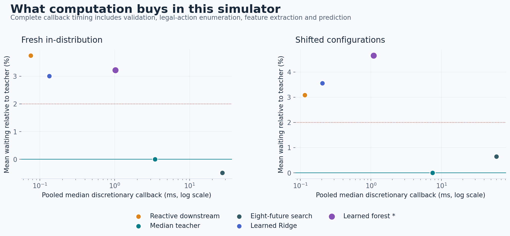
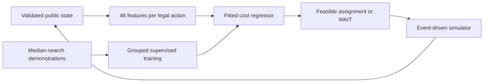

# Learned Adaptive Dispatch v1

**A real trained dispatcher, with a measured tradeoff and a failed promotion gate.**

GridGuide now has an optional learned research policy that assigns a feasible crew/task or
chooses WAIT from the current public simulation state. Five genuinely fitted models learn
from conditional-support-median search: three regularized linear rankers and two random
forests. Their learned parameters are retained as versioned, SHA-verified JSON artifacts.

This is a new prospective distillation study. It preserves the prior [adaptive opportunity
study](../adaptive-dispatch/README.md), [ML Lab I](../ml-lab/README.md) and
[ML Lab II source audit](../outage-ml/README.md).

## What was built

Training uses **48 independent configurations, 480 trajectories, 5,352 unique discretionary
states and 24,240 action rows**. IDs, private future durations and teacher outcomes are
excluded from feature inputs. Both families support variable action sets. Each fit repeats
with identical exported parameters; portable predictions match the actual fitted estimator.

Development selects the **64-tree, depth-4 forest** using complete stochastic student
rollouts, not action agreement. The linear-family winner is **Ridge alpha 10**. All five
artifacts remain inspectable, including the deeper forest that fit training data better
but performed worse in development rollouts.

## What the frozen evaluation found

Each final cohort has **24 independent configurations / 48 crew variants / 432 episodes per
method**; the primary comparisons use 384 stochastic episodes. Six methods produce 5,184
held-out method-episodes. Whole configurations, not correlated decisions or episodes, are
the uncertainty units.

| Frozen forest champion | Fresh ID | Topology / scale / crew shift |
|---|---:|---:|
| Mean modeled wait | 15.476777 h | 37.614646 h |
| Mean wait above teacher | +3.22% [2.26%, 4.22%] | +4.66% [3.22%, 6.25%] |
| Teacher/student callback speed ratio | 3.85× [3.25×, 4.49×] | 7.82× [6.45×, 9.38×] |
| Mean wait minus reactive comparator | −0.079361 h | +0.564734 h |
| Invalid actions / fallback | 0 / 0 | 0 / 0 |
| Promotion | **FAIL: teacher quality** | **FAIL: teacher quality and reactive noninferiority** |

Brackets are paired 95% configuration-bootstrap intervals. Speed compares means of
configuration-median discretionary callback times; the chart uses pooled medians, a different
descriptive quantity. Timing includes validation, features, action enumeration and prediction.
Full-episode decision CPU, load, fit and evaluation runtime are reported separately.

The trained model is faster than its teacher but does not preserve the preregistered ≤2%
waiting-cost tolerance. Critical/tail and catastrophic-regression screens pass; they are
not guarantees for individual customers. **Do not promote the model or change existing
defaults.** No retuning or model reselection followed the final reveal.

## Inspect and run it

- [Load the trained model and run a new example](REPRODUCE.md#load-the-actual-trained-champion)
- [Model card and exact artifact hashes](MODEL_CARD.md)
- [Full report, intervals, learned parameters and failure cases](presentation/REPORT.md)
- [Prospective protocol](PROTOCOL.md), [feature definitions](feature-schema.json) and [strict public-state contract](INTERFACES.md)
- [Input manifest](evidence/dataset/manifest.json), [training inventory](evidence/training/training.json) and [pre-reveal freeze](evidence/freeze.json)
- [Implementation / verification ledger](IMPLEMENTATION.md) and [691-file preservation inventory](PRESERVATION.json)

The simulator, durations, customer groups and critical declarations are fictional. The
teacher is approximate, the cohort is small, and shift changes several factors together.
No utility calibration, production dispatch, deployment or release is claimed. The existing
application, original source data, releases, maps, attribution and earlier research remain intact.
