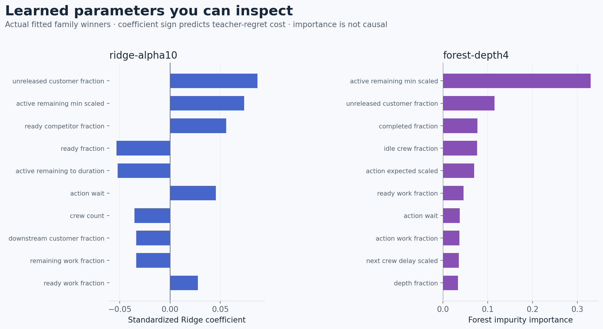
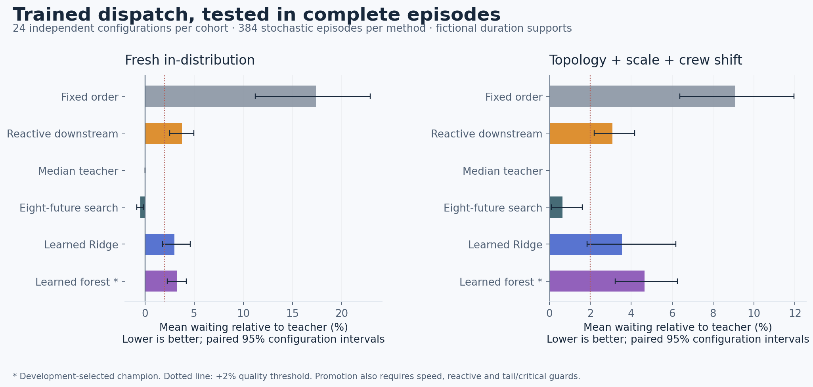
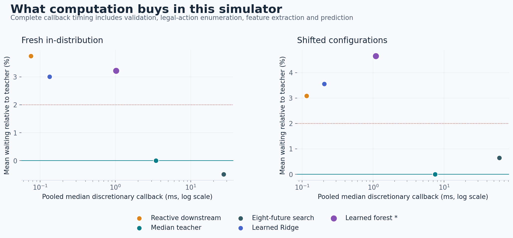
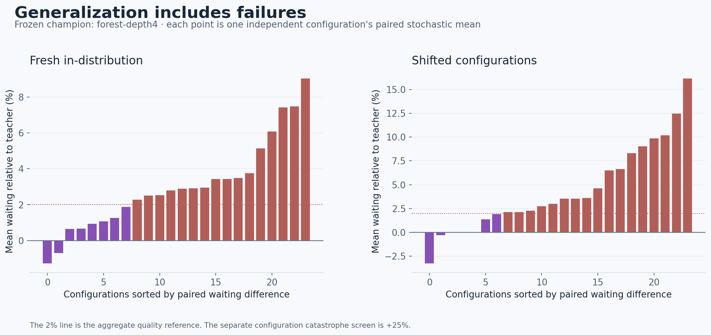

# Learned Adaptive Dispatch v1 — measured research report

**Real trained models; promotion: FAIL — do not promote.**
The development-selected champion is **forest-depth4**. Both learned families and all five fitted artifacts remain available.

This prospective study distills conditional-support-median search into a GridGuide state/action cost ranker. It does not reopen PR #20's failed eight-future headroom test or repeat ML Lab I/II. All outcomes are fictional simulator results.

## Actual training

48 training configurations, 96 crew variants, 480 independently validated trajectories, 12,980 visits, 12,055 unique public states and 5,352 discretionary states produce **24,240 action rows × 46 features**. 925 duplicate visits are retained as lineage but not extra fit weight.

Among unique discretionary states, WAIT is the teacher choice in 47/5,352; 1,347 states tie across multiple distinct tasks/WAIT. 8,801/24,240 action rows have zero teacher regret. Forced decisions are retained separately and do not inflate the fit or agreement denominators. [Label diagnostics](label-diagnostics.json) retain legal-action count quantiles.

Three weighted, standardized Ridge regressors (alpha 0.1, 1, 10) and two 64-tree forests (depth 4, 8) minimize dimensionless excess median-teacher rollout cost. Each configuration, then unique state, then legal action receives equal weight within its parent. The fitted scaler sees training only. No IDs, private durations, final outcomes or teacher costs enter features.

Every fit repeated with exact export equality. Portable predictions matched the fitted estimators on training and 2,134 development parity-probe rows within 1e-10. Total fitting pipeline: 24.444 s; peak RSS 278.0 MiB.

| Candidate | Weighted training MSE | Development mean wait (h) | First fit (s) | Load (ms) | Bytes |
|---|---:|---:|---:|---:|---:|
| forest-depth4 | 0.04073673 | 14.363986 | 3.5499 | 2.1117 | 211,281 |
| forest-depth8 | 0.01901581 | 14.494520 | 6.5119 | 20.1661 | 2,214,781 |
| ridge-alpha0.1 | 0.04784465 | 14.666755 | 0.0151 | 0.2615 | 16,860 |
| ridge-alpha1 | 0.04784478 | 14.614378 | 0.0068 | 0.2689 | 16,872 |
| ridge-alpha10 | 0.04784762 | 14.553853 | 0.0069 | 0.2785 | 16,869 |

Selection uses stochastic complete student rollouts on 16 development configurations, 32 variants and 160 episodes per method (128 stochastic). Training MSE and agreement are diagnostics, not selection criteria.

Shared state features are constant across an observation's candidate actions. In additive Ridge they shift all predicted costs equally and cannot themselves change the within-state ranking; state/action interactions can. In a forest, shared features can select different branches and thereby change action comparisons. The figure describes the fitted cost regressor, not causal importance or a pure ranking-effect measure.

## One-time held-out results

Each cohort has 24 independent configurations and 48 crew variants: 432 episodes per method, including 384 stochastic and 48 deterministic episodes. Six methods yield 2,592 method-episodes per cohort. All metrics and trajectories are independently checked. The tables below use stochastic episodes only; configuration means receive equal weight. Intervals use 2,000 paired configuration bootstrap resamples. Shift jointly changes topology, scale and crew count.

### final_id

| Policy | Mean wait (h) | p95 wait (h) | Critical maximum (h) | Branch disparity (h) | Callback median / p95 (ms) |
|---|---:|---:|---:|---:|---:|
| Fixed order | 17.599921 | 29.109396 | 21.171713 | 9.825579 | one-time fixed plan |
| Reactive downstream | 15.556138 | 26.370293 | 18.758914 | 8.887796 | 0.0757 / 0.1173 |
| Median teacher | 14.993306 | 25.644316 | 18.333407 | 8.591289 | 3.4525 / 13.9209 |
| Eight-future search | 14.919730 | 25.432997 | 18.322871 | 8.435894 | 27.4206 / 108.6120 |
| Learned Ridge | 15.445445 | 26.512604 | 18.801285 | 8.782324 | 0.1335 / 0.1755 |
| Learned forest * | 15.476777 | 26.287419 | 18.641338 | 8.853270 | 1.0189 / 1.1383 |

Champion/teacher mean wait ratio: **1.032246**, 95% CI [1.022555, 1.042162]. Champion minus reactive mean wait: **-0.079361 h**, CI [-0.342699, 0.153734].

Teacher/student ratio of mean configuration-median callback times: **3.847×**, CI [3.246, 4.486]. This differs from the pooled medians plotted below. Student full-episode decision CPU averages 27.083 ms; teacher 54.030 ms.

On visited discretionary states, tie-aware teacher agreement is 2,940/4,359 (67.45%). Invalid actions: 0; fallbacks: 0. Worst configuration mean ratio: 1.0903; worst episode ratio, including deterministic: 1.4314.

| Preregistered guard | Pass? |
|---|---|
| catastrophe | PASS |
| critical | PASS |
| p95 | PASS |
| pass | FAIL |
| reactive noninferiority | PASS |
| speed | PASS |
| support | PASS |
| teacher quality | FAIL |
| validity | PASS |

Critical/tail guard details (champion minus teacher; hours):

| Outcome | Mean degradation | 95% interval | Allowed upper degradation |
|---|---:|---:|---:|
| critical | 0.307931 | [-0.140264, 0.755923] | 0.916670 |
| p95 | 0.643103 | [0.286190, 1.071238] | 1.282216 |

Total measured evaluation batches: 272.437 s wall, 269.912 s process CPU, across 6 bounded invocations. This includes loading, simulation, agreement queries, validation, artifact writing and final aggregation.

Worst episode: `syn-learned-full-final-id-007-c2`, modular, low, student 36.102676 h versus teacher 25.221499 h. Its 5 non-tied action disagreements and both complete schedules are in [failure-cases.json](failure-cases.json).

### final_shift

| Policy | Mean wait (h) | p95 wait (h) | Critical maximum (h) | Branch disparity (h) | Callback median / p95 (ms) |
|---|---:|---:|---:|---:|---:|
| Fixed order | 39.203978 | 64.621675 | 59.829629 | 16.091838 | one-time fixed plan |
| Reactive downstream | 37.049912 | 61.308512 | 55.662047 | 14.164691 | 0.1155 / 0.1867 |
| Median teacher | 35.940527 | 61.112805 | 55.010451 | 14.722207 | 7.4832 / 27.9752 |
| Eight-future search | 36.173022 | 61.334509 | 55.352848 | 14.794513 | 60.1091 / 221.5249 |
| Learned Ridge | 37.219627 | 62.351834 | 58.662168 | 15.641456 | 0.2047 / 0.2702 |
| Learned forest * | 37.614646 | 61.767007 | 55.492739 | 14.889281 | 1.0860 / 1.1965 |

Champion/teacher mean wait ratio: **1.046580**, 95% CI [1.032165, 1.062510]. Champion minus reactive mean wait: **0.564734 h**, CI [0.135028, 1.019432].

Teacher/student ratio of mean configuration-median callback times: **7.823×**, CI [6.452, 9.378]. This differs from the pooled medians plotted below. Student full-episode decision CPU averages 48.953 ms; teacher 174.959 ms.

On visited discretionary states, tie-aware teacher agreement is 4,227/6,580 (64.24%). Invalid actions: 0; fallbacks: 0. Worst configuration mean ratio: 1.1615; worst episode ratio, including deterministic: 1.4043.

| Preregistered guard | Pass? |
|---|---|
| catastrophe | PASS |
| critical | PASS |
| p95 | PASS |
| pass | FAIL |
| reactive noninferiority | FAIL |
| speed | PASS |
| support | PASS |
| teacher quality | FAIL |
| validity | PASS |

Critical/tail guard details (champion minus teacher; hours):

| Outcome | Mean degradation | 95% interval | Allowed upper degradation |
|---|---:|---:|---:|
| critical | 0.482288 | [-0.813022, 1.904631] | 2.750523 |
| p95 | 0.654201 | [0.166041, 1.304531] | 3.055640 |

Total measured evaluation batches: 872.460 s wall, 866.097 s process CPU, across 6 bounded invocations. This includes loading, simulation, agreement queries, validation, artifact writing and final aggregation.

Worst episode: `syn-learned-full-final-shift-023-c1`, deep_sparse, high, student 47.693321 h versus teacher 33.961168 h. Its 12 non-tied action disagreements and both complete schedules are in [failure-cases.json](failure-cases.json).

## Interpretation and limits

Engineering completion and scientific promotion are separate. The JSON files contain actual learned parameters and the optional callable executes whole episodes. A failed guard keeps the existing default and research recommendations unchanged. No final result was used to retune or retrain. The primary teacher is an approximate median-world rollout search, not an optimal or calibrated dispatcher. Equal-crew aliases, synthetic graph mechanisms, limited training groups, incomplete-state exclusion and joint shift constrain generalization.

Action agreement queries are outside callback timers. Full-episode wall/CPU includes those queries, environment work and independent validation; summed callback CPU is separate. Timing is local hardware-dependent, single-thread measurement, not a production throughput claim. The frozen developer-controlled reveal is procedural isolation, not external blind testing. Bounds and hashes validate this interface, not utility safety.

## Artifacts and reproduction

| Candidate | SHA-256 |
|---|---|
| [forest-depth4](../evidence/training/models/forest-depth4.json) | `8280d3929a316c61bd5f93ef15610d891e0bf2e6cc80b8d9fb262f66cc097e52` |
| [forest-depth8](../evidence/training/models/forest-depth8.json) | `0a45f489de2f38e8125dbb89b034c5ab8f152a02815a068e8ecce125a72735e2` |
| [ridge-alpha0.1](../evidence/training/models/ridge-alpha0.1.json) | `4f321dfc89ef9126465bcaad8b53b7b7c2e7452d829fd36aed3ff9ab74d5c69d` |
| [ridge-alpha1](../evidence/training/models/ridge-alpha1.json) | `e456724efe49075d6161ac7e488d0c0a8b04c896ee637e6dbb0348c73df19856` |
| [ridge-alpha10](../evidence/training/models/ridge-alpha10.json) | `046911f68c01541474f8b6606b3ceac67ebcae2a51e87f82c4ad3f13e257ef01` |

[Protocol](../PROTOCOL.md) · [Public-state and inference contracts](../INTERFACES.md) · [Feature schema](../feature-schema.json) · [Reproduction and runnable inference](../REPRODUCE.md) · [Selection freeze](../evidence/freeze.json)
