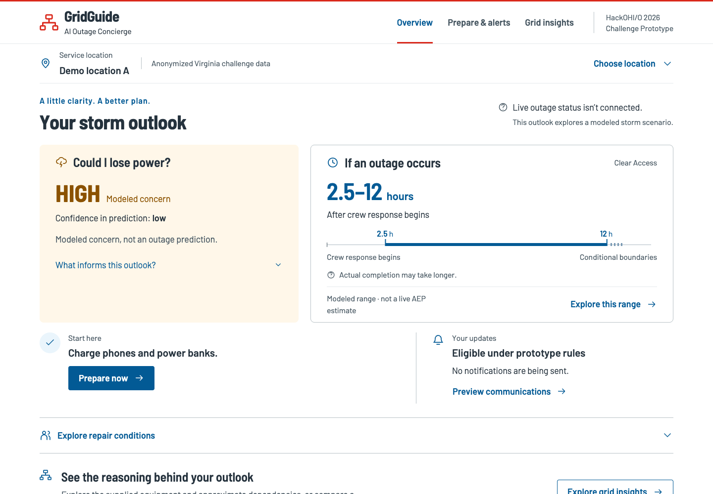
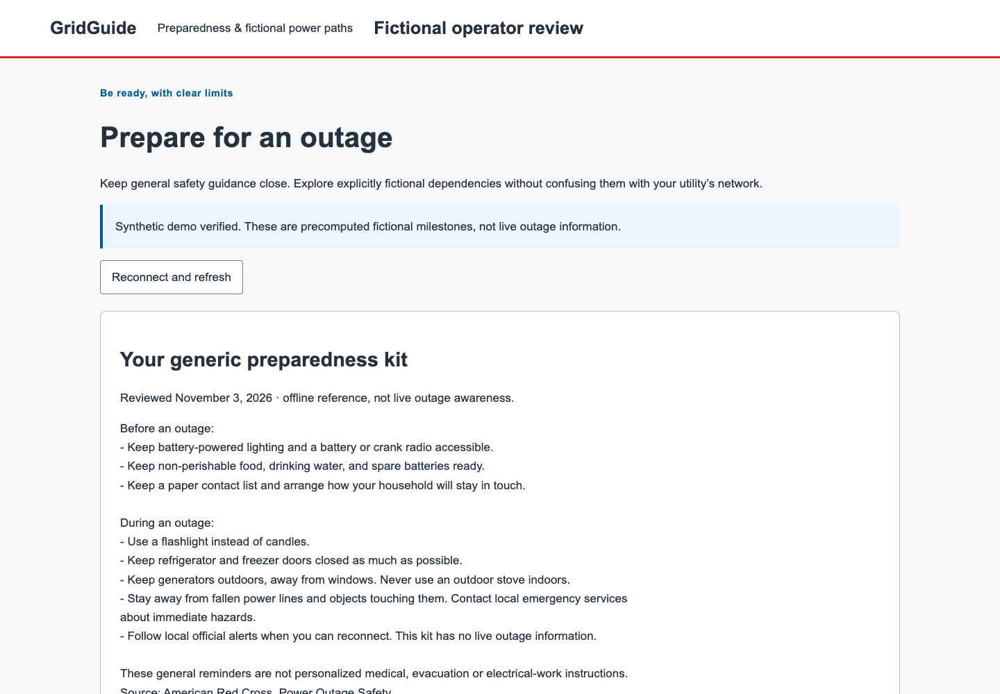
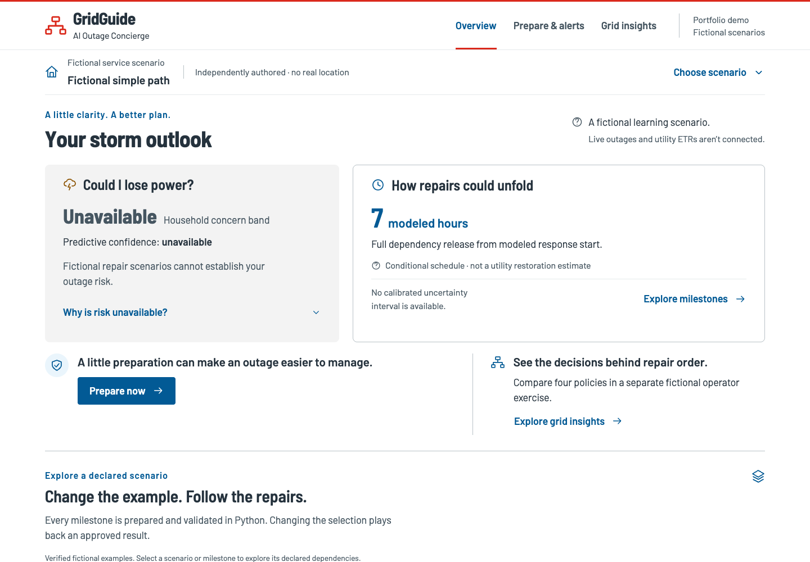

# Authentic continuity comparison

These are unedited browser screenshots, not mockups. Each column uses the same
1440×1000 desktop or 390×844 mobile viewport, reduced motion and external requests
blocked. The original and corrected pages use the existing self-hosted Barlow fonts;
the pre-correction public page uses its original Arial styling.

| View | Actual v1.0.0 | Pre-correction public package | Integrated candidate |
|---|---|---|---|
| Overview, desktop | [Original](v1-desktop.png) | [Before](before-desktop.png) | [After](after-desktop.png) |
| Overview, mobile | [Original](v1-mobile.png) | [Before](before-mobile.png) | [After](after-mobile.png) |
| Prepare, desktop | [Original](v1-preparedness-desktop.png) | [Before](before-preparedness-desktop.png) | [After](after-preparedness-desktop.png) |
| Prepare, mobile | [Original](v1-preparedness-mobile.png) | [Before](before-preparedness-mobile.png) | [After](after-preparedness-mobile.png) |
| Grid insights, desktop | [Original](v1-operator-desktop.png) | [Before](before-operator-desktop.png) | [After](after-operator-desktop.png) |
| Grid insights, mobile | [Original](v1-operator-mobile.png) | [Before](before-operator-mobile.png) | [After](after-operator-mobile.png) |

The original runs the detached `v1.0.0` tree (`b324c1b`) and its real Python browser
fixture, using the same installed pinned frontend runtime versions. The before
package is the preserved G9 archive matching main `ae6d9c4`. The after package is
identified by the [exact manifest](../../verification/continuity/package.json).
The original service uses authorized local source data; public packages contain none.

[Capture metadata and per-image hashes](capture.json) records browser version,
viewports, origins and capture time. The original route is connected explicitly to
its own API fixture, not to a screenshot mock. Reproduce with three separately running
builds using `frontend/scripts/capture-continuity.mjs` and its required environment
variables. No screen content is edited or composited by the script.

The original and fictional models are **not numerically equivalent**. The [feature
matrix](../../planning/V1_1_0_CONTINUITY.md) explains unavailable public functions
and their evidence boundaries. Previous G9 recording/screenshots remain historical;
they are not overwritten and do not depict this correction.
