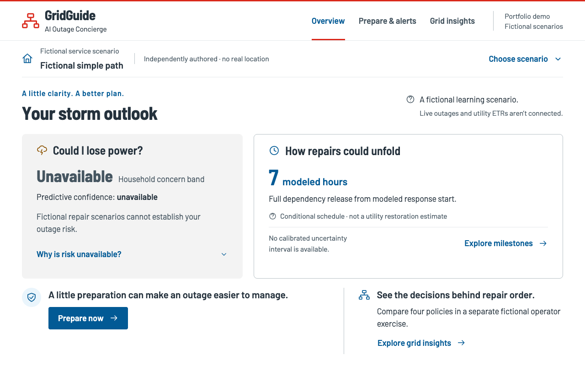

# GridGuide v1.1.0 — integrated product demonstration

**4 minutes 44.32 seconds · 1280×800 · silent, unedited application footage.**
[Watch/download WebM](gridguide-1.1.0-integrated.webm) · [English captions](captions.vtt) ·
[actual scene timings](shots.json) · [provenance and hashes](provenance.json).
Final media review is pending; no tag, GitHub Release or deployment is authorized.

Exact packaged application commit: `3c53d8e9429318f121c210d148f7d2b35ae52147`
(the approved PR #12 merge). The [47-file manifest](package.json) rebuilt and inspected
from that commit has SHA-256
`dbf1c3251fd5e297f223b424898f35f18ac27cbb182b24dd1656486cffc32ebf`.
It matches the continuity package byte-for-byte: media/tooling edits change no package
input. Historical G9 package hashes are retained only in their historical evidence.

## Watch with captions

From the repository root, with Node installed:

```sh
GG_RECORD_DIR=docs/media/v1.1.0-integrated node frontend/scripts/serve-release-media.mjs
```

Open http://127.0.0.1:18192/. This helper serves only the player, video and captions on
loopback, with byte-range support for seeking; it is not a GridGuide deployment.
Stop it with Ctrl-C. A basic Python static server plays sequentially but may reset seeks
to zero; use this tested helper for chapter review. The WebM has no audio; captions are
provided separately and can be toggled. No video frame is composited or edited.

## Actual scenes

| Start | Authentic screenshot | Scene |
|---|---|---|
| 00:00 | [01-overview](01-overview.png) | GridGuide 1.1.0: the integrated Overview, Prepare & alerts and Grid insights journey. Independently authored fiction; no live utility connection. |
| 00:20 | [02-scenario](02-scenario.png) | Select an approved fictional scenario and prepared milestone. Timing is a conditional Python-owned schedule, not a measured restoration outcome or confidence interval. |
| 00:38 | [03-completed](03-completed.png) | Completed means declared dependency repairs are complete at this fictional milestone. The schematic has no geographic coordinates and is not utility-confirmed connectivity. |
| 00:55 | [04-blocked](04-blocked.png) | Blocked clearance remains unknown. Full completion is unresolved; GridGuide never converts unknown completion into a finite utility ETR. |
| 01:12 | [05-unresolved](05-unresolved.png) | Missing evidence stays unresolved. Approved fictional definitions support this educational path, not real locations, household predictions or inferred facility attachments. |
| 01:29 | [06-explanation](06-explanation.png) | Ask GridGuide renders a deterministic explanation bound to this selected milestone. No external AI or browser calculation is required. |
| 01:44 | [07-risk](07-risk.png) | Household predictive risk is unavailable. G4 remains an evidence-bounded No-Go. Live maps, custom crew edits, alerts and G5 interval visualization are not implemented publicly. |
| 02:00 | [08-handoff](08-handoff.png) | Prepare now preserves the exact approved scenario and milestone. Prepare & alerts provides generic safety guidance and snapshots; tailored communications require authorized challenge-local inputs. |
| 02:18 | [09-offline](09-offline.png) | The actual service is stopped and browser networking is disabled. Only cached preparedness and the explicitly saved historical snapshot remain. Storage can be evicted; this is not live outage awareness. |
| 02:44 | [10-policies](10-policies.png) | Four baselines compare identical inputs in a separate fictional operator case. Completed and restricted-horizon customer-hours differ in meaning; unresolved and censored outcomes remain visible. |
| 03:04 | [11-tradeoff](11-tradeoff.png) | Critical-first improves one critical-service latency while worsening customer-hours. Fairness tradeoffs remain visible. The strongest fixed baseline stays default; optional CP-SAT remains experimental after its failed promotion target. |
| 03:25 | [12-reviewed](12-reviewed.png) | Explicit acknowledgements mark this fictional comparison reviewed. Changing settings or a constraint must invalidate this review; no dispatch or utility approval occurs. |
| 03:37 | [13-override](13-override.png) | A supported precedence override is recomputed and independently validated in Python. The previous review disappeared; fresh acknowledgements are required. A constraint can worsen modeled outcomes. |
| 03:54 | [14-export](14-export.png) | The actual downloaded JSON contains this reviewed fictional case. Checksums establish internal consistency, not authenticated reviewer identity or tamper-proof audit history. |
| 04:10 | [15-replay](15-replay.png) | Actual Python CLI output from replaying the downloaded JSON. Replay recomputes and validates the record; it does not train a model or rerun CP-SAT. |
| 04:29 | [16-closing](16-closing.png) | A reproducible fictional portfolio, not operational utility software. Start with docs/REPRODUCING_V1_1.md and run the inspected package via python deploy/serve.py. Hosting needs separate security review and authorization. |

[Mobile Overview](mobile-overview.png) · [Mobile preparedness](mobile-preparedness.png) ·
[Mobile Grid insights](mobile-operator.png). All three are fresh 390×844 captures from
this same package, not resized/composited desktop screenshots.



## Verification and reproduction

- [Playback report](verification.json): duration/resolution, actual playback, successful
  decoded seeks and matching captions for all 16 scenes; dimensions checked for all
  19 PNGs. The final wall-clock cue ends 0.129 seconds after the encoded stream; playback
  clips that tail naturally. Scene timings otherwise retain the actual capture clock.
- [Six production browser tests passed](production-tests.log): root dashboard, all 18
  prepared frames, scenario handoff, separate operator catalog, export/replay, real
  offline browser restart/service outage, request boundaries and automatic accessibility.
- The recording itself asserts the selected `syn-simple` milestone 1 handoff, stops the
  real service, verifies it is unavailable, disables browser networking and reopens the
  saved historical snapshot. It then restarts service and navigates to the separate operator
  exercise. It verifies review invalidation after a supported precedence change.
- [Actual downloaded JSON](review.json) and [actual Python CLI transcript](replay.txt)
  are retained. The transcript scene is a browser view of that output file, not a fake
  terminal. Independently replay it against the extracted package:

```sh
PYTHONDONTWRITEBYTECODE=1 /tmp/gridguide-runtime/bin/python \
  /tmp/gridguide-public/scripts/replay_review.py \
  /absolute/path/to/docs/media/v1.1.0-integrated/review.json
```

Build and inspect the exact application via [the reproduction guide](../../REPRODUCING_V1_1.md).
Use the media-refresh PR's harness while keeping the immutable package pinned to the
application commit above. Install frontend dependencies/Chrome and Playwright ffmpeg.
Keep output outside the package; ports 18190 (capture) and 18192 (playback) must be free.
From the repository root:

```sh
GRIDGUIDE_PACKAGE=/tmp/gridguide-public \
GRIDGUIDE_PUBLIC_PYTHON=/tmp/gridguide-runtime/bin/python \
GG_RECORD_DIR=/tmp/gridguide-recording \
node frontend/scripts/record-release.mjs
```

The script emits WebM, 19 PNGs, VTT, scene metadata and the real export/replay. For local
playback verification, copy this directory's `player.html` and matching `package.json`
into the fresh recording directory, then run:

```sh
GG_RECORD_DIR=/tmp/gridguide-recording GG_VERIFY_REPORT=/tmp/media-check.json \
node frontend/scripts/verify-release-media.mjs
```

Fresh timestamps, compression and output hashes vary. Reproduction means the same
validated journey and package inputs, not bit-identical video. Capture code is bound by
its SHA-256 in `shots.json`; the PR head identifies the complete tooling/evidence tree.
The verifier checks that hash, the package manifest, media hashes where available,
screenshot dimensions, playback and captions. CI also rebuilds the package, compares its
archive hash, replays the recorded JSON and runs the existing source-free application suites.
See this PR's exact-head Actions result; unexecuted source/research lanes are not passes.

## Preservation, tooling findings and limitations

[Preservation check](preservation.json): original numerical/source/contract code and
frozen G2–G5 evidence are unchanged. All 15 old G9 media hashes and PR #12 matched
comparison captures remain preserved. The [old recording](../v1.1.0/README.md) is clearly
historical; only its README gained that notice. No G3 optimization or G5 Monte Carlo was rerun.

The first capture stopped because its acknowledgement enumeration ran before the new
comparison loaded. An explicit readiness wait fixed only the harness; the full second
capture completed with exit 0. Incomplete footage is excluded. Playback QA also exposed
basic static-server seeking limitations; the loopback media helper fixes review playback,
not the product. Native captions were visually checked and sized to avoid covering the
key content. No model result, application control or response was altered for filming.

This is fictional portfolio evidence. Geographic maps, household prediction, live crew
editing, tailored alerts and G5 uncertainty visualization are not public capabilities.
G3 failed promotion, G4 No-Go, all 15 unstable G5 results and fairness/critical-service
regressions remain. There is no empirical restoration calibration or utility safety claim.
Chromium-only coverage, missing detailed VoiceOver observations, storage eviction,
same-origin compromise and non-authenticating hashes remain. Retained advisories,
unexecuted OS CVE scanning, unresolved licensing/data permissions and historical source
exposure are not waived. Public hosting still requires current security/host review and
separate authorization. Original contributor attribution and v1.0.0 remain intact.
