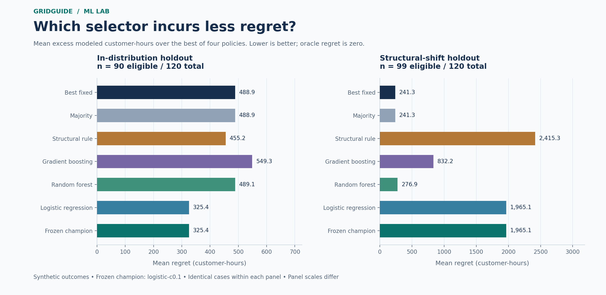
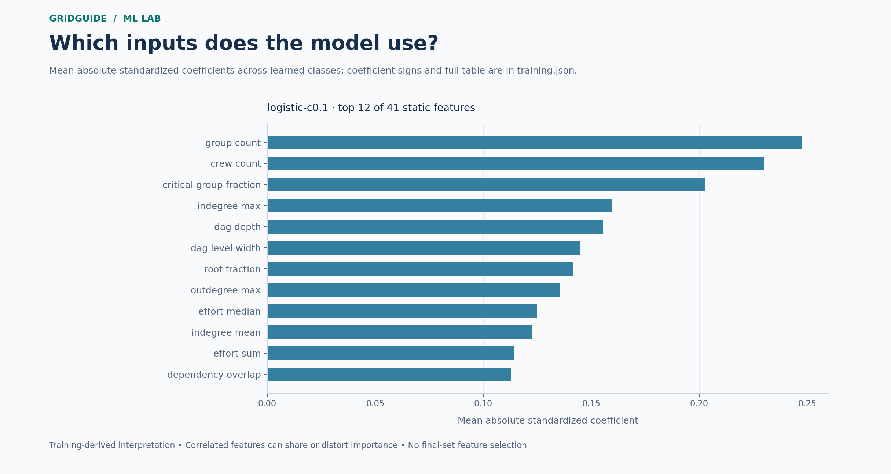
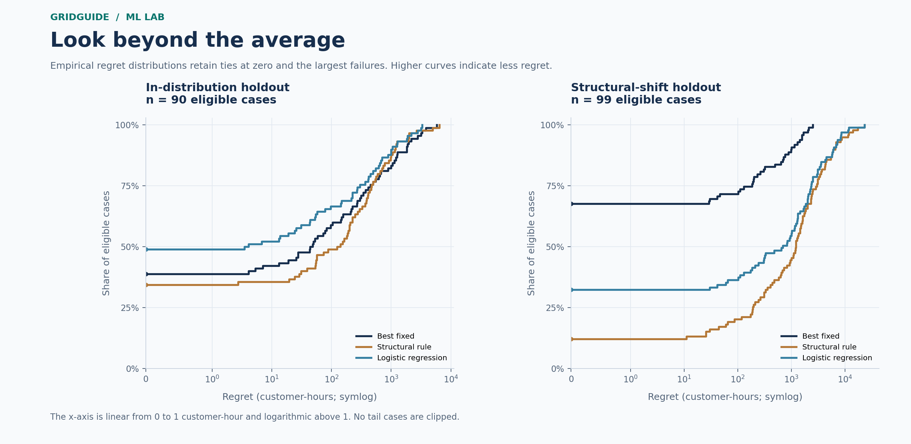
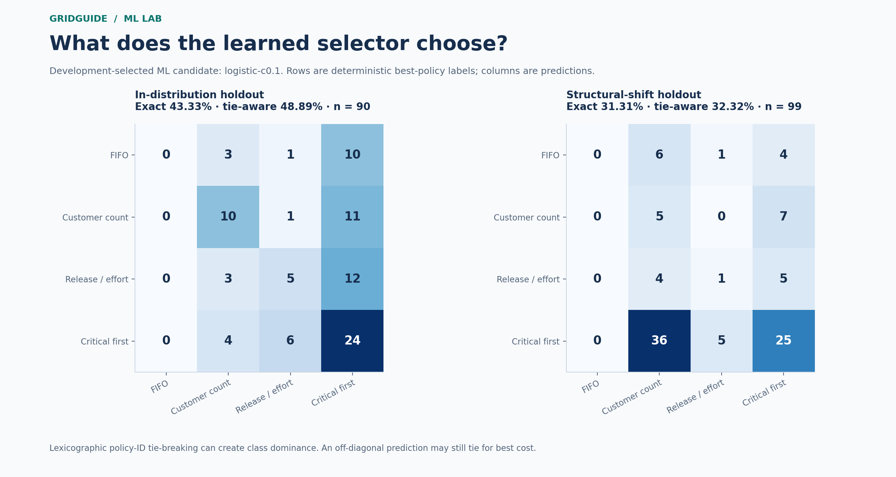

# GridGuide ML Lab

### Can structural features tell us which scheduling policy to use?

**720 fictional problems · 41 static features · 3 model families · one sealed evaluation**

[Research report](presentation/REPORT.md) · [Dataset](DATASET.md) · [Features](FEATURES.md) · [Reproduce](REPRODUCE.md) · [Protocol](../planning/V1_2_0_IMPLEMENTATION.md)

**The learned selector found a useful in-distribution pattern, but failed the promotion
gate and generalized poorly.** Logistic regression reduced average selection regret by
33.44% on the in-distribution holdout. The uncertainty interval did not establish a
positive gain, critical-service latency worsened, and performance collapsed under the
combined structural/scale shift. Keep the training-selected fixed comparator as the
research recommendation; do not promote the learned selector.

This is a complete supervised ML experiment with an inspectable negative result.
It selects among four existing policies using information available **before** any
policy runs. It predicts neither real outages nor calibrated restoration times, and
does not learn an operational utility dispatcher.

## The experiment

Each example is a whole fictional scheduling problem: repair tasks with person-hour
requirements, prerequisite edges, disjoint customer groups with possibly overlapping
repair dependencies, crew availability, and declared critical-service flags. Four
unchanged policies produce schedules. A separate validator checks every schedule and
metric; exact integer customer-seconds determine the best-policy labels and ties.

The new generator varies graph mechanisms, effort distributions, customer sizes,
dependency overlap, report order and missing scope. It shares scheduling contracts
with GridGuide's earlier research, **not its published evaluation data**. All related
1/2/4-crew variants remain in one configuration group. ID-invariant topology signatures
exclude duplicate graphs across groups. Similarity between independently generated
graphs remains possible; this is not proof of universal structural independence.

| Partition | Cases | Configuration groups | Eligible cases | Purpose |
|---|---:|---:|---:|---|
| Training | 360 | 120 | 297 | Fit transforms, models, fixed/majority baselines; grouped CV |
| Development | 120 | 40 | 99 | Select hyperparameters and model family |
| Final in-distribution | 120 | 40 | 90 | One-time comparison on new configurations |
| Final structural/scale shift | 120 | 40 | 99 | New mechanisms and larger graphs, reported separately |

Four ID mechanisms use 10–36 tasks. Two shifted mechanisms use 40–64 tasks; mechanism
and scale change together, so this experiment cannot isolate which change causes the
failure. Incomplete cases remain in all coverage tables and receive no finite learning
target or recommendation. Known completion beyond the 168-hour reporting horizon is
finite and eligible; unresolved completion is not.

## From inputs to a learned recommendation

The 41 features summarize effort, graph depth/branching/bottlenecks, dependency overlap,
customer groups, crew availability and report-order relationships. IDs, seeds, family
names, partition labels, schedules and policy outcomes never enter the feature matrix.
Train-only pipelines fit imputation/scaling, then logistic regression, random forest
or gradient boosting. A fixed eight-configuration search uses three-fold grouped
cross-validation for diagnostics and development mean regret for final selection.

Training included all four target classes: 87 customer-count, 23 FIFO, 133
critical-proxy-first and 54 release/person-hour labels. Lexicographic tie-breaking
can inflate a class; tie-aware accuracy and full tie sets remain available. Every
candidate was refitted twice, yielding identical serialized artifacts in the pinned
environment. The selected experimental champion was **logistic regression, C=0.1**;
no development examples were added to its training set.

*Coefficient magnitudes describe this fitted classifier, not causal repair priorities
or calibrated confidence. The feature dictionary records units and derivations.*

## What the untouched holdout showed

Regret is the selected policy's completed modeled customer-hours minus the best of
four policies on the **same case**. Lower is better. The hindsight oracle is available
only after all policies run; it is not a deployable baseline or a global optimum.

| Frozen selector | ID: mean regret, customer-hours (n=90) | Shift: mean regret, customer-hours (n=99) |
|---|---:|---:|
| Training-selected fixed policy | 488.914 | 241.276 |
| Structural heuristic | 455.216 | 2,415.316 |
| Selected logistic regression | **325.400** | **1,965.070** |
| Best-of-four hindsight reference | 0 | 0 |

The new fixed and majority selectors both choose `legacy-critical-proxy-first-adapter-v1`.
This is a comparator selected from **new training data**; GridGuide v1.1.0's historical
release/person-hour default and its findings are unchanged.

For ID, the mean paired improvement was 163.514 customer-hours, with a configuration
bootstrap 95% interval **[−14.561, 458.551]** across 30 eligible groups. Wins/ties/losses
were **18/62/10**. Maximum critical-group latency increased by **3.581 hours on average**
across 78 supported cases, exceeding the preregistered 0.25-hour tolerance. These are
fictional group outcomes, not evidence about real critical facilities.

For shift, mean regret was **714.45% higher** than fixed, with **10/41/48** wins/ties/losses.
The paired improvement interval was **[−2,763.714, −870.315] customer-hours** across 33
eligible groups. Critical latency increased 34.983 hours on average across 84 supported
cases; branch disparity increased 1.392 hours across 99 cases. Both promotion gates
failed. We did not change the dataset, model, feature set or threshold after reveal.

The shifted target distribution is dominated by the critical-first policy (66/99
labels), while the learned model selects customer-count on 51/99 cases. Its shifted
tie-aware accuracy is 32.32%; it never selects FIFO there. Large errors and critical
service tradeoffs remain in the [complete report](presentation/REPORT.md) and
[per-case evidence](evidence/final/cases.jsonl.gz), including every other trained candidate.

## Why this result is useful

The project demonstrates dataset engineering, strict lineage contracts, supervised
training, train-only preprocessing, grouped validation, statistical comparison,
model persistence, leakage defenses and reproducible reporting. It also demonstrates
why a development win is insufficient for promotion. The simulator favors particular
structural conventions; a classifier can learn those conventions without learning a
robust policy-selection rule for unfamiliar problems.

The final input manifest was committed before training; the chosen model, environment,
features, acceptance criteria and evaluator were committed before labels were generated.
An exclusive receipt prevents rerunning the final evaluation as a fresh selection
opportunity. Subsequent replay verifies the spent evidence without fitting anything.
This is developer-controlled procedural isolation, **not an externally independent
blind test**. Repository authors can bypass their own safeguards, and hashes establish
consistency rather than identity.

## Inspect and reproduce

- [Exact reproduction commands and artifact inventory](REPRODUCE.md)
- [Full report: all candidates, paired metrics, subgroups and worst errors](presentation/REPORT.md)
- [Dataset manifest](evidence/dataset/manifest.json) · [Training results](evidence/training/training.json)
- [Committed model/evaluator freeze](evidence/selection-freeze.json) · [Final invocation](evidence/dataset/evaluation-receipt.json)
- [Final machine-readable results](evidence/final/results.json) · [Completion hashes](evidence/final/completion.json)
- [Phase ledger](evidence/phase-ledger.json) · [Independent code review](REVIEW.md)
- [Dependency and source licensing](DEPENDENCIES.md)

No AEP challenge files, utility observations, online inference, GPU, paid service or
hosted application is needed. This static research showcase intentionally avoids adding
maintenance or packaging risk to the existing dashboard. Original code and authored
synthetic data follow the repository MIT grant; third-party dependencies retain their
own licenses. No AEP redistribution permission is inferred.
