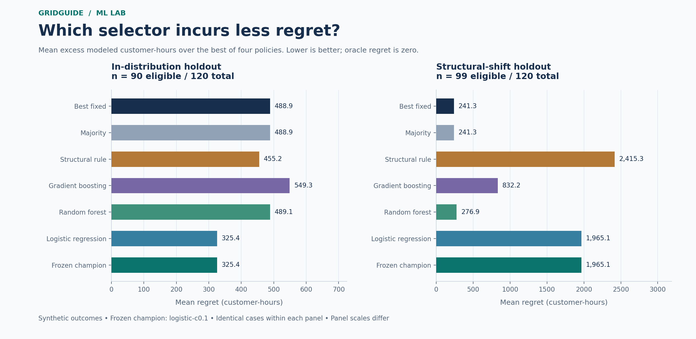
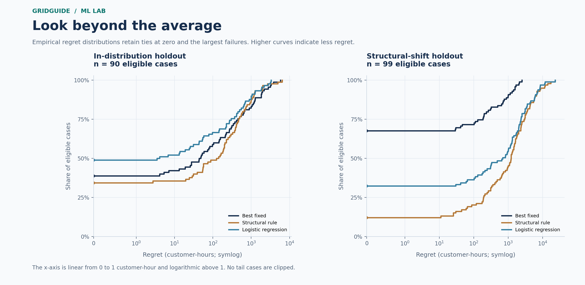
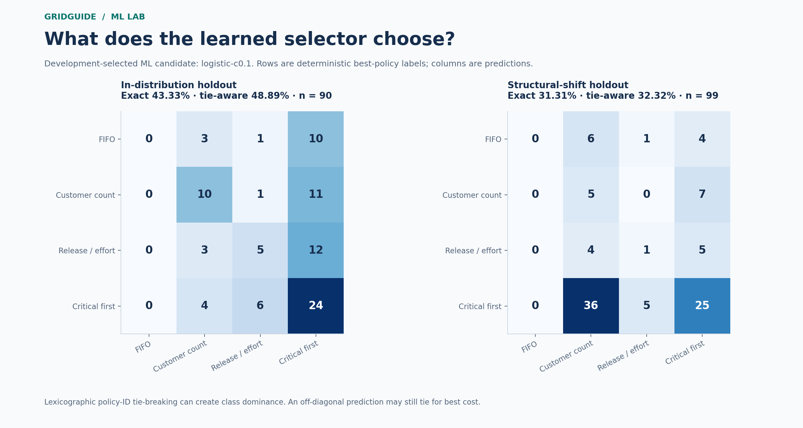
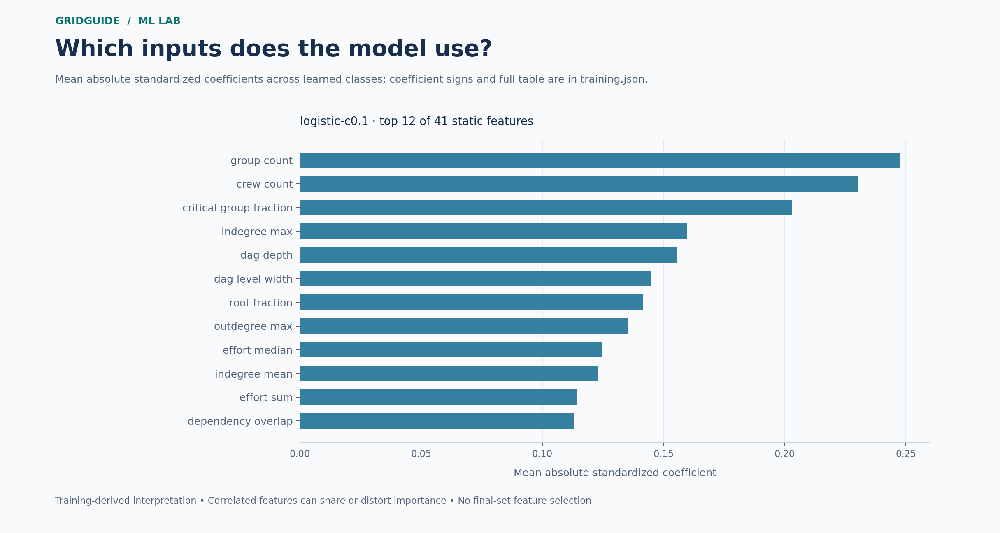

# ML-assisted restoration policy selection

**Fictional scheduling research. No real outage prediction, calibrated restoration time, or utility dispatch claim.**

A supervised classifier chooses among four unchanged scheduling policies using pre-decision structural features. The target is the independently validated lowest modeled completed customer-hours. The best-of-four hindsight reference is unavailable at prediction time and is not a deployable selector.

Development selected **`logistic-c0.1`** as the strongest learned candidate and **`logistic-c0.1`** as the frozen experimental champion. The training-only fixed policy is **`legacy-critical-proxy-first-adapter-v1`**. These choices were frozen before this evaluation.

## Measured findings

- **In-distribution holdout:** 90/120 eligible cases; learned mean regret 325.400 customer-hours, fixed 488.914; mean regret is 33.44% lower versus fixed. Preregistered gate: **FAIL**. Paired mean improvement interval [-14.561, 458.551] customer-hours across 30 configuration groups. Mean critical-latency increase: 3.581 hours on 78 paired supported cases.

- **Structural-shift holdout:** 99/120 eligible cases; learned mean regret 1,965.070 customer-hours, fixed 241.276; mean regret is 714.45% higher versus fixed. Preregistered gate: **FAIL**. Paired mean improvement interval [-2,763.714, -870.315] customer-hours across 33 configuration groups. Mean critical-latency increase: 34.983 hours on 84 paired supported cases.

**No learned-selector promotion is supported.** Retain the fixed-policy baseline as the prudent recommendation. The frozen champion remains the experimental identity; failed final gates do not trigger retuning, a replacement champion, or a positive performance claim.

Success requires at least 5% lower mean absolute regret, positive measurable baseline regret, a positive lower endpoint of the grouped 95% paired-improvement interval, and mean critical-latency and branch-disparity increases no greater than 0.25 hour each. Missing support is untestable. A failed gate remains a negative finding; engineering completion does not establish scientific success. No final result changes the selected champion.

## Task, data and model development

Each row represents one independently authored fictional scheduling problem. Four in-distribution graph mechanisms vary topology, effort, customer dependency overlap, group size, report order, crews and availability. Shifted mechanisms also increase task scale; the shift therefore combines topology and scale and does not isolate either effect. Related crew variants share a configuration group and stay in one partition. Historical G2 evidence is background, never this final test. No AEP challenge data supplies features or labels.

The 41 static features summarize task effort, DAG structure, customer groups, dependencies, crew availability and missingness. IDs, family labels, seeds, partitions, schedules and policy outcomes are excluded. Complete task scope and known customer releases are required; incomplete cases abstain. Known release after 168 hours remains eligible for full-completion scoring, separately reported as known-later censoring.

Eight predefined candidates cover multinomial logistic regression, random forest and gradient boosting. Preprocessing fits within training-only pipelines, with three-fold grouped cross-validation. Every final candidate fits training only; development mean absolute regret selects hyperparameters and the champion without refitting on development. Same-environment repeated fits check deterministic predictions and serialized artifacts.

| Development partition | Total cases | Eligible cases | Withheld cases |
| --- | --- | --- | --- |
| dev | 120 | 99 | 21 |
| train | 360 | 297 | 63 |

| Figure policy label | Exact unchanged policy ID |
| --- | --- |
| FIFO | fifo-v1 |
| Customer count | customer-count-v1 |
| Release / effort | legacy-release-per-person-hour-adapter-v1 |
| Critical first | legacy-critical-proxy-first-adapter-v1 |

| Development candidate | Mean regret (customer-h) | Grouped CV mean regret (customer-h) | Artifact bytes |
| --- | --- | --- | --- |
| boosting-rate0.03 | 412.295 | 383.029 | 67,341 |
| boosting-rate0.1 | 412.877 | 410.484 | 70,884 |
| forest-depth4 | 416.592 | 359.818 | 108,817 |
| forest-depth8 | 425.058 | 331.851 | 269,969 |
| forest-depthall | 439.613 | 348.308 | 312,045 |
| logistic-c0.1 | 373.710 | 381.580 | 3,456 |
| logistic-c1 | 409.339 | 457.402 | 3,461 |
| logistic-c10 | 521.471 | 456.833 | 3,460 |

Training deterministic-label class counts: Customer count 87, FIFO 23, Critical first 133, Release / effort 54.

## Final metrics and coverage

### In-distribution holdout

120 cases; 90 eligible; 30 abstentions. Ineligible reasons: `{'incomplete_task_scope,unresolved_customer_release': 27, 'unresolved_customer_release': 3}`.

| Selector | n | Mean / median / p95 regret (customer-h) | Mean / median / p95 relative regret | Exact / tie-aware accuracy | Coverage | Gate |
| --- | --- | --- | --- | --- | --- | --- |
| boosting-rate0.03 | 90 | 549.282 / 75.618 / 2,498.276 | 7.06% / 2.18% / 24.53% | 35.56% / 36.67% | 75.00% | FAIL |
| boosting-rate0.1 | 90 | 540.869 / 57.057 / 2,498.276 | 6.82% / 1.88% / 24.31% | 35.56% / 36.67% | 75.00% | FAIL |
| champion | 90 | 325.400 / 3.786 / 1,855.284 | 5.08% / 0.18% / 23.30% | 43.33% / 48.89% | 75.00% | FAIL |
| fixed | 90 | 488.914 / 46.056 / 2,498.276 | 5.65% / 1.75% / 20.97% | 37.78% / 38.89% | 75.00% | FAIL |
| forest-depth4 | 90 | 489.117 / 49.063 / 2,498.276 | 5.66% / 1.75% / 20.97% | 37.78% / 38.89% | 75.00% | FAIL |
| forest-depth8 | 90 | 443.761 / 53.074 / 2,077.511 | 5.94% / 1.75% / 24.25% | 36.67% / 37.78% | 75.00% | FAIL |
| forest-depthall | 90 | 452.120 / 57.057 / 2,077.511 | 6.33% / 1.88% / 24.25% | 35.56% / 36.67% | 75.00% | FAIL |
| heuristic | 90 | 455.216 / 132.824 / 1,964.162 | 8.02% / 2.19% / 28.45% | 31.11% / 34.44% | 75.00% | FAIL |
| hindsight | 90 | 0.000 / 0.000 / 0.000 | 0.00% / 0.00% / 0.00% | 100.00% / 100.00% | 75.00% | FAIL |
| logistic-c0.1 | 90 | 325.400 / 3.786 / 1,855.284 | 5.08% / 0.18% / 23.30% | 43.33% / 48.89% | 75.00% | FAIL |
| logistic-c1 | 90 | 377.612 / 5.445 / 1,855.284 | 5.56% / 0.18% / 23.30% | 41.11% / 48.89% | 75.00% | FAIL |
| logistic-c10 | 90 | 309.445 / 3.720 / 1,403.156 | 4.98% / 0.13% / 23.30% | 41.11% / 47.78% | 75.00% | FAIL |
| majority | 90 | 488.914 / 46.056 / 2,498.276 | 5.65% / 1.75% / 20.97% | 37.78% / 38.89% | 75.00% | FAIL |

Every selector uses the same eligible cases. Hindsight is an unattainable reference. Relative-regret denominator is max(oracle cost, 1/3600 customer-hour).

| Selector | Completed mean (customer-h) | Restricted 168h mean on predicted cases (customer-h) | Wins / ties / losses vs fixed | Paired improvement 95% interval (customer-h) |
| --- | --- | --- | --- | --- |
| boosting-rate0.03 | 8,677.366 | 8,603.487 | 8 / 69 / 13 | [-136.041, -0.820] |
| boosting-rate0.1 | 8,668.953 | 8,595.074 | 12 / 61 / 17 | [-139.168, 17.818] |
| champion | 8,453.484 | 8,379.605 | 18 / 62 / 10 | [-14.561, 458.551] |
| fixed | 8,616.998 | 8,543.120 | 0 / 90 / 0 | [0.000, 0.000] |
| forest-depth4 | 8,617.201 | 8,543.323 | 3 / 83 / 4 | [-2.183, 2.042] |
| forest-depth8 | 8,571.845 | 8,497.966 | 9 / 72 / 9 | [-47.102, 193.093] |
| forest-depthall | 8,580.204 | 8,506.325 | 8 / 71 / 11 | [-64.329, 190.587] |
| heuristic | 8,583.300 | 8,529.289 | 44 / 3 / 43 | [-301.596, 449.841] |
| hindsight | 8,128.084 | 8,054.205 | 55 / 35 / 0 | [238.158, 802.997] |
| logistic-c0.1 | 8,453.484 | 8,379.605 | 18 / 62 / 10 | [-14.561, 458.551] |
| logistic-c1 | 8,505.696 | 8,430.229 | 23 / 48 / 19 | [-92.959, 409.690] |
| logistic-c10 | 8,437.529 | 8,362.061 | 28 / 42 / 20 | [-41.724, 484.682] |
| majority | 8,616.998 | 8,543.120 | 0 / 90 / 0 | [0.000, 0.000] |

All-case policy support (restricted values include unresolved waiting through 168h, not fabricated finite restoration times; customer-case mass can repeat customers across fictional variants):

| Policy | Unresolved cases / customer-case mass | Known-later cases / customer-case mass | All-case restricted mean (customer-h) |
| --- | --- | --- | --- |
| Customer count | 30 / 3186 | 3 / 325 | 12,395.616 |
| FIFO | 30 / 3186 | 4 / 342 | 12,805.600 |
| Critical first | 30 / 3186 | 3 / 217 | 12,247.582 |
| Release / effort | 30 / 3186 | 3 / 254 | 12,156.375 |

Paired secondary outcomes: positive differences mean worse than fixed. Critical latency is the maximum wait among explicitly fictional critical groups per case, not a real facility metric.

| Selector | Critical: n / mean Δh / regressions | Branch disparity: n / mean Δh / regressions | Small-group wait: n / mean Δh / regressions |
| --- | --- | --- | --- |
| boosting-rate0.03 | 78 / 1.352 / 9 | 90 / -0.714 / 2 | 69 / 0.777 / 12 |
| boosting-rate0.1 | 78 / 2.175 / 17 | 90 / -0.752 / 4 | 69 / 1.087 / 19 |
| champion | 78 / 3.581 / 17 | 90 / 0.010 / 10 | 69 / 0.263 / 13 |
| fixed | 78 / 0.000 / 0 | 90 / 0.000 / 0 | 69 / 0.000 / 0 |
| forest-depth4 | 78 / 0.052 / 4 | 90 / -0.026 / 2 | 69 / 0.017 / 4 |
| forest-depth8 | 78 / 1.663 / 10 | 90 / -0.178 / 3 | 69 / 0.742 / 12 |
| forest-depthall | 78 / 2.005 / 9 | 90 / -0.234 / 4 | 69 / 1.034 / 13 |
| heuristic | 78 / 12.657 / 64 | 90 / -1.517 / 28 | 69 / 3.420 / 45 |
| hindsight | 78 / 6.816 / 37 | 90 / -0.936 / 16 | 69 / 0.164 / 23 |
| logistic-c0.1 | 78 / 3.581 / 17 | 90 / 0.010 / 10 | 69 / 0.263 / 13 |
| logistic-c1 | 78 / 5.463 / 32 | 90 / -0.228 / 18 | 69 / 0.937 / 22 |
| logistic-c10 | 78 / 7.441 / 38 | 90 / -0.223 / 21 | 69 / 1.841 / 27 |
| majority | 78 / 0.000 / 0 | 90 / 0.000 / 0 | 69 / 0.000 / 0 |

**By generation mechanism** — best learned versus fixed:

| Group | n | Learned / fixed mean regret (customer-h) | Mean paired gain (customer-h) | Grouped 95% interval | Gate |
| --- | --- | --- | --- | --- | --- |
| bottleneck | 24 | 252.813 / 322.963 | 70.149 | [3.454, 170.065] | PASS |
| layered | 24 | 196.969 / 306.017 | 109.048 | [-138.257, 476.721] | FAIL |
| modular | 27 | 552.414 / 948.792 | 396.378 | [-7.550, 1,196.981] | FAIL |
| random_ordered | 15 | 238.404 / 219.294 | -19.111 | [-70.980, 10.339] | FAIL |

**By task-count scale** — best learned versus fixed:

| Group | n | Learned / fixed mean regret (customer-h) | Mean paired gain (customer-h) | Grouped 95% interval | Gate |
| --- | --- | --- | --- | --- | --- |
| 10–20 | 54 | 134.533 / 211.992 | 77.459 | [-8.864, 229.228] | FAIL |
| 21–36 | 36 | 611.700 / 904.298 | 292.598 | [-73.959, 922.095] | FAIL |

Policy ties: 20/90 eligible cases. Label counts: `{'customer-count-v1': 22, 'fifo-v1': 14, 'legacy-critical-proxy-first-adapter-v1': 34, 'legacy-release-per-person-hour-adapter-v1': 20}`. Learned prediction counts: `{'customer-count-v1': 20, 'legacy-critical-proxy-first-adapter-v1': 57, 'legacy-release-per-person-hour-adapter-v1': 13}`.

### Structural-shift holdout

120 cases; 99 eligible; 21 abstentions. Ineligible reasons: `{'incomplete_task_scope,unresolved_customer_release': 12, 'unresolved_customer_release': 9}`.

| Selector | n | Mean / median / p95 regret (customer-h) | Mean / median / p95 relative regret | Exact / tie-aware accuracy | Coverage | Gate |
| --- | --- | --- | --- | --- | --- | --- |
| boosting-rate0.03 | 99 | 832.228 / 172.229 / 3,077.457 | 14.74% / 1.12% / 59.28% | 42.42% / 42.42% | 82.50% | FAIL |
| boosting-rate0.1 | 99 | 1,155.471 / 209.903 / 5,799.402 | 18.95% / 2.60% / 80.73% | 40.40% / 40.40% | 82.50% | FAIL |
| champion | 99 | 1,965.070 / 689.178 / 8,228.694 | 22.54% / 5.09% / 101.31% | 31.31% / 32.32% | 82.50% | FAIL |
| fixed | 99 | 241.276 / 0.000 / 1,572.835 | 2.37% / 0.00% / 9.66% | 66.67% / 67.68% | 82.50% | FAIL |
| forest-depth4 | 99 | 276.918 / 0.000 / 1,636.415 | 3.96% / 0.00% / 10.16% | 66.67% / 67.68% | 82.50% | FAIL |
| forest-depth8 | 99 | 320.453 / 0.000 / 1,710.325 | 4.69% / 0.00% / 22.38% | 61.62% / 62.63% | 82.50% | FAIL |
| forest-depthall | 99 | 326.170 / 0.000 / 1,710.325 | 4.93% / 0.00% / 25.16% | 60.61% / 61.62% | 82.50% | FAIL |
| heuristic | 99 | 2,415.316 / 1,210.537 / 8,974.104 | 22.81% / 9.07% / 92.42% | 11.11% / 12.12% | 82.50% | FAIL |
| hindsight | 99 | 0.000 / 0.000 / 0.000 | 0.00% / 0.00% / 0.00% | 100.00% / 100.00% | 82.50% | FAIL |
| logistic-c0.1 | 99 | 1,965.070 / 689.178 / 8,228.694 | 22.54% / 5.09% / 101.31% | 31.31% / 32.32% | 82.50% | FAIL |
| logistic-c1 | 99 | 2,166.333 / 961.176 / 8,604.125 | 24.04% / 8.17% / 98.02% | 23.23% / 24.24% | 82.50% | FAIL |
| logistic-c10 | 99 | 2,782.912 / 1,516.966 / 10,561.975 | 28.24% / 13.99% / 84.48% | 16.16% / 16.16% | 82.50% | FAIL |
| majority | 99 | 241.276 / 0.000 / 1,572.835 | 2.37% / 0.00% / 9.66% | 66.67% / 67.68% | 82.50% | FAIL |

Every selector uses the same eligible cases. Hindsight is an unattainable reference. Relative-regret denominator is max(oracle cost, 1/3600 customer-hour).

| Selector | Completed mean (customer-h) | Restricted 168h mean on predicted cases (customer-h) | Wins / ties / losses vs fixed | Paired improvement 95% interval (customer-h) |
| --- | --- | --- | --- | --- |
| boosting-rate0.03 | 17,288.674 | 16,508.689 | 6 / 59 / 34 | [-999.381, -277.835] |
| boosting-rate0.1 | 17,611.917 | 16,806.187 | 7 / 50 / 42 | [-1,412.590, -519.174] |
| champion | 18,421.516 | 17,263.163 | 10 / 41 / 48 | [-2,763.714, -870.315] |
| fixed | 16,697.722 | 15,929.010 | 0 / 99 / 0 | [0.000, 0.000] |
| forest-depth4 | 16,733.364 | 15,964.652 | 1 / 95 / 3 | [-91.432, 0.000] |
| forest-depth8 | 16,776.899 | 16,007.839 | 2 / 89 / 8 | [-169.272, -10.655] |
| forest-depthall | 16,782.616 | 16,013.727 | 3 / 86 / 10 | [-175.395, -17.452] |
| heuristic | 18,871.762 | 17,368.806 | 16 / 4 / 79 | [-3,312.753, -1,237.686] |
| hindsight | 16,456.446 | 15,657.867 | 32 / 67 / 0 | [111.611, 384.153] |
| logistic-c0.1 | 18,421.516 | 17,263.163 | 10 / 41 / 48 | [-2,763.714, -870.315] |
| logistic-c1 | 18,622.779 | 17,374.614 | 17 / 20 / 62 | [-2,962.732, -1,043.918] |
| logistic-c10 | 19,239.358 | 17,891.579 | 17 / 5 / 77 | [-3,601.231, -1,658.008] |
| majority | 16,697.722 | 15,929.010 | 0 / 99 / 0 | [0.000, 0.000] |

All-case policy support (restricted values include unresolved waiting through 168h, not fabricated finite restoration times; customer-case mass can repeat customers across fictional variants):

| Policy | Unresolved cases / customer-case mass | Known-later cases / customer-case mass | All-case restricted mean (customer-h) |
| --- | --- | --- | --- |
| Customer count | 21 / 1533 | 32 / 3058 | 20,491.683 |
| FIFO | 21 / 1533 | 32 / 3131 | 20,988.640 |
| Critical first | 21 / 1533 | 26 / 1942 | 18,206.827 |
| Release / effort | 21 / 1533 | 31 / 2444 | 18,710.760 |

Paired secondary outcomes: positive differences mean worse than fixed. Critical latency is the maximum wait among explicitly fictional critical groups per case, not a real facility metric.

| Selector | Critical: n / mean Δh / regressions | Branch disparity: n / mean Δh / regressions | Small-group wait: n / mean Δh / regressions |
| --- | --- | --- | --- |
| boosting-rate0.03 | 84 / 12.891 / 31 | 99 / -1.365 / 18 | 78 / 3.619 / 24 |
| boosting-rate0.1 | 84 / 19.069 / 38 | 99 / -0.036 / 25 | 78 / 3.023 / 26 |
| champion | 84 / 34.983 / 46 | 99 / 1.392 / 31 | 78 / 15.124 / 33 |
| fixed | 84 / 0.000 / 0 | 99 / 0.000 / 0 | 78 / 0.000 / 0 |
| forest-depth4 | 84 / 0.460 / 3 | 99 / -0.154 / 0 | 78 / 0.128 / 3 |
| forest-depth8 | 84 / 2.378 / 8 | 99 / -1.003 / 2 | 78 / 0.697 / 8 |
| forest-depthall | 84 / 2.951 / 9 | 99 / -0.946 / 3 | 78 / 0.847 / 9 |
| heuristic | 84 / 50.639 / 74 | 99 / 0.634 / 54 | 78 / 14.360 / 49 |
| hindsight | 84 / 7.116 / 17 | 99 / -0.875 / 10 | 78 / 1.101 / 12 |
| logistic-c0.1 | 84 / 34.983 / 46 | 99 / 1.392 / 31 | 78 / 15.124 / 33 |
| logistic-c1 | 84 / 46.981 / 62 | 99 / 1.090 / 41 | 78 / 18.151 / 51 |
| logistic-c10 | 84 / 46.424 / 73 | 99 / 0.925 / 53 | 78 / 13.869 / 59 |
| majority | 84 / 0.000 / 0 | 99 / 0.000 / 0 | 78 / 0.000 / 0 |

**By generation mechanism** — best learned versus fixed:

| Group | n | Learned / fixed mean regret (customer-h) | Mean paired gain (customer-h) | Grouped 95% interval | Gate |
| --- | --- | --- | --- | --- | --- |
| deep_sparse | 51 | 549.858 / 296.107 | -253.751 | [-727.647, 42.273] | FAIL |
| preferential | 48 | 3,468.733 / 183.019 | -3,285.715 | [-5,064.074, -1,840.904] | FAIL |

**By task-count scale** — best learned versus fixed:

| Group | n | Learned / fixed mean regret (customer-h) | Mean paired gain (customer-h) | Grouped 95% interval | Gate |
| --- | --- | --- | --- | --- | --- |
| 40–64 | 99 | 1,965.070 / 241.276 | -1,723.794 | [-2,763.714, -870.315] | FAIL |

Policy ties: 11/99 eligible cases. Label counts: `{'customer-count-v1': 12, 'fifo-v1': 11, 'legacy-critical-proxy-first-adapter-v1': 66, 'legacy-release-per-person-hour-adapter-v1': 10}`. Learned prediction counts: `{'customer-count-v1': 51, 'legacy-critical-proxy-first-adapter-v1': 41, 'legacy-release-per-person-hour-adapter-v1': 7}`.

## Failure analysis and interpretation

The confusion matrix uses deterministic tie-broken labels. High exact accuracy can reflect a dominant class; tie-aware accuracy recognizes equal-cost choices. The primary objective remains cost regret. A good mean can conceal rare severe failures, so the table below retains the largest learned regrets.

**In-distribution holdout — largest learned errors**

| Case | Family / tasks | Learned choice | Best tie-broken policy | Learned / fixed regret (customer-h) |
| --- | --- | --- | --- | --- |
| syn-ml-final-id-modular-009-c1 | modular / 34 | Critical first | Release / effort | 3,318.287 / 3,318.287 |
| syn-ml-final-id-modular-009-c4 | modular / 34 | Critical first | Customer count | 3,165.987 / 3,165.987 |
| syn-ml-final-id-bottleneck-004-c1 | bottleneck / 27 | Critical first | FIFO | 2,759.205 / 2,759.205 |
| syn-ml-final-id-modular-009-c2 | modular / 34 | Critical first | Customer count | 2,179.362 / 2,179.362 |
| syn-ml-final-id-modular-004-c2 | modular / 30 | Critical first | Customer count | 1,876.464 / 1,876.464 |
| syn-ml-final-id-random-ordered-001-c2 | random_ordered / 27 | Critical first | Customer count | 1,829.397 / 1,829.397 |
| syn-ml-final-id-bottleneck-003-c2 | bottleneck / 19 | Critical first | Customer count | 1,270.933 / 1,270.933 |
| syn-ml-final-id-modular-006-c1 | modular / 23 | Critical first | FIFO | 1,255.203 / 1,255.203 |

Learned/fixed policy disagreements: 33/90 eligible cases.

**Structural-shift holdout — largest learned errors**

| Case | Family / tasks | Learned choice | Best tie-broken policy | Learned / fixed regret (customer-h) |
| --- | --- | --- | --- | --- |
| syn-ml-final-shift-preferential-003-c1 | preferential / 59 | Customer count | Critical first | 23,086.396 / 0.000 |
| syn-ml-final-shift-preferential-003-c2 | preferential / 59 | Customer count | Critical first | 11,807.743 / 0.000 |
| syn-ml-final-shift-preferential-014-c1 | preferential / 45 | Customer count | Critical first | 11,322.362 / 0.000 |
| syn-ml-final-shift-preferential-000-c1 | preferential / 52 | Release / effort | Critical first | 8,592.007 / 0.000 |
| syn-ml-final-shift-preferential-019-c1 | preferential / 54 | Customer count | Critical first | 8,366.088 / 0.000 |
| syn-ml-final-shift-preferential-016-c1 | preferential / 44 | Release / effort | Critical first | 8,213.428 / 0.000 |
| syn-ml-final-shift-preferential-016-c2 | preferential / 44 | Customer count | Critical first | 7,263.311 / 0.000 |
| syn-ml-final-shift-preferential-006-c1 | preferential / 57 | Customer count | Critical first | 7,154.045 / 0.000 |

Learned/fixed policy disagreements: 58/99 eligible cases.

Importance is descriptive of the fitted synthetic classifier. Correlated features, class imbalance and simulator conventions can drive it; it does not explain utility causality or validate dispatch decisions.

## Resources and reproduction

Training process: 6.286 seconds; peak RSS 203,096,064 bytes. Final evaluation: 4.454 seconds; peak RSS 158,466,048 bytes. These are measured process values, not portable SLAs.

| Candidate | Training + CV + replay seconds | Dev batch inference seconds / case | Final inference seconds / case |
| --- | --- | --- | --- |
| boosting-rate0.03 | 1.160813 | 0.00000524 | 0.00081262 |
| boosting-rate0.1 | 1.029017 | 0.00000523 | 0.00075068 |
| forest-depth4 | 0.419457 | 0.00001910 | 0.00181133 |
| forest-depth8 | 0.477450 | 0.00002235 | 0.00183268 |
| forest-depthall | 0.492550 | 0.00002243 | 0.00183818 |
| logistic-c0.1 | 0.029037 | 0.00000251 | 0.00063448 |
| logistic-c1 | 0.032132 | 0.00000249 | 0.00060395 |
| logistic-c10 | 0.051278 | 0.00000260 | 0.00058977 |

Training environment: `{'cpu_count': 12, 'machine': 'arm64', 'packages': {'joblib': '1.6.0', 'matplotlib': '3.10.7', 'numpy': '2.3.5', 'pydantic': '2.12.3', 'scikit-learn': '1.7.2', 'scipy': '1.15.3', 'threadpoolctl': '3.7.0'}, 'processor': 'arm', 'python': '3.12.14', 'system': 'Darwin', 'thread_limit': 1}`. Final inference denominator includes all cases (including cheap abstentions); development timing is batch prediction on eligible feature rows.

Dataset hash: `98ce22461f6b642a66e65076d08687c69b2ee0c06d32c966e6ad173fe80e028b`. Training source revision: `fa3c9ccab28612fabd99cfc1430a1388d374dd4b`. The training manifest preserves per-file source hashes, feature schema, parameters and individual model hashes; the final completion manifest binds the evaluation receipt.

[Training evidence](../evidence/training/training.json) · [Complete final comparisons](../evidence/final/results.json) · [Per-case outcomes and errors](../evidence/final/cases.jsonl.gz) · [Presentation hash manifest](manifest.json).

Regenerate with `python -m research.ml_lab report --training TRAINING --final FINAL --output NEW_DIRECTORY`. The renderer only reads evidence; it never retrains or reopens model selection. It refuses existing output. The final directory must have a sibling `selection-freeze.json`; completion status, final artifact hashes, numerical digests and frozen training/model hashes must validate before rendering. Figures have deterministic metadata and are reproducible byte-for-byte in the same pinned environment. Cross-platform font/raster byte equivalence is not assumed.

## Limits and preserved negative findings

- The final set is procedurally sealed by the same development team, not an externally independent blind test. Hashes establish consistency, not independence or authenticity.

- The four-policy oracle is not the global scheduling optimum. The model cannot improve the policies themselves.

- Generator groups support conditional bootstrap uncertainty; authored mechanisms and correlated variants do not represent independent utility events. Candidate and subgroup intervals are descriptive, without multiplicity correction.

- Incomplete scope is withheld from supervised labels and predictions. Coverage is explicit; restricted-horizon descriptive outcomes do not fill missing full-completion labels.

- Structural summaries discard detailed graph information. Topology and scale shift jointly; findings cannot establish real-world generalization or identify which shift factor caused a regression.

- No interactive UI, production integration, deployment, v1.2.0 release or real-data predictor is introduced. Original G2/G3/G4/G5 conclusions, default policies and historical artifacts remain unchanged.

- Contributor-authored synthetic code/data are covered by the repository MIT scope; no AEP data permission is inferred. Dependency licenses remain separately documented.
