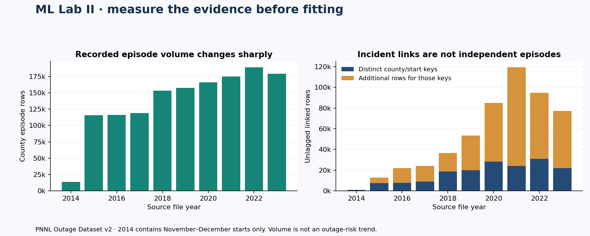
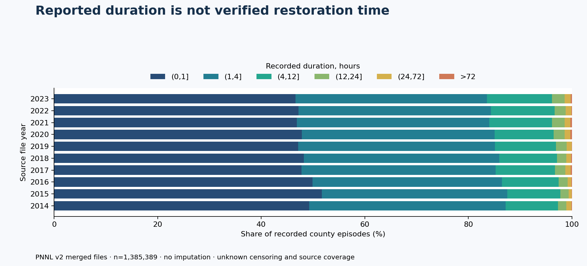

# GridGuide · ML Lab II

### Before predicting restoration, verify what “duration” measures.

**Observed U.S. outage data · 50 audited CSVs · three source investigations · NO-GO before training**

[Source audit](SOURCE_AUDIT.md) · [Feasibility decision](FEASIBILITY.md) · [Measured inventory](presentation/MEASURED.md) · [Reproduce](REPRODUCE.md)

**The defensible result is a source-audit study, not a fitted outage predictor.**
We acquired and hash-pinned PNNL's Outage Dataset v2, read its official guidelines and
disclaimer, audited every CSV, inspected Purdue's workbook, and checked the Zenodo
EAGLE-I/VTEC release and its processing-sensitivity evidence. The reviewed evidence
does not pass this study's label, information-cutoff and incident-grouping requirements.
No models were fitted and no holdout was opened.

This is a separate empirical question from ML Lab I's fictional scheduling-policy
selection and G4's outage-probability feasibility study. Their evidence remains intact.

## What the audit measured

| Evidence | Actual finding | Why it matters |
|---|---|---|
| PNNL merged files, 2014–2023 | **1,385,389** county episodes; all durations positive and on quarter-hour increments | Clean numeric cells do not establish uncensored restoration outcomes |
| PNNL unlagged incident links | **526,165** rows, **168,858** distinct county/start keys within year | Rows are correlated; **357,307** additional rows must not become independent examples |
| Exact duplicate linked rows | **273,291 / 526,165** | Even simple row counts substantially overstate distinct evidence |
| Incident chronology | **306,190 / 526,165** unlagged rows start after their attached incident's restoration timestamp | Those links cannot be accepted as reliable storm membership without repair and validation |
| Incident identity | **29** year/event IDs have multiple incident definitions | Prefixing an ID with the year does not fully resolve identity |
| Purdue workbook | **1,534** rows; **58** missing durations, **78** zero durations; **31/1,476** duration/timestamp discrepancies over one minute | Missingness, zero-duration semantics, duplicates and rights need resolution |
| Zenodo sensitivity evidence | All **17,060** evaluated complete-source recovery transitions retain a positive smoothed signal | Processed persistence and physical restoration are different targets |

These are file-level descriptive findings, not independent-event confidence estimates.
The 8-hour and 24-hour PNNL matching alternatives are audited separately; the large
unlagged chronology discrepancy is **not** attributed to those alternatives.

## The question we investigated

Could total restoration duration be estimated when an outage is first reported, using
only information available then? Geography and recorded start-calendar fields are
plausible inputs. Whole-episode customer minima, maxima and means, completed restoration
timestamps, final incident classifications and event-level completeness are not established
as onset-time inputs. Removing those columns prevents obvious leakage but does not resolve
the label and grouping problems.

Thresholding duration into “long outage” leaves those problems intact. A retrospective
model of a processed catalog quantity would need a different, explicitly qualified target
and validated grouping; this audit does not promote that substitute simply to train a model.
The [decision record](FEASIBILITY.md) separates known defects, unavailable evidence and
conditions that could support a future study.

## Inspectable research engineering

The isolated Python package performs bounded acquisition, checksum verification, strict
CSV schema checks, safe OOXML cached-value reading, missingness/duplicate/time diagnostics,
and deterministic aggregate reporting. It retains naive timestamps instead of inventing UTC.
Every archive member is hashed. Raw external inputs remain in an ignored cache; committed
evidence consists of acquisition receipts and aggregate measurements.

The figures regenerate from the committed audit JSON without source access. CI exercises
corrupt-input, duplicate, identity, missingness, time-boundary and integrity tests. Full
source replay is a separate command, so routine PR checks do not download external datasets.
Passing these checks establishes reproducibility of the audit, not scientific feasibility.

**[Read the field-level source review](SOURCE_AUDIT.md) · [Review the gate](FEASIBILITY.md) · [Run the audit](REPRODUCE.md)**

## Attribution and limits

PNNL dataset: Buxin She, Veronica Adetola and Ji Young Yun, *Event-correlated Outage
Dataset in America*, Outage Dataset v2, [OEDI 6458](https://data.openei.org/submissions/6458),
CC BY 4.0. GridGuide computed the aggregate checks and figures; no endorsement is implied.
Purdue dataset: Sayanti Mukherjee, Roshanak Nateghi and Makarand Hastak. Zenodo dataset:
Shah Afzal Saki, Giulia Sofia, Bandana Kar and Emmanouil Anagnostou. Exact sources, rights,
inherited attribution and modification notices are in [SOURCES.md](SOURCES.md).

This is an evidence-bounded NO-GO, not a finding that all observed-outage ML is impossible.
It supplies no household ETR, outage probability, causal weather attribution or operational
utility recommendation. No predictive comparison, confidence interval, calibration result,
training resource measurement or geographic transfer score exists to report.
