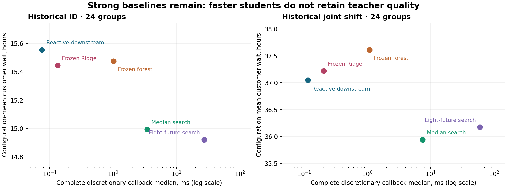

# GridGuide ML opportunity audit

**NO-GO for an immediate new training pilot.** Decision-focused action ranking is the
best candidate for a future controlled investigation, but its incremental value remains
unproven. The existing trained dispatcher, dynamic baselines and historical conclusions
are preserved. **Zero new research fits; zero new final holdouts; no application changes.**

[Detailed measured report](REPORT.md) · [Protocol](PROTOCOL.md) ·
[Reproducible evidence](evidence/audit.json) · [Verification](VERIFICATION.md) ·
[Issue #22](https://github.com/its-spark-dev/GridGuide/issues/22)



## Verified findings

Independent code recalculates waiting, critical, p95 and branch outcomes from archived
schedules/customer dependencies, then aggregates paired configuration groups. Historical
point estimates match. Bootstrap intervals use 2,000 paired configuration resamples;
the full report distinguishes fresh retrospective intervals from the old frozen tests.

| Historical dispatch cohort | Reactive wait, h | Median teacher, h | Frozen forest, h | Teacher gain over reactive |
|---|---:|---:|---:|---:|
| PR20 confirmation | 11.675868 | 11.284803 | not trained | 3.349% |
| PR21 ID | 15.556138 | 14.993306 | 15.476777 | 3.618% |
| PR21 joint shift | 37.049912 | 35.940527 | 37.614646 | 2.994% |

Each cohort has 24 configurations. PR20 uses 1,536 stochastic episodes/method; PR21
uses 384 per final cohort. These are separate fictional populations, never paired
across studies. The forest remains faster than its teacher but fails its historical
quality gate; the shifted forest also performs worse than cheap reactive downstream.

- **Restricted hindsight routing:** choosing among downstream, frozen forest and Ridge
  after seeing each configuration's outcomes yields **1.85945% ID / 1.30358% shift**
  ratio-of-means improvement. This is outcome-informed and bounds only that fixed
  three-policy-per-configuration selector on these results, not novel policies.
- **Teacher signal:** 5,352 discretionary training states, 24,240 action rows, 46 public
  features; 1,347 states have tied optimal distinct actions. WAIT is selected only
  47 times. The frozen forest matches just 4 of those 47 training WAIT labels.
- **State mismatch is not a demonstrated remedy:** most student states are absent from
  the paired teacher trajectory, yet their mean teacher regret is lower on ID. Exact
  feature collisions show no contradictory targets; this does not prove feature sufficiency.
- **Tiny exact diagnostic:** 12 fresh four-task configurations, two crew variants and
  two uncertainty profiles give 48 non-clairvoyant exact expectations. The optimum
  improves median search by **0.01269%**. Independent solvers and complete duration-world
  rollout expectations agree. This cannot bound headroom on larger problems.
- **Static selection:** ML I's best-of-four hindsight total-cost margin is 5.67% ID,
  1.44% shift; its trained selector's shifted regret remains 714.45% worse than fixed.
  ML II remains a separate source-audit NO-GO, not an untrained dispatch experiment.

## Ranked opportunities

| Rank | Track | Verdict and missing evidence |
|---|---|---|
| 1 | Decision-focused action ranking | **CONDITIONAL GO for a separately registered investigation.** Approximate teacher supervision is valid, but a ranking loss has no measured rollout/latency advantage yet; no pilot now. |
| 2 | On-policy dataset aggregation | **CONDITIONAL GO after a training-only query-value ablation.** Exact-state novelty does not establish causal value of more labels. |
| 3 | Static per-policy prediction/routing | **NO-GO now.** Limited shifted ceiling and unstable generalization; no robust achievable margin established. |
| 4 | New uncertainty predictor | **NO-GO.** No new externally justified input/target; rights and endpoint blockers from ML II remain. |

No track meets every Issue #22 pilot condition. The [full report](REPORT.md) provides
the gate rationale, exact formulas, all comparator/critical/tail tables, per-group
diagnostics, timing caveats, data limitations and a conditional one-factor-at-a-time
next-study design. A normal power approximation suggests 44–50 base groups for a 2%
gain using ID/development teacher-reactive variance; doubled SD requires about 175–197.
These are planning estimates for an untrained candidate, not guaranteed power.

## Reproduce

Use Python 3.12.14 and the existing `requirements-ml.lock` environment:

```sh
OPENBLAS_NUM_THREADS=1 OMP_NUM_THREADS=1 .venv-ml/bin/python -m research.ml_opportunity   --exact --output /tmp/gridguide-opportunity-new
.venv-ml/bin/python -m research.ml_opportunity.report   --evidence /tmp/gridguide-opportunity-new --output /tmp/gridguide-opportunity-page
.venv-ml/bin/python -m unittest discover -s research/ml_opportunity/tests -t . -v
.venv-ml/bin/python scripts/check_opportunity_preservation.py
```

[Analysis source](../../../research/ml_opportunity/) · [Input/source hashes](evidence/sources.json) ·
[Fresh exact inputs/results](evidence/exact.json) · [Preservation inventory](PRESERVATION.json)

All data are fictional. No AEP raw files or new real-outage data are used. The audit
preserves 1,062 previous files and checks ten tracked data objects by Git identity
without opening them. No model/default promotion, merge, tag, release or deployment.
Existing regression suites still exercise temporary smoke training; those verification
fixtures are not a new scientific pilot or a reuse of the historical training study.
