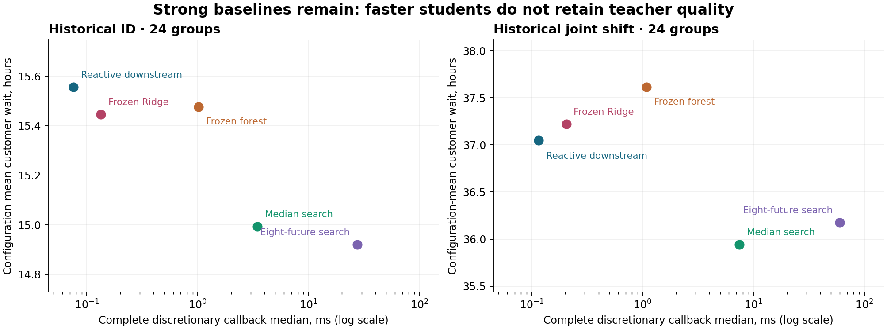

# GridGuide · Is another dispatch model justified?

**NO-GO for an immediate new training pilot. CONDITIONAL GO for a separately registered
decision-ranking investigation only after the value and validation conditions below are met.**

This audit reproduces historical evidence from merged PRs #18–#21 and adds a small exact
scheduling diagnostic. It trains **zero new models**, opens **zero new final holdouts**,
and changes **no application defaults**. Existing fitted GridGuide models remain available.
All scheduling outcomes are fictional; none predicts actual utility outages or field benefit.

[Issue #22](https://github.com/its-spark-dev/GridGuide/issues/22) · [Audit protocol](PROTOCOL.md) ·
[Machine-readable audit](evidence/audit.json) · [Exact diagnostic](evidence/exact.json) ·
[Source hashes](evidence/sources.json) · [Verification ledger](VERIFICATION.md)



## What was independently reproduced

The implementation reads individual archived episodes, not their published averages.
It independently recomputes customer waiting, critical, p95 and branch metrics from
retained schedules and fictional customer dependencies before aggregating them.
It rejects duplicate or missing method episodes, mismatched exogenous duration draws,
unpaired metric support and timing/episode coverage mismatches. Independent means agree
with published waiting values within 1e-10 hours; PR #21 critical, p95, branch and median
callback values are also checked. Historical evaluator/aggregation code is not imported.

For a method m and configuration g, W(g,m) is the average of completed customer-hours /
customer count over its stochastic episodes. The reported cost is the equal-weight mean
of W over configurations. Crew variants and low/high draws are balanced in these archives.
Critical means average each episode's maximum declared-critical group wait; p95 means
average customer-weighted episode p95. Unsupported critical outcomes are excluded on
matched support, never changed to zero. These are different metrics and denominators.

Intervals below use **2,000 paired configuration bootstrap resamples**, Python random
seed 2026110422. They are new retrospective uncertainty summaries, not new confirmatory
tests. Independent RNG implementation changes interval endpoints slightly from the old
NumPy bootstrap, without changing historical point estimates or promotion decisions.
Configuration groups, not actions or repeated episodes, are the resampling unit.


### PR #20 confirmation

| Method | Mean wait, h | Critical maximum, h (groups) | Customer p95, h | Complete discretionary callback median / p95, ms |
|---|---:|---:|---:|---:|
| Fixed order | 12.674750 | 14.517864 (16) | 23.996160 | one-time plan |
| Reactive downstream | 11.675868 | 14.129301 (16) | 20.934150 | 0.0428 / 0.0951 |
| Median search | 11.284803 | 13.883665 (16) | 20.628745 | 3.4951 / 15.2766 |
| Eight-future search | 11.272070 | 14.150094 (16) | 20.476906 | 28.1814 / 121.2394 |

Primary denominator: **1536 stochastic episodes/method, 24 configurations**. Deterministic episodes are excluded from this audit's primary quality and timing tables.
All 15 archived comparators are aggregated in JSON, including the weaker fixed-floor controls. The original PR #20 timing table includes deterministic episodes; its median of 3.490396 ms therefore differs slightly from this stochastic-only 3.495125 ms. Its 8.056× timing ratio is preserved.

| Candidate versus reference | Candidate − reference, h | Paired 95% interval | Relative cost change |
|---|---:|---:|---:|
| Median search vs Reactive downstream | -0.391065 | [-0.5596, -0.2376] | -3.3493% |
| Eight-future search vs Median search | -0.012734 | [-0.0918, 0.0485] | -0.1128% |

### PR #21 ID

| Method | Mean wait, h | Critical maximum, h (groups) | Customer p95, h | Complete discretionary callback median / p95, ms |
|---|---:|---:|---:|---:|
| Fixed order | 17.599921 | 21.171713 (24) | 29.109396 | one-time plan |
| Reactive downstream | 15.556138 | 18.758914 (24) | 26.370293 | 0.0757 / 0.1173 |
| Median search | 14.993306 | 18.333407 (24) | 25.644316 | 3.4525 / 13.9209 |
| Eight-future search | 14.919730 | 18.322871 (24) | 25.432997 | 27.4206 / 108.6120 |
| Frozen forest | 15.476777 | 18.641338 (24) | 26.287419 | 1.0189 / 1.1383 |
| Frozen Ridge | 15.445445 | 18.801285 (24) | 26.512604 | 0.1335 / 0.1755 |

Primary denominator: **384 stochastic episodes/method, 24 configurations**. Deterministic episodes are excluded from this audit's primary quality and timing tables.

| Candidate versus reference | Candidate − reference, h | Paired 95% interval | Relative cost change |
|---|---:|---:|---:|
| Median search vs Reactive downstream | -0.562832 | [-0.8739, -0.3193] | -3.6181% |
| Eight-future search vs Median search | -0.073575 | [-0.1409, -0.0168] | -0.4907% |
| Frozen forest vs Reactive downstream | -0.079361 | [-0.3300, 0.1413] | -0.5102% |
| Frozen forest vs Median search | +0.483471 | [0.2968, 0.6906] | +3.2246% |

### PR #21 joint shift

| Method | Mean wait, h | Critical maximum, h (groups) | Customer p95, h | Complete discretionary callback median / p95, ms |
|---|---:|---:|---:|---:|
| Fixed order | 39.203978 | 59.829629 (24) | 64.621675 | one-time plan |
| Reactive downstream | 37.049912 | 55.662047 (24) | 61.308512 | 0.1155 / 0.1867 |
| Median search | 35.940527 | 55.010451 (24) | 61.112805 | 7.4832 / 27.9752 |
| Eight-future search | 36.173022 | 55.352848 (24) | 61.334509 | 60.1091 / 221.5249 |
| Frozen forest | 37.614646 | 55.492739 (24) | 61.767007 | 1.0860 / 1.1965 |
| Frozen Ridge | 37.219627 | 58.662168 (24) | 62.351834 | 0.2047 / 0.2702 |

Primary denominator: **384 stochastic episodes/method, 24 configurations**. Deterministic episodes are excluded from this audit's primary quality and timing tables.

| Candidate versus reference | Candidate − reference, h | Paired 95% interval | Relative cost change |
|---|---:|---:|---:|
| Median search vs Reactive downstream | -1.109384 | [-1.4492, -0.7881] | -2.9943% |
| Eight-future search vs Median search | +0.232494 | [0.0397, 0.5426] | +0.6469% |
| Frozen forest vs Reactive downstream | +0.564734 | [0.1039, 1.0882] | +1.5243% |
| Frozen forest vs Median search | +1.674118 | [1.0191, 2.3638] | +4.6580% |

Median search has measurable value against downstream on each historical cohort. The
extra eight-future computation is not a consistently stronger teacher: its PR #20 gain
was 0.1128%, while PR #21 ID improves 0.4907% and the joint shift regresses 0.6469%.
These are separate cohorts, not paired replications of an identical population.

The forest loses 0.483471 h / 1.674118 h to median search on ID/shift. Its old teacher-quality
gate remains failed. Ridge dominates the forest on the ID waiting/callback point frontier;
both students are dominated by reactive downstream on shift. This is descriptive Pareto
dominance in two metrics, not statistical dominance or permission to reselect a champion.
Critical/p95 tradeoffs and uncertainty remain in the tables/JSON.

Complete callback timings include PR #21 public validation, legal-action enumeration,
features and prediction. They exclude the separately instrumented teacher agreement query.
PR #20 did not use PR #21's public-validator wrapper, so absolute latency is not paired
across studies. Fixed-plan time is not interchangeable with callback time. Forced decisions
make all-callback medians misleading; both distributions and counts are retained in JSON.


| PR #21 resource measure | ID | Joint shift |
|---|---:|---:|
| Reactive downstream full-episode callback CPU, ms | 1.592 | 4.225 |
| Median search full-episode callback CPU, ms | 54.030 | 174.959 |
| Frozen forest full-episode callback CPU, ms | 27.083 | 48.953 |
| Frozen Ridge full-episode callback CPU, ms | 3.708 | 9.499 |

The original speed estimand is teacher/student **ratio of mean configuration-median** callback times: 3.847× [3.2123, 4.4790] ID, 7.823× [6.3913, 9.3821] shift. It is not the ratio of pooled medians.

Archived training wall time: 24.444 s; process peak RSS 278.0 MiB. Forest/Ridge artifact loads: 2.112 / 0.279 ms; sizes 211,281 / 16,869 bytes. These are recorded local measurements. Incremental per-model RSS and production throughput are unavailable; peak process memory is not model memory. PR #20 confirmation recorded 901.750 s and 430.375 MiB; its aggregate run is not a model-memory comparison.

## Restricted hindsight ceilings: exact scope matters

For each already-observed configuration, pick the minimum W among **downstream, frozen
forest-depth4 and frozen ridge-alpha10**. Let B(g) be that minimum. The Issue #22 number
is **1 − mean(B) / mean(Wreactive)**. A different estimand, mean(1 − B/Wreactive), averages
relative configuration improvements. The audit computes and preserves both, plus every
group winner and cost, rather than treating them as interchangeable.

| Historical cohort | Reactive mean, h | Hindsight mean, h | Ratio-of-means gain (Issue #22) | Mean group-relative gain |
|---|---:|---:|---:|---:|
| ID | 15.556138 | 15.266880 | 1.85945% | 1.40460% |
| Joint shift | 37.049912 | 36.566936 | 1.30358% | 1.65067% |

This is a ceiling only for **one fixed choice from those three policies per configuration
on these realized group averages**. It sees outcomes before choosing and is not deployable.
It does not bound a state-dependent router, a novel ranker, or population-optimal behavior.
The selector class can include reactive, so its nonnegative gain is partly guaranteed by
construction. Bootstrap intervals describe selected empirical gains; they do not debias
selection or establish that a predictor can achieve them. No episode-level hindsight
minimum is mislabeled a configuration selector ceiling. Both spent final sets remain spent.

## Signal, identifiability and imitation

480 historical training trajectories give 12,980 visits, 12,055 unique states, 5,352 discretionary states and 24,240 action rows with 46 public features. 6,703 forced states are excluded from the supervised denominator.

- Legal actions: median 4, p95 9, maximum 21; after crew-alias collapse, maximum 12.
- 1,347/5,352 states tie across distinct tasks/WAIT; 8,801/24,240 action rows have zero teacher regret.
- Best/second-distinct-action margin: median 0.018794, p95 0.347574, dimensionless normalized teacher regret. Tied best actions have zero margin. These are not realized outage-hour gains.
- WAIT is legal in 5,087 states but selected in only 47: 0.878% of discretionary states. On the same in-sample states, forest chooses WAIT 41 times but matches only 4 of the 47 teacher-WAIT labels; Ridge chooses WAIT 49 times and matches none. Tie-aware overall agreement hides this rare-action failure.
- 22,374 exact feature vectors; 1,403 repeated vectors, 0 contradictory targets; 47,732 distinct feature-vector pairs, 0 opposing strict ranks. No within-state equal-vector/distinct-task contradictions were found.

Zero exact collisions **does not prove sufficient features**: 46 continuous summaries
and report rank can make collisions rare while discarding relevant graph structure.
Near-neighbor conditional rank noise, representation sufficiency, and intervention-based
value of teacher queries are unmeasured. Targets are deterministic approximate median-world
rollout costs, not expected Bayes-optimal action values or realized future outcomes.

Each shared-state additive Ridge term cancels when comparing actions within a state;
existing interaction features can still change ranking. Raw action-cost MSE therefore
does not directly optimize the decision. Historically the depth-8 forest halved training
MSE relative to depth 4 yet had worse development rollout cost. That motivates testing a
ranking loss, but it is not evidence that a new loss will beat cheap downstream or median search.

The forest agrees with the teacher on 4,018/5,352 training states (75.07%), versus
2,940/4,359 ID student decisions (67.45%) and 4,227/6,580 shift decisions (64.24%).
Training agreement is in-sample and unique-state weighted here; evaluation agreements
are decision visits on new groups. Their difference cannot isolate covariate shift.

The training mixture already includes 1,882 discretionary states not seen on its pure
teacher trajectories, alongside 3,470 teacher-seen states. Exact public-state comparison
within each paired student/teacher evaluation episode gives:

| Frozen forest trajectory | Teacher-shared states | Student-only states | Mean teacher regret: shared / student-only |
|---|---:|---:|---:|
| Development | 226 | 1281 | 0.079899 / 0.028686 |
| ID | 697 | 3662 | 0.075609 / 0.030177 |
| Joint shift | 1160 | 5420 | 0.036553 / 0.046486 |

State overlap uses the same case, profile and exogenous draw, excluding forced decisions.
Different previous actions naturally change later exact states. Student-only states do
**not** have higher average teacher regret on ID/development; they do on shift. This
association does not establish that on-policy aggregation cures the failure. No counterfactual
new-query intervention or causal estimate exists. Complete per-group cost/error values
and worst episodes are retained in JSON, rather than selecting only favorable examples.

## Static selection and data rights

ML Lab I has a different task and objective: whole-case selection among four static policies,
measured in **customer-hours**, not the adaptive per-customer waiting hours above.

| ML I partition | Eligible cases / groups | Fixed regret, customer-hours | Four-policy hindsight total-cost gain | Fixed tie-optimal cases |
|---|---:|---:|---:|---:|
| train | 297 / 99 | 319.753817 | 3.4220% | 137 |
| dev | 99 / 33 | 413.658656 | 5.0043% | 38 |
| final_id | 90 / 30 | 488.914497 | 5.6738% | 35 |
| final_shift | 99 / 33 | 241.276288 | 1.4450% | 67 |

The old logistic selector's ID regret is 325.400170 customer-hours, a 33.44% **regret**
reduction, not a 33.44% reduction in total waiting cost. Shift regret is 1,965.070166,
714.45% worse than fixed. Its critical degradation reproduces +3.580759 h (78 supported
ID cases) and +34.983304 h (84 shifted cases). Neither historical promotion gate changes.
All 99 eligible shifted cases have task counts outside the training range; topology and
scale changed jointly. Training labels span all four policies, but critical-first labels
rise from 133/297 training cases to 66/99 shift cases. This supports neither causal
attribution to scale nor a stable shifted routing advantage. Integer policy costs,
best/second margins, family labels and feature-range counts are independently summarized.

ML Lab II is a **separate source audit**, not dispatch training. Its [NO-GO](../../outage-ml/FEASIBILITY.md)
remains authoritative: PNNL endpoint/coverage/incident identity, Purdue artifact-specific
rights, and Zenodo segmentation/coverage limitations are unresolved. We did not acquire
new real outage data or open AEP raw files. Existing static/public dispatch inputs are
genuine pre-decision *simulator* observations; they are not evidence of a new externally
calibrated uncertainty predictor. No future outcome, private duration, identity or split
marker is added as a feature. MIT attribution/licenses remain unchanged.

## Fresh exact non-clairvoyant check

The predeclared diagnostic uses 12 fresh four-task configurations, 1/2 crews and low/high
finite duration supports: 24 variants and 48 exact expectations. Graph edges, repair
efforts and overlapping customer requirements are sampled before evaluating algorithms.
Four-task size excludes the 10+ task historical graphs; no model training occurs.

At state s, the Bellman recursion minimizes over legal actions **before** the next event
is observed. WAIT transitions integrate only conditional active-duration supports given
survival; unstarted durations remain unknown. Immediate cost is unreleased customers ×
elapsed seconds. A complete independent duration-world enumeration checks each fixed
policy expectation, while the old Bellman solver separately checks each new optimum.
This is stochastic scheduling with known authored supports, not perfect future information.

| Four-task policy | Mean expected wait, h | Exact optimum reduction | Paired 95% reduction interval, h |
|---|---:|---:|---:|
| fifo | 1.904764 | 16.39098% | [0.0973, 0.6042] |
| downstream | 1.602877 | 0.64400% | [-0.0000, 0.0222] |
| median | 1.592756 | 0.01269% | [-0.0000, 0.0006] |

Exact optimum mean: **1.592554 h**. All 48 solves and policy expectation checks agree exactly as rational customer-seconds. Maximum states in one new solve: 11,125, below the 100,000 cap. Fixed-policy checks enumerate 2,328 duration worlds per policy across the 48 cases. No Monte Carlo approximation enters those expectations.

The tiny optimum improves median search by only 0.01269%, but this is **not** an upper
bound for the larger dispatch problems. Four-task structure, no arrival delays and a
small authored sample limit transfer. Twelve-group bootstrap intervals describe this
sample only. The diagnostic offers no evidence for a materially stronger scalable teacher;
it does not prove one cannot exist.

## Opportunity ranking and pilot gate

No track currently meets **all** Issue #22 conditions. The missing condition for A/B is
a demonstrated, appropriately priced improvement attributable to the proposed intervention,
not a lack of a runnable model or computable supervision. A plausible objective or more
data is insufficient to claim that condition. The exact diagnostic and observed teacher
advantage bound the argument locally; neither establishes ranking/aggregation efficacy.

| Rank / track | Input and target | Empirical value / compute | Robustness and validity | Verdict now |
|---|---|---|---|---|
| 1 · A: decision-focused ranking | Public state/action inputs and teacher preference pairs are identifiable; teacher is approximate | 3.62% / 2.99% teacher advantage over reactive leaves a distillation target; frozen students do not robustly capture it. A compact ranker could be cheap, but neither its gain nor latency is measured | Ties, rare WAIT, summary representation and joint shift remain; MSE/rollout discrepancy is motivation, not a win | **CONDITIONAL GO for a new prospective investigation; NO-GO for this issue's immediate pilot gate** |
| 2 · B: on-policy teacher queries | New training/dev states can be labeled without hidden futures | State mismatch is observed, but regret is not consistently worse there; existing mixture already broadens coverage. Teacher querying adds ms per state | No controlled query-budget ablation or causal benefit; adaptively choosing final-derived targets would leak | **CONDITIONAL GO only after a training-only mismatch/query-value experiment; no pilot now** |
| 3 · C: static cost prediction/routing | Static features and exact four-policy costs are valid fictional targets | 5.67% ID hindsight total-cost margin falls to 1.44% on shift; achievable gain lower. Adaptive three-policy routing has only 1.86% / 1.30% retrospective group ceiling | Old shifted selector fails strongly; no stable shifted signal established. Neither ceiling bounds novel action policies | **NO-GO for another selector now** |
| 4 · D: new uncertainty prediction | No additional externally justified input/target pair demonstrated | No defensible value/cost estimate | ML II rights, ascertainment and endpoint blockers remain; arbitrary latent signals would manufacture predictability | **NO-GO** |

No new hyperparameter search, learned policy, dataset aggregation or source acquisition was
performed. This is a conservative value-of-information decision under the explicit gate,
not a claim that all future ML approaches must fail. Ranking A first does not promote the
old forest or rewrite the PR #20 / #21 failed gates.

## Conditional next-study design and economics

If A is reopened, register a fresh, development-only objective ablation before generating
data: one compact pairwise regret-weighted linear ranker versus the same feature/weight
pipeline with cost MSE, frozen Ridge/forest, downstream, FIFO and median search. At most
three regularization choices, a single training pass per declared seed, and no neural/RL
expansion. Teacher labels are computed only from public training/development states.
First verify that predicted ranking gains survive full paired rollouts and the runtime
budget; do not substitute action accuracy for episode outcomes. A positive exploratory
result would justify a **separate** sealed confirmation protocol, not a final claim here.

For B, first use a training-only randomized query-budget ablation (teacher-only versus
mixed versus student-visited states with equal total queries) and evaluate complete
rollouts on new configuration groups. Without that intervention, exact-state novelty
cannot tell us where useful labels lie. Do not combine A+B and attribute the result to one.

One-factor shifts should preserve each base configuration in one split/group: base
10–14 tasks, original four topology mechanisms, 2/3 crews; change topology alone to
preferential/deep-sparse at the same size/crews, scale alone to 18–24 tasks with base
mechanisms/crews, and crew count alone to 1/4 on the same base graphs. Related variants
remain grouped. Predeclare generation parameters and seeds; compare each intervention
with its matched control and avoid pooling shift arms. Historical joint shift cannot
identify a causal driver. Also retain a joint-shift stress test without causal attribution.

Prospective practical thresholds, explicitly prototype choices: **≥2% wait improvement
against downstream at ≤1 ms median full callback**, or **≤2% degradation from median
search at ≥3× speed**. Require critical/p95 upper degradation ≤max(0.25 h, 5% reference),
zero invalid actions and worst configuration ratio ≤1.25. Include fallbacks, p95 callback,
load, memory and full-episode CPU. These planning thresholds never replace old gates.

For a paired group difference with SD s, planning minimum effect δ = 0.02 × reference
mean, normal approximation n = ceil(((1.96 + 0.84)s/δ)²) gives 80% power against zero
at two-sided 5%. It does **not** give 80% power to certify a lower bound of 2%. To test
a 2% superiority margin, replace δ with expected gain minus 2%; equal-to-margin effects
cannot reliably clear that gate at finite n. Historical teacher/reactive variance is only
a proxy for an untrained ranker. No variance estimate from a future final cohort is used.

| Historical variance proxy | 2% effect, h | Paired SD, h | Approx. groups | Groups if SD doubles |
|---|---:|---:|---:|---:|
| PR20 | 0.2335 | 0.4199 | 26 | 102 |
| PR21 dev | 0.2883 | 0.7215 | 50 | 197 |
| PR21 ID | 0.3111 | 0.7336 | 44 | 175 |
| PR21 shift | 0.7410 | 0.8663 | 11 | 43 |

A subsequent small development study could cap at 48 training + 24 development groups,
four shift arms kept within their parent groups, 2 variants × 2 profiles × 4 paired draws
per arm and six policies: 9,216 development method-episodes if all four arms are used.
Cap teaching at 25,000 unique states and combined collection/fitting/evaluation at two
single-core hours and 1 GiB RSS; stop and report incomplete evidence on a cap, never
quietly drop slow configurations. This is a proposed budget, not an executed pilot or a
measured capacity promise. Empirical callbacks suggest benchmarking feasibility first.

The 24-group development proposal is for exploration, not adequately powered confirmation.
For a later confirmation, plan at least 50 independent base groups per required arm using
the current SD proxy, and consider approximately 200 under doubled-SD sensitivity; re-plan
from **new development** variance before sealing final inputs. At 50 groups × 4 arms ×
2 variants × 2 profiles × 8 draws × 6 policies, evaluation costs 38,400 method-episodes.
At 200 groups it costs 153,600. These are simulation budgets, not independent sample counts.
Use simultaneous or predeclared hierarchical inference if making claims across several arms.

## Reproduce and preserve

Use the existing Python 3.12.14 environment and `requirements-ml.lock`. No new dependency,
GPU, API key, raw dataset, retraining command or network access is required during analysis.
Statistics/aggregation are standard-library code; frozen feature/model adapters use the
already-pinned numerical dependencies. All commands operate inside the raw-data/network
denial guard. New output directories are required; historical paths are rejected.

```sh
OPENBLAS_NUM_THREADS=1 OMP_NUM_THREADS=1 .venv-ml/bin/python -m research.ml_opportunity   --exact --output /tmp/gridguide-opportunity-new
.venv-ml/bin/python -m research.ml_opportunity.report   --evidence /tmp/gridguide-opportunity-new --output /tmp/gridguide-opportunity-page
.venv-ml/bin/python -m unittest discover -s research/ml_opportunity/tests -t . -v
.venv-ml/bin/python scripts/check_opportunity_preservation.py
.venv-ml/bin/python scripts/check_learned_preservation.py
.venv-ml/bin/python scripts/check_frozen_artifacts.py
```

The [preservation inventory](PRESERVATION.json) covers 1,062 baseline files. Ten tracked
data objects are checked by Git blob identity without opening raw/processed data. Existing
historical checks remain intact. Root README, maps, attribution, MIT license, all prior
research, numerical rules and application behavior are unchanged. Reproduction code is
under [research/ml_opportunity](../../../research/ml_opportunity/). New hashes bind source
and evidence, not independent authorship or utility validity.

### Remaining uncertainty

No feature-sufficiency theorem, causal query-value estimate, scalable exact optimum,
real-outage outcome validation, heterogeneous-crew/travel/switching model or external
deployment evidence was produced. Non-collision and a failed pilot gate cannot establish
that ML has no possible value. The concrete result is narrower: **a new training run is
not yet justified by demonstrated incremental value under Issue #22's gate**. Preserve
the trained artifacts and strong dynamic baselines; reopen a specific controlled study
only with its missing evidence and prospective protocol made explicit.
